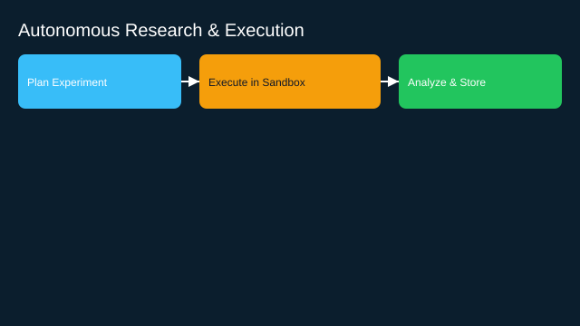

# Autonomous Research and Code Execution Agent

- Goals: propose experiments, run code, analyze results
- Tools: notebook runners, sandboxes, datasets
- Memory: experiment registry, results store
- Policies: resource limits, safe execution, approvals
- Evaluation: result validity, reproducibility, cost
- Rollout: sandbox only → gated to production datasets

See the SVG: ./use-case.svg

