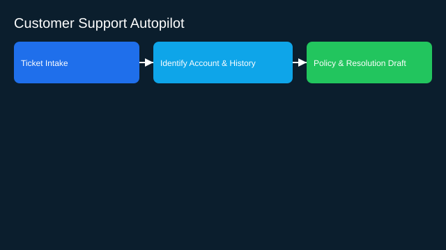

# Customer Support Autopilot

- Goals: deflect and resolve Tier‑1/2 tickets; reduce time‑to‑resolution
- Tools: CRM, ticketing, billing, knowledge base search, email/chat
- Memory: conversation state, customer profile, historical tickets
- Policies: escalation rules, refunds, compliance scripts
- Evaluation: resolution rate, CSAT, policy violations, time saved
- Rollout: start with suggestions; move to auto‑resolve with approvals

See the SVG: ./use-case.svg

