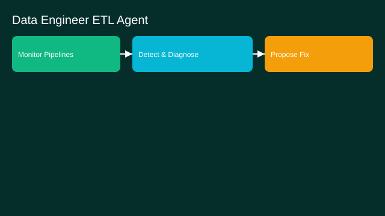

# Data Engineer ETL Agent

- Goals: build/maintain pipelines; monitor and fix failures
- Tools: SQL engines, warehouses, schedulers, data quality APIs
- Memory: schema registry, lineage, run history
- Policies: PII handling, cost budgets, approval for schema changes
- Evaluation: pipeline reliability, MTTR, cost per run
- Rollout: read‑only → propose fixes → gated execution

See the SVG: ./use-case.svg

