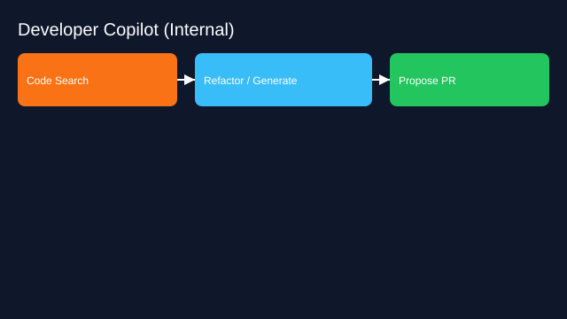

# Developer Copilot for Internal Codebases

- Goals: code generation, refactors, docs, migrations
- Tools: repo indexer, code search, CI, issue tracker
- Memory: workspace state, dependency graph, style guides
- Policies: branch protections, test coverage gate
- Evaluation: PR cycle time, defect rate, review load
- Rollout: suggestions only → gated actions → auto‑PRs for low‑risk

See the SVG: ./use-case.svg

