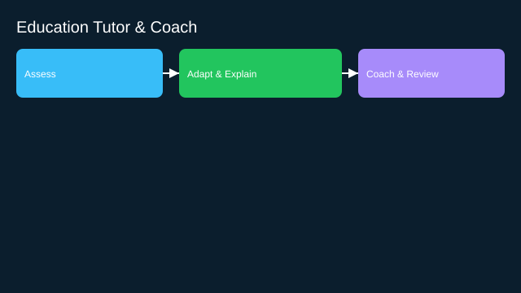

# Education Tutor and Coach

- Goals: adaptive practice, explanations, feedback
- Tools: content repos, assessment engines, calendars
- Memory: learner model and progress
- Policies: age/consent, curriculum alignment
- Evaluation: learning gains, engagement, fairness
- Rollout: teacher‑in‑the‑loop, classroom pilots

See the SVG: ./use-case.svg

