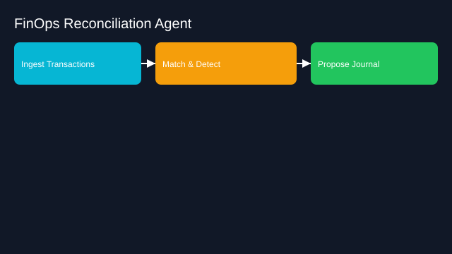

# Financial Operations Reconciliation Agent

- Goals: match transactions, flag anomalies, prepare journals
- Tools: ERP, bank APIs, spreadsheets, anomaly detectors
- Memory: ledger schema, rules, historical matches
- Policies: approval thresholds, audit trails, SOX controls
- Evaluation: reconciliation accuracy, time saved, exceptions rate
- Rollout: shadow mode → propose entries → gated posting

See the SVG: ./use-case.svg

