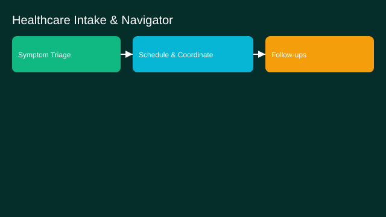

# Healthcare Intake and Care Navigator

- Goals: triage symptoms, coordinate appointments, follow‑ups
- Tools: EHR, scheduling, telehealth, guidelines
- Memory: patient context and consents
- Policies: HIPAA, escalation to clinicians
- Evaluation: wait times, adherence, outcomes proxy
- Rollout: pilot under clinical supervision

See the SVG: ./use-case.svg

