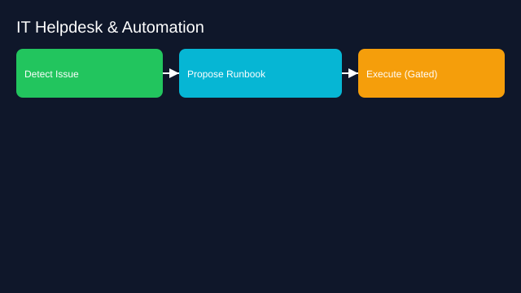

# IT Helpdesk and Automation Agent

- Goals: resolve common IT requests and incidents
- Tools: endpoint mgmt, identity, knowledge base, chat
- Memory: device inventory, user permissions, run histories
- Policies: privileged actions gated, change windows
- Evaluation: first‑contact resolution, time saved
- Rollout: suggestions → runbooks with approvals → auto for trivial

See the SVG: ./use-case.svg

