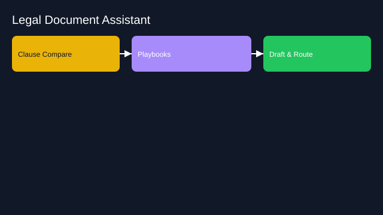

# Legal Document Assistant

- Goals: summarize, clause compare, draft with playbooks
- Tools: DMS, clause library, compare tools, e‑signature
- Memory: matter history, definitions, precedents
- Policies: confidentiality levels, jurisdiction checks
- Evaluation: review time, error rate, compliance
- Rollout: internal teams first, strict guardrails

See the SVG: ./use-case.svg

