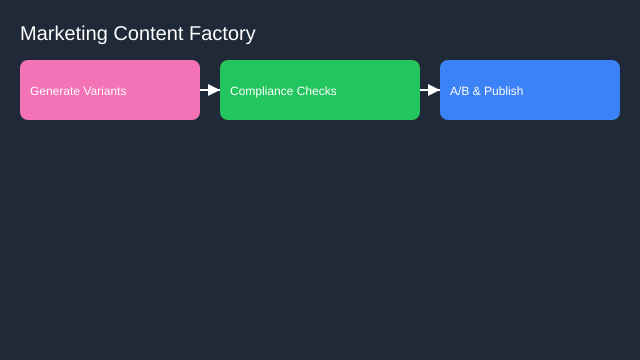

# Marketing Content Factory

- Goals: generate on‑brand content variations at scale
- Tools: CMS, brand style DB, asset libraries, A/B platforms
- Memory: style guide embeddings, campaign history
- Policies: brand compliance, legal review, region rules
- Evaluation: engagement lift, approval rate, turnaround time
- Rollout: drafts with checks → partial auto‑publish for low‑risk

See the SVG: ./use-case.svg

