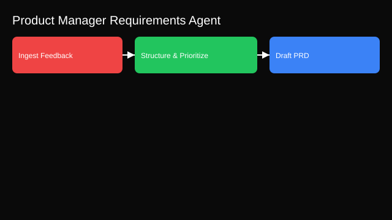

# Product Manager Requirements Agent

- Goals: turn feedback into structured specs, PRDs, and roadmaps
- Tools: issue trackers, survey tools, analytics, doc editors
- Memory: product taxonomy, historic roadmap decisions
- Policies: privacy for user feedback, template adherence
- Evaluation: stakeholder satisfaction, cycle time, rework rate
- Rollout: draft‑only → review templates → partial automation

See the SVG: ./use-case.svg

