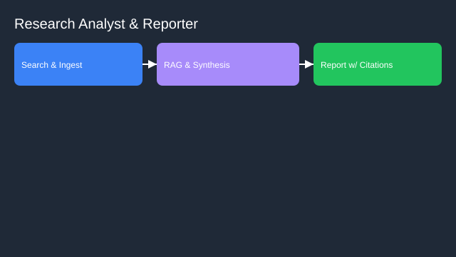

# Research Analyst and Report Generator

- Goals: answer questions with citations, synthesize literature
- Tools: web search, PDF parsers, vector DB, citation manager
- Memory: research graph, notes per topic
- Policies: citation requirements, claim verification, bias checks
- Evaluation: factuality with source support, coverage, timeliness
- Rollout: internal research first → stakeholder sign‑off workflows

See the SVG: ./use-case.svg

