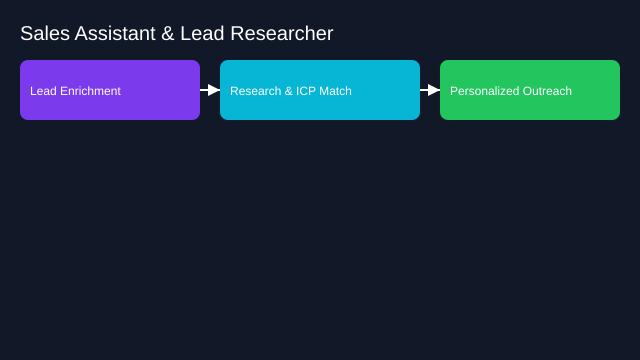

# Sales Assistant and Lead Researcher

- Goals: enrich leads, draft outreach, tailor value props
- Tools: CRM, web browsing, enrichment APIs, email
- Memory: account notes, ICP characteristics
- Policies: do‑not‑contact, compliant messaging
- Evaluation: reply rate uplift, meetings booked, quality checks
- Rollout: pilot with SDR team; tighten prompts and guardrails

See the SVG: ./use-case.svg

