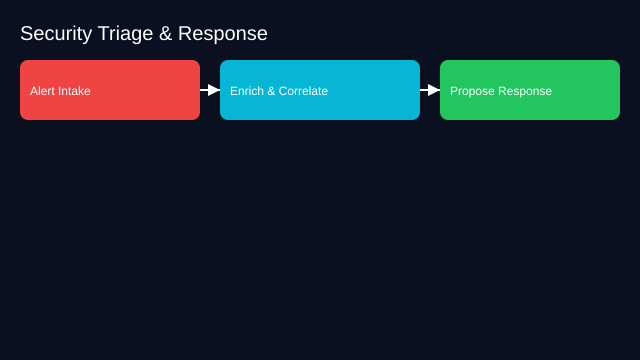

# Security Triage and Response Agent

- Goals: triage alerts, enrich with context, propose response steps
- Tools: SIEM, EDR, threat intel, ticketing, sandbox
- Memory: asset inventory, runbooks, incident history
- Policies: isolation actions require approval, evidence retention
- Evaluation: MTTD/MTTR, false positive reduction
- Rollout: triage suggestions → gated containment actions

See the SVG: ./use-case.svg

