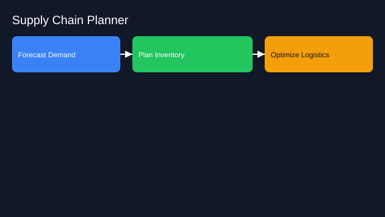

# Supply Chain Planner

- Goals: forecast demand, plan inventory, optimize logistics
- Tools: forecasting libs, ERP, traffic APIs
- Memory: lead times, constraints, historical sales
- Policies: service levels, cost caps, risk buffers
- Evaluation: forecast accuracy, stockouts, cost
- Rollout: decision support → semi‑auto → closed‑loop

See the SVG: ./use-case.svg

