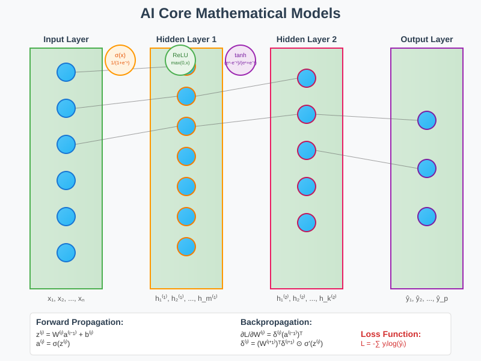

# Core Mathematical Models in Artificial Intelligence



## Overview

Modern AI's exceptional performance in learning, reasoning, and decision-making stems from sophisticated mathematical foundations. This section explores the core mathematical models that enable neural networks to achieve human-level and superhuman performance through elegant abstractions of biological neural processes and mathematical optimization principles.

## 1. Neural Network Mathematical Foundation

### Mathematical Definition

A neural network can be formally defined as a composite mathematical function:

```
f(x; θ) = f_L(f_{L-1}(...f_2(f_1(x; θ_1); θ_2)...; θ_{L-1}); θ_L)
```

Where:
- **x**: Input vector `x ∈ R^n` (features or data samples)
- **θ**: Parameter set `θ = {W^(l), b^(l)}_{l=1}^L` (weights and biases)
- **f_l**: Layer transformation `f_l(z) = σ(W^(l)z + b^(l))`
- **σ**: Activation function (ReLU, sigmoid, tanh)
- **L**: Number of layers in the network

### Forward Propagation Mathematics

**Linear Transformation**:
```
z^(l) = W^(l)a^(l-1) + b^(l)
```

**Non-linear Activation**:
```
a^(l) = σ(z^(l))
```

**Common Activation Functions**:
- **ReLU**: `σ(x) = max(0, x)`
- **Sigmoid**: `σ(x) = 1/(1 + e^(-x))`
- **Tanh**: `σ(x) = (e^x - e^(-x))/(e^x + e^(-x))`
- **Softmax**: `σ(x_i) = e^(x_i)/Σ_j e^(x_j)`

### Backpropagation Algorithm

**Chain Rule Application**:
```
∂L/∂W^(l) = ∂L/∂z^(l) × ∂z^(l)/∂W^(l) = δ^(l) × (a^(l-1))^T
∂L/∂b^(l) = δ^(l)
```

**Error Propagation**:
```
δ^(l) = (W^(l+1))^T δ^(l+1) ⊙ σ'(z^(l))
```

Where `⊙` denotes element-wise multiplication (Hadamard product).

**Output Layer Error**:
```
δ^(L) = ∇_a L ⊙ σ'(z^(L))
```

## 2. Universal Approximation Theory

### Mathematical Theorem

**Universal Approximation Theorem (Hornik, 1991)**:
Any continuous function `f: R^n → R^m` on a compact set can be approximated arbitrarily well by a neural network with a single hidden layer containing a finite number of neurons with non-polynomial activation functions.

**Formal Statement**:
For any continuous function `f` on `[0,1]^n`, any `ε > 0`, there exists a neural network `N` such that:
```
sup_{x∈[0,1]^n} |f(x) - N(x)| < ε
```

### Practical Implications

**Approximation Capacity**:
- **Width**: Wider networks can approximate more complex functions
- **Depth**: Deeper networks can be more efficient for certain function classes
- **Expressivity**: The number of functions representable grows exponentially with network size

**Function Complexity Bounds**:
```
N(W, d) ≤ 2^(Wd log(Wd))
```
Where `N(W, d)` is the number of functions with `W` parameters and depth `d`.

## 3. Loss Functions and Optimization Landscape

### Common Loss Functions

**Mean Squared Error (Regression)**:
```
L(y, ŷ) = (1/2n) Σ_i (y_i - ŷ_i)²
```

**Cross-Entropy Loss (Classification)**:
```
L(y, ŷ) = -Σ_i y_i log(ŷ_i)
```

**Hinge Loss (SVM-style)**:
```
L(y, ŷ) = max(0, 1 - y·ŷ)
```

**Huber Loss (Robust Regression)**:
```
L_δ(y, ŷ) = {
    (1/2)(y - ŷ)²           if |y - ŷ| ≤ δ
    δ(|y - ŷ| - δ/2)        otherwise
}
```

### Optimization Landscape Theory

**Critical Point Analysis**:
A point `θ*` is a critical point if `∇L(θ*) = 0`. Classification:
- **Global minimum**: `L(θ*) ≤ L(θ)` for all `θ`
- **Local minimum**: `L(θ*) ≤ L(θ)` for `θ` in some neighborhood
- **Saddle point**: Neither minimum nor maximum

**Hessian Matrix**:
```
H_ij = ∂²L/∂θ_i∂θ_j
```

**Second-order conditions**:
- **Local minimum**: `H ≻ 0` (positive definite)
- **Local maximum**: `H ≺ 0` (negative definite)
- **Saddle point**: `H` has both positive and negative eigenvalues

## 4. Gradient-Based Optimization Algorithms

### Gradient Descent Variants

**Vanilla Gradient Descent**:
```
θ_{t+1} = θ_t - α∇L(θ_t)
```

**Momentum**:
```
v_{t+1} = βv_t + α∇L(θ_t)
θ_{t+1} = θ_t - v_{t+1}
```

**Adaptive Methods (Adam)**:
```
m_t = β₁m_{t-1} + (1-β₁)g_t
v_t = β₂v_{t-1} + (1-β₂)g_t²
m̂_t = m_t/(1-β₁^t)
v̂_t = v_t/(1-β₂^t)
θ_t = θ_{t-1} - α(m̂_t/(√v̂_t + ε))
```

### Convergence Analysis

**Convex Case (Strong Convexity)**:
For strongly convex functions with parameter `μ`:
```
L(θ_t) - L(θ*) ≤ (1 - αμ)^t (L(θ_0) - L(θ*))
```

**Non-convex Case**:
Under smoothness assumption with Lipschitz constant `L`:
```
min_{t≤T} ||∇L(θ_t)||² ≤ (2/αT)(L(θ_0) - L*) + αL σ²
```

## 5. Regularization Theory

### Mathematical Formulation

**L1 Regularization (LASSO)**:
```
L_reg(θ) = L(θ) + λ||θ||₁ = L(θ) + λΣ_i |θ_i|
```

**L2 Regularization (Ridge)**:
```
L_reg(θ) = L(θ) + λ||θ||₂² = L(θ) + λΣ_i θ_i²
```

**Elastic Net**:
```
L_reg(θ) = L(θ) + λ₁||θ||₁ + λ₂||θ||₂²
```

### Dropout as Regularization

**Mathematical Interpretation**:
Dropout can be viewed as training an ensemble of 2^n subnetworks, where n is the number of neurons.

**Expected Value**:
```
E[y_dropout] = p · y_full
```

Where `p` is the keep probability.

**Variance Reduction**:
```
Var[y_dropout] = p(1-p) · Var[y_neuron]
```

## 6. Information Theory and Learning

### Information-Theoretic Measures

**Mutual Information**:
```
I(X;Y) = H(X) - H(X|Y) = Σ_x Σ_y p(x,y) log(p(x,y)/(p(x)p(y)))
```

**Cross-Entropy**:
```
H(p,q) = -Σ_x p(x) log q(x)
```

**KL-Divergence**:
```
D_KL(P||Q) = Σ_x P(x) log(P(x)/Q(x))
```

### Information Bottleneck Principle

**Objective Function**:
```
max I(T;Y) - βI(T;X)
```

Where:
- `T`: Intermediate representation
- `X`: Input
- `Y`: Output
- `β`: Trade-off parameter

This principle explains why neural networks learn hierarchical representations.

## 7. Generalization Theory

### PAC Learning Framework

**Probably Approximately Correct (PAC) Learning**:
A hypothesis class `H` is PAC-learnable if there exists an algorithm that, for any distribution `D` and any `ε, δ > 0`, returns a hypothesis `h` such that:
```
P[error(h) ≤ ε] ≥ 1 - δ
```

### VC Dimension

**Vapnik-Chervonenkis Dimension**:
The VC dimension of a hypothesis class `H` is the largest number of points that can be shattered (all possible labelings achieved) by `H`.

**Generalization Bound**:
```
P[|error_true(h) - error_empirical(h)| ≤ ε] ≥ 1 - δ
```

Where:
```
ε = O(√((d log(m/d) + log(1/δ))/m))
```

`d` is VC dimension, `m` is sample size.

## 8. Deep Learning Specific Phenomena

### Lottery Ticket Hypothesis

**Mathematical Statement**:
For a dense neural network, there exists a sparse subnetwork that, when trained from initialization, achieves comparable performance to the original network.

**Formalization**:
Given network `f(x; θ)` with mask `m`, the pruned network is `f(x; m ⊙ θ)` where `⊙` is element-wise multiplication.

### Double Descent

**Empirical Risk Curve**:
The test error as a function of model complexity exhibits two descent phases:
1. **Classical regime**: Error decreases then increases (bias-variance tradeoff)
2. **Overparameterized regime**: Error decreases again with more parameters

**Mathematical Understanding**:
Related to the interpolation threshold where models begin to perfectly fit training data.

## 9. Practical Implementation Considerations

### Numerical Stability

**Gradient Clipping**:
```
g_clipped = {
    g                    if ||g|| ≤ τ
    τ · g/||g||         otherwise
}
```

**Layer Normalization**:
```
y = γ((x - μ)/σ) + β
```
Where `μ` and `σ` are computed over feature dimension.

### Weight Initialization

**Xavier/Glorot Initialization**:
```
W ~ U(-√(6/(fan_in + fan_out)), √(6/(fan_in + fan_out)))
```

**He Initialization (for ReLU)**:
```
W ~ N(0, 2/fan_in)
```

## Key Theoretical Results

**1. Universal Approximation**: Neural networks can approximate any continuous function
**2. Expressivity**: Deeper networks can be exponentially more expressive than shallow ones
**3. Optimization**: Gradient descent finds global minima for overparameterized networks under certain conditions
**4. Generalization**: Implicit regularization effects of gradient descent help generalization
**5. Information Processing**: Networks compress input information while preserving task-relevant features

## Mathematical Tools Used

- **Linear Algebra**: Matrix operations, eigenvalue decomposition, singular value decomposition
- **Calculus**: Partial derivatives, chain rule, gradient computation
- **Probability Theory**: Random variables, distributions, expectation, concentration inequalities
- **Information Theory**: Entropy, mutual information, data processing inequality
- **Optimization Theory**: Convex optimization, non-convex optimization, convergence analysis
- **Functional Analysis**: Function spaces, approximation theory, completeness

## Applications in Practice

Understanding these mathematical foundations enables:
- **Architecture Design**: Principled choices of network depth, width, and connectivity
- **Optimization**: Selection of appropriate learning rates, optimizers, and training procedures  
- **Regularization**: Application of techniques to improve generalization
- **Debugging**: Mathematical intuition for diagnosing training problems
- **Innovation**: Development of new architectures and training methods based on theoretical insights

The mathematical models presented here form the theoretical backbone of modern artificial intelligence, providing both the tools for analysis and the foundation for continued advancement in the field.