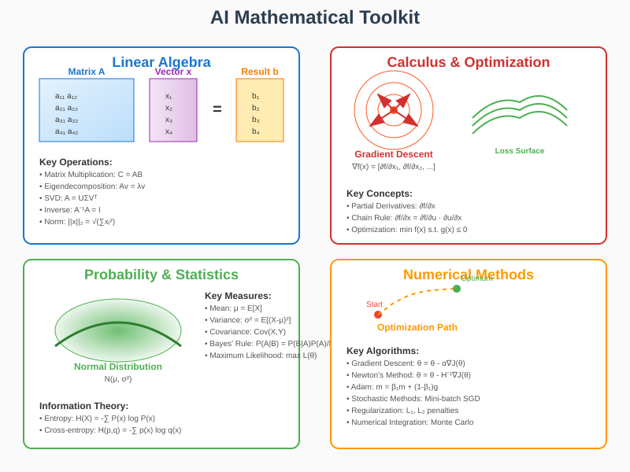

# Mathematical Toolkit for Artificial Intelligence



## Overview

The mathematical toolkit for AI encompasses the fundamental mathematical disciplines that enable machine learning algorithms to function effectively. This section explores the essential mathematical tools that form the backbone of artificial intelligence, from basic linear algebra operations to advanced optimization techniques. Understanding these mathematical foundations is crucial for developing, debugging, and optimizing AI systems.

## 1. Linear Algebra: The Foundation of AI Computations

### Mathematical Structures

**Vectors and Vector Spaces**:
A vector space V over a field F (typically ℝ) satisfies:
- **Closure**: ∀u,v ∈ V, u + v ∈ V
- **Associativity**: ∀u,v,w ∈ V, (u + v) + w = u + (v + w)
- **Commutativity**: ∀u,v ∈ V, u + v = v + u
- **Identity**: ∃0 ∈ V such that ∀v ∈ V, v + 0 = v
- **Scalar multiplication**: ∀α ∈ F, v ∈ V, αv ∈ V

**Matrix Operations**:
- **Matrix Multiplication**: (AB)ᵢⱼ = Σₖ AᵢₖBₖⱼ
- **Transpose**: (Aᵀ)ᵢⱼ = Aⱼᵢ
- **Inverse**: A⁻¹A = AA⁻¹ = I (when exists)
- **Determinant**: det(A) = Σₚ sgn(π)∏ᵢ aᵢ,π(i)

### Eigenanalysis and Spectral Theory

**Eigenvalue Problem**:
```
Av = λv
```
Where:
- **A**: n×n matrix
- **v**: eigenvector (v ≠ 0)
- **λ**: eigenvalue

**Characteristic Polynomial**:
```
p(λ) = det(A - λI) = 0
```

**Spectral Decomposition**:
For symmetric matrices A:
```
A = QΛQᵀ = Σᵢ λᵢqᵢqᵢᵀ
```

**Principal Component Analysis (PCA)**:
Find directions of maximum variance:
```
max vᵀCv subject to ||v||₂ = 1
```
Where C is the covariance matrix.

### Singular Value Decomposition (SVD)

**Mathematical Definition**:
```
A = UΣVᵀ
```
Where:
- **U**: m×m orthogonal matrix (left singular vectors)
- **Σ**: m×n diagonal matrix (singular values)  
- **V**: n×n orthogonal matrix (right singular vectors)

**Applications in AI**:
- **Dimensionality Reduction**: Low-rank approximation
- **Matrix Completion**: Collaborative filtering
- **Denoising**: Signal reconstruction
- **Compression**: Data representation

### Norms and Distance Metrics

**Vector Norms**:
- **L₁ norm**: ||x||₁ = Σᵢ |xᵢ|
- **L₂ norm**: ||x||₂ = √(Σᵢ xᵢ²)
- **L∞ norm**: ||x||∞ = maxᵢ |xᵢ|
- **Lp norm**: ||x||ₚ = (Σᵢ |xᵢ|ᵖ)^(1/p)

**Matrix Norms**:
- **Frobenius norm**: ||A||_F = √(Σᵢⱼ |aᵢⱼ|²)
- **Spectral norm**: ||A||₂ = σₘₐₓ(A)
- **Nuclear norm**: ||A||* = Σᵢ σᵢ(A)

## 2. Calculus and Mathematical Analysis

### Differential Calculus for Optimization

**Partial Derivatives**:
For function f: ℝⁿ → ℝ:
```
∂f/∂xᵢ = lim_{h→0} [f(x + heᵢ) - f(x)]/h
```

**Gradient Vector**:
```
∇f(x) = [∂f/∂x₁, ∂f/∂x₂, ..., ∂f/∂xₙ]ᵀ
```

**Chain Rule for Composite Functions**:
For f(g(x)):
```
df/dx = (df/dg)(dg/dx)
```

**Multivariable Chain Rule**:
For f(u₁(x), u₂(x), ..., uₘ(x)):
```
∂f/∂xᵢ = Σⱼ (∂f/∂uⱼ)(∂uⱼ/∂xᵢ)
```

### Hessian Matrix and Second-Order Analysis

**Hessian Matrix**:
```
H[f](x) = [∂²f/∂xᵢ∂xⱼ]
```

**Taylor Series Expansion**:
```
f(x + h) ≈ f(x) + ∇f(x)ᵀh + (1/2)hᵀH[f](x)h
```

**Convexity Conditions**:
- **Convex**: H ⪰ 0 (positive semidefinite)
- **Strongly convex**: H ≻ μI for some μ > 0
- **Concave**: H ⪯ 0 (negative semidefinite)

### Integral Calculus and Measure Theory

**Fundamental Theorem of Calculus**:
```
∫ₐᵇ f'(x)dx = f(b) - f(a)
```

**Multiple Integrals**:
For joint probability densities:
```
P(A) = ∫∫_A f(x,y) dx dy
```

**Change of Variables**:
```
∫_R f(x) dx = ∫_S f(g(u))|J_g(u)| du
```
Where J_g is the Jacobian determinant.

## 3. Probability Theory and Statistics

### Probability Foundations

**Kolmogorov Axioms**:
1. P(Ω) = 1 (certainty)
2. P(A) ≥ 0 for all events A
3. For disjoint events: P(⋃ᵢ Aᵢ) = Σᵢ P(Aᵢ)

**Conditional Probability**:
```
P(A|B) = P(A ∩ B)/P(B)
```

**Bayes' Theorem**:
```
P(H|E) = P(E|H)P(H)/P(E)
```

**Law of Total Probability**:
```
P(A) = Σᵢ P(A|Bᵢ)P(Bᵢ)
```

### Random Variables and Distributions

**Expected Value**:
```
E[X] = ∫ x f_X(x) dx  (continuous)
E[X] = Σₓ x P(X = x)  (discrete)
```

**Variance**:
```
Var[X] = E[(X - E[X])²] = E[X²] - (E[X])²
```

**Moment Generating Function**:
```
M_X(t) = E[e^{tX}]
```

**Common Distributions**:
- **Gaussian**: f(x) = (1/√(2πσ²))exp(-(x-μ)²/(2σ²))
- **Exponential**: f(x) = λe^{-λx} for x ≥ 0
- **Gamma**: f(x) = (β^α/Γ(α))x^{α-1}e^{-βx}
- **Beta**: f(x) = (1/B(α,β))x^{α-1}(1-x)^{β-1}

### Multivariate Probability Theory

**Joint Distributions**:
```
f_{X,Y}(x,y) = P(X = x, Y = y)
```

**Marginal Distributions**:
```
f_X(x) = ∫ f_{X,Y}(x,y) dy
```

**Independence**:
X and Y are independent if:
```
f_{X,Y}(x,y) = f_X(x)f_Y(y)
```

**Covariance**:
```
Cov(X,Y) = E[(X - E[X])(Y - E[Y])]
```

**Correlation**:
```
ρ_{X,Y} = Cov(X,Y)/√(Var[X]Var[Y])
```

### Statistical Inference

**Maximum Likelihood Estimation**:
```
θ̂_{MLE} = argmax_θ ∏ᵢ f(xᵢ|θ) = argmax_θ Σᵢ log f(xᵢ|θ)
```

**Maximum A Posteriori (MAP)**:
```
θ̂_{MAP} = argmax_θ P(θ|D) ∝ argmax_θ P(D|θ)P(θ)
```

**Confidence Intervals**:
For parameter θ with confidence level 1-α:
```
P(L(X) ≤ θ ≤ U(X)) = 1 - α
```

## 4. Information Theory

### Entropy and Information Measures

**Shannon Entropy**:
```
H(X) = -Σₓ P(x) log P(x)
```

**Cross-Entropy**:
```
H(p,q) = -Σₓ p(x) log q(x)
```

**Kullback-Leibler Divergence**:
```
D_{KL}(P||Q) = Σₓ P(x) log(P(x)/Q(x))
```

**Mutual Information**:
```
I(X;Y) = Σₓ,ᵧ P(x,y) log(P(x,y)/(P(x)P(y)))
```

### Information-Theoretic Bounds

**Data Processing Inequality**:
For Markov chain X → Y → Z:
```
I(X;Z) ≤ I(X;Y)
```

**Fano's Inequality**:
```
H(X|Y) ≤ H(P_e) + P_e log(|𝒳| - 1)
```

**Jensen-Shannon Divergence**:
```
JS(P,Q) = (1/2)[D_{KL}(P||M) + D_{KL}(Q||M)]
```
Where M = (1/2)(P + Q).

## 5. Optimization Theory

### Convex Optimization

**Convex Sets**:
A set C is convex if:
```
∀x,y ∈ C, ∀λ ∈ [0,1]: λx + (1-λ)y ∈ C
```

**Convex Functions**:
A function f is convex if:
```
f(λx + (1-λ)y) ≤ λf(x) + (1-λ)f(y)
```

**Optimality Conditions**:
For unconstrained problem min f(x):
- **First-order**: ∇f(x*) = 0
- **Second-order**: ∇²f(x*) ⪰ 0

**KKT Conditions**:
For constrained problem with inequality constraints gᵢ(x) ≤ 0:
```
∇f(x*) + Σᵢ λᵢ∇gᵢ(x*) = 0
λᵢ ≥ 0, gᵢ(x*) ≤ 0, λᵢgᵢ(x*) = 0
```

### Non-Convex Optimization

**Gradient Descent Convergence**:
For L-smooth functions:
```
f(x_{k+1}) ≤ f(x_k) - (α/2)||∇f(x_k)||²
```
With step size α ≤ 1/L.

**Stochastic Gradient Descent**:
```
x_{k+1} = x_k - α_k ∇f_i(x_k)
```
Where i is randomly sampled.

**Adam Optimizer**:
```
m_t = β₁m_{t-1} + (1-β₁)g_t
v_t = β₂v_{t-1} + (1-β₂)g_t²
x_t = x_{t-1} - α(m̂_t/(√v̂_t + ε))
```

### Constrained Optimization

**Lagrange Multipliers**:
For problem min f(x) subject to g(x) = 0:
```
∇f(x*) = λ∇g(x*)
```

**Penalty Methods**:
```
min f(x) + ρ∑ᵢ max(0, gᵢ(x))²
```

**Augmented Lagrangian**:
```
L_ρ(x,λ) = f(x) + λᵀg(x) + (ρ/2)||g(x)||²
```

## 6. Numerical Methods and Computational Mathematics

### Matrix Computations

**LU Decomposition**:
```
A = LU
```
Where L is lower triangular, U is upper triangular.

**QR Decomposition**:
```
A = QR
```
Where Q is orthogonal, R is upper triangular.

**Cholesky Decomposition**:
For positive definite A:
```
A = LLᵀ
```

### Numerical Integration

**Monte Carlo Integration**:
```
∫ f(x) dx ≈ (V/N) Σᵢ f(xᵢ)
```
Where xᵢ are random samples.

**Quadrature Rules**:
- **Trapezoidal**: ∫ₐᵇ f(x)dx ≈ (h/2)[f(a) + 2∑f(xᵢ) + f(b)]
- **Simpson's**: Uses quadratic interpolation
- **Gaussian**: Optimal node placement

### Automatic Differentiation

**Forward Mode**:
Computes derivatives alongside function evaluation:
```
∂f/∂x = lim_{h→0} [f(x + h·v) - f(x)]/h
```

**Reverse Mode** (Backpropagation):
Computes gradients by traversing computational graph backwards.

**Computational Complexity**:
- Forward mode: O(n) for n inputs, 1 output
- Reverse mode: O(m) for 1 input, m outputs

## Mathematical Tools in AI Applications

### Deep Learning Applications

**Matrix Operations**: Efficient computation of layer transformations
**Eigenanalysis**: Understanding network behavior and spectral properties
**Optimization**: Training neural networks via gradient-based methods
**Probability**: Bayesian neural networks and uncertainty quantification
**Information Theory**: Understanding representational capacity

### Machine Learning Applications

**Linear Algebra**: Feature transformations and dimensionality reduction
**Statistics**: Model selection and hypothesis testing  
**Optimization**: Parameter estimation and loss minimization
**Calculus**: Gradient-based learning algorithms
**Information Theory**: Feature selection and mutual information

### Key Computational Libraries

**Linear Algebra**: BLAS, LAPACK, NumPy, SciPy
**Automatic Differentiation**: TensorFlow, PyTorch, JAX
**Optimization**: SciPy.optimize, CVXPY, Gurobi
**Statistics**: R, statsmodels, scikit-learn
**Numerical Computing**: MATLAB, Mathematica, Julia

## Why Mathematical Rigor Matters

Understanding these mathematical foundations enables AI practitioners to:

1. **Design principled algorithms** based on solid theoretical foundations
2. **Debug and diagnose problems** using mathematical intuition
3. **Optimize performance** through mathematical analysis and approximation
4. **Ensure robustness** via theoretical guarantees and bounds
5. **Innovate effectively** by combining mathematical insights with practical requirements
6. **Scale solutions** using efficient numerical methods and approximations

The mathematical toolkit presented here forms the essential foundation for all advanced AI techniques, from basic machine learning to cutting-edge deep learning and beyond.