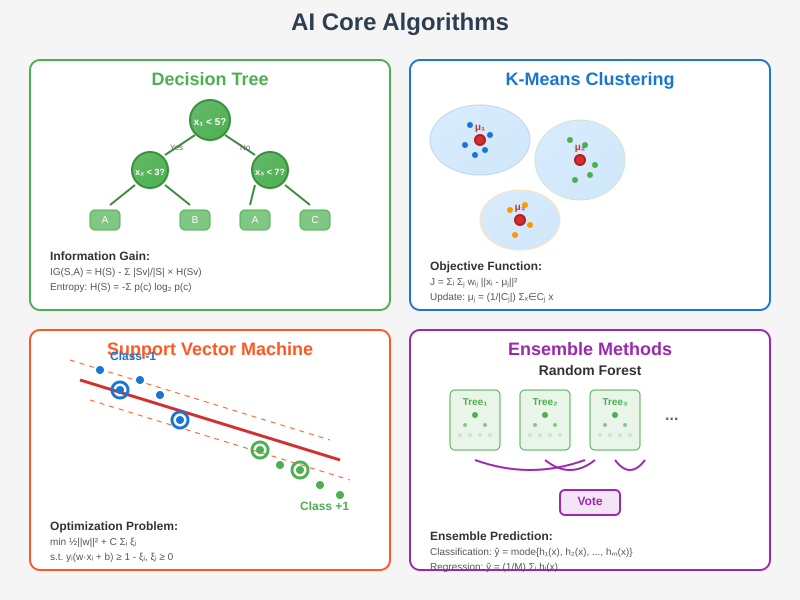

# Core AI Algorithms: Mathematical Analysis and Implementation



## Overview

This section explores the fundamental algorithms that power modern artificial intelligence systems. Each algorithm is presented with its mathematical foundation, computational complexity analysis, convergence properties, and practical implementation considerations. Understanding these core algorithms and their mathematical properties is essential for developing effective AI systems and advancing the field.

## 1. Decision Trees: Information-Theoretic Learning

### Mathematical Foundation

**Decision Tree Structure**:
A decision tree T can be formally defined as:
```
T = (V, E, L, f, φ)
```
Where:
- **V**: Set of internal nodes (decision nodes)
- **E**: Set of edges (branches)
- **L**: Set of leaf nodes (predictions)
- **f**: Node → Feature mapping
- **φ**: Node → Threshold mapping

### Information Gain and Entropy

**Shannon Entropy**:
For dataset S with classes C:
```
H(S) = -Σ_{c∈C} p(c) log₂ p(c)
```
Where p(c) is the proportion of samples belonging to class c.

**Information Gain**:
```
IG(S, A) = H(S) - Σ_{v∈Values(A)} (|Sv|/|S|) × H(Sv)
```
Where:
- A: Attribute/feature
- Sv: Subset of S where attribute A has value v

**Gain Ratio** (C4.5 improvement):
```
GR(S, A) = IG(S, A) / IV(S, A)
```
Where IV(S, A) = -Σv (|Sv|/|S|) log₂(|Sv|/|S|) is the intrinsic value.

### Splitting Criteria

**Gini Impurity**:
```
Gini(S) = 1 - Σ_{c∈C} p(c)²
```

**Gini Gain**:
```
Gini_Gain(S, A) = Gini(S) - Σ_{v∈Values(A)} (|Sv|/|S|) × Gini(Sv)
```

**Misclassification Error**:
```
Error(S) = 1 - max_{c∈C} p(c)
```

### Pruning and Regularization

**Cost-Complexity Pruning**:
Minimize the cost-complexity measure:
```
Rα(T) = R(T) + α|T|
```
Where:
- R(T): Misclassification rate of tree T
- |T|: Number of leaf nodes
- α: Complexity parameter

**Mathematical Justification**:
Based on structural risk minimization principle:
```
Risk ≤ Empirical_Risk + Complexity_Penalty
```

### Complexity Analysis

**Training Time**: O(mn log n) where m is number of features, n is number of samples
**Prediction Time**: O(log n) for balanced trees
**Space Complexity**: O(n) in worst case (unbalanced tree)

## 2. Support Vector Machines: Optimization-Based Learning

### Mathematical Formulation

**Primal Optimization Problem**:
```
min_{w,b,ξ} (1/2)||w||² + C Σᵢ ξᵢ
```
Subject to:
```
yᵢ(wᵀxᵢ + b) ≥ 1 - ξᵢ
ξᵢ ≥ 0
```

**Lagrangian**:
```
L(w,b,ξ,α,μ) = (1/2)||w||² + C Σᵢ ξᵢ - Σᵢ αᵢ[yᵢ(wᵀxᵢ + b) - 1 + ξᵢ] - Σᵢ μᵢξᵢ
```

**Dual Problem**:
```
max_α Σᵢ αᵢ - (1/2) Σᵢ Σⱼ αᵢαⱼyᵢyⱼxᵢᵀxⱼ
```
Subject to:
```
Σᵢ αᵢyᵢ = 0
0 ≤ αᵢ ≤ C
```

### Kernel Methods

**Kernel Trick**:
Replace dot product xᵢᵀxⱼ with kernel function K(xᵢ,xⱼ):
```
f(x) = Σᵢ αᵢyᵢK(xᵢ,x) + b
```

**Common Kernels**:
- **Linear**: K(x,y) = xᵀy
- **Polynomial**: K(x,y) = (γxᵀy + r)ᵈ
- **RBF (Gaussian)**: K(x,y) = exp(-γ||x-y||²)
- **Sigmoid**: K(x,y) = tanh(γxᵀy + r)

**Mercer's Theorem**:
A function K is a valid kernel if and only if the kernel matrix is positive semidefinite:
```
K ≽ 0 ⟺ ∀c ∈ ℝⁿ: cᵀKc ≥ 0
```

### Sequential Minimal Optimization (SMO)

**Two-Variable Optimization**:
At each step, solve for two αᵢ, αⱼ:
```
min_{αᵢ,αⱼ} W(αᵢ,αⱼ) = (1/2)Kᵢᵢαᵢ² + (1/2)Kⱼⱼαⱼ² + sKᵢⱼαᵢαⱼ + (terms not involving αᵢ,αⱼ)
```
Where s = yᵢyⱼ.

**Coordinate Update**:
```
αⱼ^{new} = αⱼ^{old} + yⱼ(Eᵢ - Eⱼ)/η
```
Where η = 2Kᵢⱼ - Kᵢᵢ - Kⱼⱼ.

### Complexity Analysis

**Training Time**: O(n³) general, O(n²) with SMO
**Prediction Time**: O(number of support vectors)
**Space Complexity**: O(n²) for kernel matrix

## 3. K-Means Clustering: Expectation-Maximization Approach

### Mathematical Formulation

**Objective Function**:
```
J = Σᵢ Σⱼ wᵢⱼ ||xᵢ - μⱼ||²
```
Where:
- wᵢⱼ ∈ {0,1}: Cluster assignment indicator
- μⱼ: Centroid of cluster j

**Lagrangian with Constraint** Σⱼ wᵢⱼ = 1:
```
L = Σᵢ Σⱼ wᵢⱼ ||xᵢ - μⱼ||² + Σᵢ λᵢ(Σⱼ wᵢⱼ - 1)
```

### Lloyd's Algorithm

**E-step** (Assignment):
```
wᵢⱼ = {1 if j = argmin_k ||xᵢ - μₖ||², 0 otherwise}
```

**M-step** (Update):
```
μⱼ = (Σᵢ wᵢⱼxᵢ) / (Σᵢ wᵢⱼ)
```

### Convergence Analysis

**Convergence Guarantee**:
The objective function J monotonically decreases:
```
J^{(t+1)} ≤ J^{(t)}
```

**Convergence Rate**:
Under regularity conditions, K-means has linear convergence:
```
J^{(t)} - J* ≤ ρᵗ(J^{(0)} - J*)
```
Where 0 < ρ < 1.

### K-Means++ Initialization

**Probabilistic Selection**:
Choose next center with probability proportional to:
```
P(x) = D²(x) / Σₓ D²(x)
```
Where D(x) is distance to nearest existing center.

**Approximation Guarantee**:
K-means++ achieves O(log k)-approximation in expectation:
```
E[Cost] ≤ O(log k) × OPT
```

### Complexity Analysis

**Time per iteration**: O(nkd) where n=samples, k=clusters, d=dimensions
**Total time**: O(nkdt) where t is number of iterations
**Space**: O(nkd)

## 4. Neural Networks: Gradient-Based Learning

### Feedforward Computation

**Layer-wise Transformation**:
```
z^{(l)} = W^{(l)}a^{(l-1)} + b^{(l)}
a^{(l)} = σ(z^{(l)})
```

**Universal Approximation**:
A feedforward network with one hidden layer can approximate any continuous function on compact sets arbitrarily well.

### Backpropagation Algorithm

**Loss Function Gradient**:
```
∂L/∂W^{(l)} = ∂L/∂z^{(l)} (a^{(l-1)})ᵀ = δ^{(l)} (a^{(l-1)})ᵀ
∂L/∂b^{(l)} = δ^{(l)}
```

**Error Propagation**:
```
δ^{(l)} = ((W^{(l+1)})ᵀ δ^{(l+1)}) ⊙ σ'(z^{(l)})
```

**Output Layer Error**:
```
δ^{(L)} = ∇_{a^{(L)}} L ⊙ σ'(z^{(L)})
```

### Optimization Landscapes

**Critical Point Analysis**:
For loss function L(θ), critical points satisfy ∇L(θ) = 0.

**Hessian Properties**:
- **Local minimum**: H ≻ 0 (positive definite)
- **Saddle point**: H has both positive and negative eigenvalues
- **Local maximum**: H ≺ 0 (negative definite)

### Complexity Analysis

**Forward pass**: O(Σₗ nₗnₗ₊₁) where nₗ is layer size
**Backward pass**: Same as forward pass
**Total training**: O(epochs × batch_size × network_size)

## 5. Random Forests: Ensemble Learning

### Mathematical Framework

**Bagging Predictor**:
For regression:
```
f̂(x) = (1/B) Σᵦ f̂ᵦ(x)
```
For classification (majority vote):
```
Ĉ(x) = argmax_c Σᵦ I[f̂ᵦ(x) = c]
```

**Out-of-Bag Error Estimate**:
```
OOB_Error = (1/n) Σᵢ I[yᵢ ≠ Ĉ₋ᵢ(xᵢ)]
```
Where Ĉ₋ᵢ uses only trees that don't contain sample i.

### Variance Reduction Theory

**Bias-Variance Decomposition**:
For squared loss:
```
E[L] = Bias² + Variance + Noise
```

**Ensemble Variance**:
If individual predictors have variance σ² and correlation ρ:
```
Var[f̂_ensemble] = ρσ² + ((1-ρ)/B)σ²
```

**Random Feature Selection**:
At each split, consider only m = √p features (regression) or m = log₂p + 1 (classification).

### Feature Importance

**Gini Importance**:
```
GI_j = Σₙ nₙ × |impurity_decrease_at_node_n_for_feature_j|
```

**Permutation Importance**:
```
PI_j = Error(X_perm_j, y) - Error(X, y)
```
Where X_perm_j has feature j randomly permuted.

### Complexity Analysis

**Training**: O(B × n log n × m) for B trees
**Prediction**: O(B × tree_depth)
**Memory**: O(B × number_of_nodes)

## 6. Gradient Boosting: Sequential Learning

### Mathematical Foundation

**Functional Gradient Descent**:
```
F_m(x) = F_{m-1}(x) + γ_m h_m(x)
```
Where h_m minimizes:
```
h_m = argmin_h Σᵢ L(yᵢ, F_{m-1}(xᵢ) + h(xᵢ))
```

**Negative Gradient**:
```
r_{im} = -[∂L(yᵢ, F(xᵢ))/∂F(xᵢ)]_{F=F_{m-1}}
```

### AdaBoost Algorithm

**Weight Update**:
```
w_i^{(t+1)} = w_i^{(t)} exp(-α_t y_i h_t(x_i))
```

**Classifier Weight**:
```
α_t = (1/2) ln((1 - ε_t)/ε_t)
```
Where ε_t is the weighted error rate.

**Final Classifier**:
```
H(x) = sign(Σₜ α_t h_t(x))
```

### XGBoost Optimization

**Objective Function**:
```
Obj = Σᵢ L(yᵢ, ŷᵢ) + Σₖ Ω(fₖ)
```
Where Ω(f) = γT + (1/2)λ||w||² is regularization.

**Second-Order Approximation**:
```
Obj ≈ Σᵢ [gᵢfₜ(xᵢ) + (1/2)hᵢfₜ²(xᵢ)] + Ω(fₜ)
```
Where gᵢ and hᵢ are first and second derivatives.

### Complexity Analysis

**Training**: O(M × n log n × d) for M boosting rounds
**Prediction**: O(M × tree_depth)
**Memory**: Linear in number of trees

## 7. Principal Component Analysis: Dimensionality Reduction

### Mathematical Formulation

**Covariance Matrix**:
```
C = (1/n) XᵀX
```
Where X is mean-centered data matrix.

**Eigenvalue Problem**:
```
Cv_i = λᵢv_i
```

**Principal Components**:
Sorted eigenvectors v₁, v₂, ..., vₚ corresponding to λ₁ ≥ λ₂ ≥ ... ≥ λₚ.

**Dimensionality Reduction**:
```
Y = XW
```
Where W = [v₁, v₂, ..., vₖ] contains first k principal components.

### Optimization Perspective

**Variance Maximization**:
```
max_{w: ||w||=1} wᵀCw
```
Solution: w = v₁ (first eigenvector)

**Reconstruction Error Minimization**:
```
min_W ||X - XWWᵀ||²_F
```
Solution: W contains first k eigenvectors.

### Singular Value Decomposition

**SVD Formulation**:
```
X = UΣVᵀ
```

**Relationship to PCA**:
- Principal components: columns of V
- Explained variance: diagonal elements of Σ²
- Scores: XW = UΣ

### Complexity Analysis

**Covariance method**: O(p²n + p³)
**SVD method**: O(min(np², n²p))
**Prediction**: O(pk) for k components

## 8. Expectation-Maximization: Probabilistic Learning

### General Framework

**Complete Data Likelihood**:
```
L(θ; X, Z) = log P(X, Z | θ)
```

**E-step**:
```
Q(θ | θ^{(t)}) = E_{Z|X,θ^{(t)}}[log P(X, Z | θ)]
```

**M-step**:
```
θ^{(t+1)} = argmax_θ Q(θ | θ^{(t)})
```

### Gaussian Mixture Models

**Model Definition**:
```
P(x) = Σₖ πₖ N(x; μₖ, Σₖ)
```

**E-step** (Posterior probabilities):
```
γ_{ik} = P(z_i = k | x_i, θ) = (πₖ N(x_i; μₖ, Σₖ)) / Σⱼ πⱼ N(x_i; μⱼ, Σⱼ)
```

**M-step** (Parameter updates):
```
πₖ = (1/n) Σᵢ γ_{ik}
μₖ = (Σᵢ γ_{ik} x_i) / (Σᵢ γ_{ik})
Σₖ = (Σᵢ γ_{ik} (x_i - μₖ)(x_i - μₖ)ᵀ) / (Σᵢ γ_{ik})
```

### Convergence Properties

**Monotonic Increase**:
```
L(θ^{(t+1)}) ≥ L(θ^{(t)})
```

**Convergence Rate**:
Under regularity conditions, EM has linear convergence rate.

### Complexity Analysis

**E-step**: O(nkd) for n points, k components, d dimensions
**M-step**: O(nkd + kd²) 
**Total**: O(iterations × nkd)

## Algorithm Selection and Comparison

### Computational Complexity Summary

| Algorithm | Training | Prediction | Space |
|-----------|----------|------------|-------|
| Decision Trees | O(mn log n) | O(log n) | O(n) |
| SVM | O(n³) | O(#SV) | O(n²) |
| K-Means | O(nkdt) | O(kd) | O(nkd) |
| Random Forest | O(B×n log n×m) | O(B×depth) | O(B×nodes) |
| Neural Networks | O(epochs×batch×params) | O(params) | O(params) |

### Theoretical Guarantees

**PAC Learning**: Many algorithms (decision trees, SVMs) are PAC-learnable
**Approximation**: Neural networks have universal approximation properties
**Convergence**: EM, K-means guarantee convergence to local optima
**Generalization**: VC theory provides bounds for many algorithms

### Practical Considerations

**Bias-Variance Tradeoff**: Different algorithms make different tradeoffs
**Scalability**: Consider both time and memory requirements
**Interpretability**: Decision trees are interpretable, neural networks less so
**Robustness**: Some algorithms are more robust to outliers and noise

## Advanced Topics

### Online Learning Algorithms

**Stochastic Gradient Descent**:
```
θ_{t+1} = θ_t - η_t ∇f_t(θ_t)
```

**Regret Bounds**:
```
Regret_T = Σₜ f_t(θ_t) - min_θ Σₜ f_t(θ)
```

### Meta-Learning

**Model-Agnostic Meta-Learning (MAML)**:
```
θ* = argmin_θ Σᵢ L_i(θ - α∇L_i(θ))
```

### Transfer Learning

**Fine-tuning**: Adapt pre-trained model parameters
**Feature Extraction**: Use pre-trained features with new classifier
**Domain Adaptation**: Handle distribution shift between domains

Understanding these algorithms and their mathematical foundations provides the theoretical basis for developing effective AI systems and choosing appropriate methods for specific problems. The mathematical analysis reveals why certain algorithms work well in particular contexts and guides algorithm selection and hyperparameter tuning.