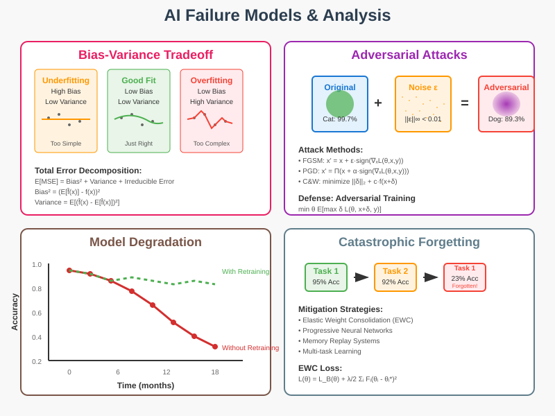

# AI Failure Models: Mathematical Analysis and Robustness



## Overview

Understanding failure modes is crucial for building robust and reliable AI systems. This section provides a comprehensive mathematical analysis of common AI failure modes, their underlying causes, and mitigation strategies. By studying these failure patterns, we can develop more robust algorithms and better understand the limitations of current AI approaches.

## 1. Bias-Variance Tradeoff: The Fundamental Learning Challenge

### Mathematical Decomposition

**Expected Loss Decomposition**:
For a loss function L and true target function f, the expected loss can be decomposed as:
```
E[L(y, ĝ(x))] = Bias²(ĝ(x)) + Var(ĝ(x)) + σ²
```

Where:
- **Bias²(ĝ(x))** = (E[ĝ(x)] - f(x))²
- **Var(ĝ(x))** = E[(ĝ(x) - E[ĝ(x)])²]
- **σ²** = E[(y - f(x))²] (irreducible error)

### Detailed Analysis

**Bias Component**:
Measures systematic error due to model assumptions:
```
Bias(ĝ(x)) = E[ĝ(x)] - f(x)
```

**Variance Component**:
Measures sensitivity to training data variations:
```
Var(ĝ(x)) = E[ĝ(x)²] - (E[ĝ(x)])²
```

**Model Complexity Effects**:
- **High Bias, Low Variance**: Simple models (linear regression, naive Bayes)
- **Low Bias, High Variance**: Complex models (deep neural networks, decision trees)
- **Optimal Tradeoff**: Achieved through regularization and model selection

### Mathematical Example: Polynomial Regression

For polynomial degree d:
```
Bias² ∝ d⁻²ᵅ (decreases with complexity)
Variance ∝ d/n (increases with complexity)
Total Error = A·d⁻²ᵅ + B·d/n + σ²
```

Optimal degree: d* = (2αnA/B)^(1/(2α+1))

### Mitigation Strategies

**Cross-Validation**:
K-fold CV estimator:
```
CV(k) = (1/k) Σᵢ L(fᵢ, Dᵢ)
```

**Regularization**:
Add penalty term:
```
L_reg(θ) = L(θ) + λR(θ)
```

**Ensemble Methods**:
Combine multiple models:
```
f̂_ensemble = (1/M) Σᵢ f̂ᵢ
Var[f̂_ensemble] = (1/M)Var[f̂ᵢ] (if uncorrelated)
```

## 2. Overfitting: Excessive Model Complexity

### Mathematical Characterization

**Training vs. Validation Error**:
```
Overfitting ⟺ E_train[L] << E_val[L]
```

**VC-Dimension Analysis**:
For hypothesis class H with VC-dimension d:
```
P[|R(h) - R_emp(h)| > ε] ≤ 4m_H(2m)exp(-mε²/8)
```
Where m_H(2m) ≤ (2em/d)^d is the growth function.

**Generalization Bound**:
With probability 1-δ:
```
R(h) ≤ R_emp(h) + √((d log(2em/d) + log(4/δ))/(2m))
```

### Rademacher Complexity

**Definition**:
```
R_m(F) = (1/m) E[sup_{f∈F} |Σᵢ σᵢf(xᵢ)|]
```
Where σᵢ are Rademacher random variables.

**Generalization Bound**:
```
E[R(f)] ≤ R_emp(f) + 2R_m(F) + √(log(1/δ)/(2m))
```

### Early Stopping

**Optimal Stopping Time**:
```
t* = argmin_t E[L_val(θ_t)]
```

**Patience-Based Stopping**:
Stop if validation loss doesn't improve for p epochs:
```
t* = min{t : L_val(θ_{t+k}) ≥ L_val(θ_t) ∀k ∈ [1,p]}
```

### Regularization Techniques

**L1 Regularization (LASSO)**:
```
L₁(θ) = L(θ) + λ||θ||₁
```
Promotes sparsity: ∂||θ||₁/∂θᵢ = sign(θᵢ)

**L2 Regularization (Ridge)**:
```
L₂(θ) = L(θ) + λ||θ||₂²
```
Closed-form solution: θ̂ = (X^T X + λI)⁻¹X^T y

**Dropout**:
```
r ~ Bernoulli(p)
ỹ = r ⊙ y
```
Equivalent to L2 regularization in linear models.

## 3. Underfitting: Insufficient Model Capacity

### Mathematical Analysis

**Model Bias**:
When hypothesis class H doesn't contain the true function:
```
inf_{h∈H} E[L(h,f)] > E[L(f,f)]
```

**Approximation Error**:
```
ε_app = inf_{f∈F} E[(f(x) - f*(x))²]
```

**Universal Approximation**:
For neural networks, ε_app → 0 as width → ∞ for any continuous function on compact sets.

### Complexity Measures

**Fat-Shattering Dimension**:
For regression problems with margin γ:
```
fat_γ(F) = max{m : ∃x₁,...,x_m, r₁,...,r_m s.t. ∀S⊆[m] ∃f_S∈F}
```

**Covering Numbers**:
```
N(ε,F,L₂(μ)) = min{N : ∃f₁,...,f_N s.t. ∀f∈F, min_i ||f-fᵢ||_{L₂(μ)} ≤ ε}
```

### Mitigation Strategies

**Feature Engineering**:
Transform input space: x → φ(x)

**Kernel Methods**:
Implicit feature mapping via kernel trick:
```
K(x,x') = ⟨φ(x),φ(x')⟩
```

**Deep Learning**:
Learn hierarchical representations automatically.

## 4. Adversarial Examples: Systematic Vulnerability

### Mathematical Framework

**Adversarial Perturbation**:
```
x_adv = x + δ
```
Subject to ||δ||_p ≤ ε (bounded perturbation)

**Adversarial Loss**:
```
L_adv(θ) = E[(x,y)~D][max_{||δ||≤ε} L(f_θ(x+δ), y)]
```

### Attack Methods

**Fast Gradient Sign Method (FGSM)**:
```
x_adv = x + ε · sign(∇_x L(θ, x, y))
```

**Projected Gradient Descent (PGD)**:
```
x^{(t+1)} = Π_{||δ||≤ε}(x^{(t)} + α · sign(∇_x L(θ, x^{(t)}, y)))
```

**Carlini & Wagner (C&W)**:
```
min ||δ||₂ + c · f(x+δ)
```
Where f(x+δ) = max(max_{i≠t} Z_i(x+δ) - Z_t(x+δ), -κ)

### Theoretical Analysis

**Lipschitz Continuity**:
A function f is L-Lipschitz if:
```
|f(x₁) - f(x₂)| ≤ L||x₁ - x₂||
```

**Adversarial Robustness**:
For ε-robustness:
```
∀||δ|| ≤ ε : argmax_k f_k(x) = argmax_k f_k(x+δ)
```

**Trade-off with Accuracy**:
```
min_θ λ · L_clean(θ) + (1-λ) · L_adv(θ)
```

### Defense Mechanisms

**Adversarial Training**:
```
min_θ E[(x,y)][max_{||δ||≤ε} L(f_θ(x+δ), y)]
```

**Certified Defenses**:
Provide mathematical guarantees:
```
|f(x+δ) - f(x)| ≤ L||δ||
```

**Randomized Smoothing**:
```
g(x) = E[f(x + η)] where η ~ N(0, σ²I)
```

## 5. Distribution Shift: Covariate and Concept Drift

### Mathematical Formulation

**Covariate Shift**:
P_train(x) ≠ P_test(x) but P(y|x) remains constant

**Prior Shift**:
P_train(y) ≠ P_test(y) but P(x|y) remains constant  

**Concept Drift**:
P_train(y|x) ≠ P_test(y|x)

### Importance Weighting

**Density Ratio Estimation**:
```
w(x) = p_test(x) / p_train(x)
```

**Weighted ERM**:
```
min_f (1/n) Σᵢ w(xᵢ)L(f(xᵢ), yᵢ)
```

**KL-Divergence Regularization**:
```
min_f E_train[w(x)L(f(x),y)] + λ·KL(w(x)p_train(x)||p_test(x))
```

### Domain Adaptation

**H-Divergence**:
```
d_H(D_S, D_T) = 2sup_{h∈H}|P_S(h=1) - P_T(h=1)|
```

**Generalization Bound**:
```
ε_T(h) ≤ ε_S(h) + (1/2)d_H(D_S, D_T) + λ
```

**Maximum Mean Discrepancy (MMD)**:
```
MMD²(X,Y) = ||μ_p - μ_q||²_H
```

### Mitigation Strategies

**Online Learning**:
Update model continuously:
```
θ_{t+1} = θ_t - η_t ∇L(θ_t, x_t, y_t)
```

**Ensemble Methods**:
Combine predictions across time:
```
ŷ = Σᵢ w_i(t) f_i(x)
```

## 6. Catastrophic Forgetting: Sequential Learning Failure

### Mathematical Analysis

**Forgetting Measure**:
```
F_j = (1/k) Σᵢ (a_{j,i} - b_{j,i})
```
Where a_{j,i} is accuracy on task j after training task i.

**Stability-Plasticity Dilemma**:
```
min_θ L_new(θ) + λ · Ω(θ, θ_old)
```

### Elastic Weight Consolidation (EWC)

**Fisher Information Matrix**:
```
F_i = E[∇_θ log p(x_i|θ)]²
```

**EWC Loss**:
```
L(θ) = L_B(θ) + (λ/2) Σᵢ F_i(θ_i - θ*_A)²
```

**Theoretical Justification**:
Based on Laplace approximation of posterior:
```
log p(θ|D_A) ≈ log p(θ*|D_A) - (1/2)(θ-θ*)ᵀF(θ-θ*)
```

### Progressive Networks

**Network Structure**:
```
h_i^{(k)} = f(W_i^{(k)}h_{i-1}^{(k)} + Σⱼ U_{i,j}^{(k)}h_j^{(<k)})
```

**Capacity Growth**:
Parameters grow linearly: |θ_T| = T·|θ_base|

### Memory Replay

**Rehearsal Loss**:
```
L_total = L_new + α·L_replay
```

**Optimal Memory Allocation**:
```
m*_i = argmax_m I(θ; D_i|m_i) - C(m_i)
```

## 7. Mode Collapse: Generative Model Failure

### Mathematical Characterization

**Jensen-Shannon Divergence**:
```
JS(p_data, p_g) = (1/2)KL(p_data||m) + (1/2)KL(p_g||m)
```
Where m = (p_data + p_g)/2

**Mode Collapse Indicator**:
```
MC = 1 - H[p_g(x)] / H[p_data(x)]
```

### GAN Objective Analysis

**Original GAN**:
```
min_G max_D E[log D(x)] + E[log(1-D(G(z)))]
```

**Optimal Discriminator**:
```
D*(x) = p_data(x) / (p_data(x) + p_g(x))
```

**Mode Collapse Conditions**:
When ∇_G L = 0 but support(p_g) ⊊ support(p_data)

### Mitigation Techniques

**Wasserstein GAN**:
```
min_G max_{D∈Lip₁} E[D(x)] - E[D(G(z))]
```

**Spectral Normalization**:
```
W̄ = W / σ(W)
```
Where σ(W) is the spectral norm.

**Progressive Growing**:
Start with low resolution and gradually increase complexity.

## 8. Gradient-Based Optimization Failures

### Vanishing Gradients

**Mathematical Analysis**:
For deep networks:
```
∂L/∂W^{(1)} = (∂L/∂a^{(L)}) Π_{i=2}^L (W^{(i)})ᵀ diag(σ'(z^{(i)}))
```

**Gradient Magnitude**:
```
||∂L/∂W^{(1)}|| ≤ ||∂L/∂a^{(L)}|| Π_{i=2}^L ||W^{(i)}|| ||σ'||_∞
```

If ||W^{(i)}|| < 1 and ||σ'||_∞ < 1, gradients vanish exponentially.

### Exploding Gradients

**Gradient Clipping**:
```
g ← g · min(1, τ/||g||)
```

**Spectral Normalization**:
Bound spectral norm of weight matrices:
```
ρ(W) = max_||x||=1 ||Wx|| ≤ c
```

### Local Minima and Saddle Points

**Hessian Analysis**:
- **Local minimum**: H ≻ 0 (all eigenvalues positive)
- **Saddle point**: H has mixed eigenvalues
- **Local maximum**: H ≺ 0 (all eigenvalues negative)

**Escape Probability**:
For saddle points with negative curvature γ:
```
P(escape) ≈ exp(-2πγη)
```

**Strict Saddle Property**:
All critical points are either global minima or strict saddle points with negative eigenvalue bounded away from zero.

## 9. Robustness Analysis and Verification

### Lipschitz Constants

**Definition**:
```
L_f = sup_{x≠y} ||f(x) - f(y)|| / ||x - y||
```

**Neural Network Bounds**:
```
L_f ≤ Π_{i=1}^L ||W^{(i)}||_2 Π_{i=1}^L L_{σᵢ}
```

### Interval Bound Propagation

**Layer-wise Bounds**:
```
l^{(i+1)} ≤ W^{(i+1)}⁺u^{(i)} + W^{(i+1)}⁻l^{(i)} + b^{(i+1)}
u^{(i+1)} ≥ W^{(i+1)}⁺u^{(i)} + W^{(i+1)}⁻l^{(i)} + b^{(i+1)}
```

### Abstract Interpretation

**Zonotope Domains**:
```
Z = c + Σᵢ αᵢgᵢ, αᵢ ∈ [-1,1]
```

**Linear Transform**:
```
AZ = Ac + Σᵢ αᵢ(Agᵢ)
```

## 10. Fairness and Algorithmic Bias

### Mathematical Definitions

**Demographic Parity**:
```
P(Ŷ = 1|A = 0) = P(Ŷ = 1|A = 1)
```

**Equalized Odds**:
```
P(Ŷ = 1|A = 0, Y = y) = P(Ŷ = 1|A = 1, Y = y) ∀y
```

**Calibration**:
```
P(Y = 1|Ŷ = s, A = a) = s ∀s,a
```

### Impossibility Results

**Chouldechova's Theorem**:
If prevalence differs across groups and the classifier satisfies calibration, it cannot satisfy equalized odds.

**Kleinberg et al. Theorem**:
Calibration, balance for positive class, and balance for negative class cannot all be satisfied when base rates differ.

### Bias Mitigation

**Fair Representation Learning**:
```
min L(h(g(X)), Y) + λ·I(g(X); A)
```

**Adversarial Debiasing**:
```
min_θ max_φ L_pred(θ) - λ·L_adv(φ,θ)
```

## Prevention and Mitigation Strategies

### Regularization Techniques
- **L1/L2 regularization**: Control model complexity
- **Dropout**: Prevent co-adaptation
- **Batch normalization**: Stabilize training
- **Data augmentation**: Increase effective training size

### Robust Training Methods
- **Adversarial training**: Train on adversarial examples
- **Certified defenses**: Provide mathematical guarantees
- **Ensemble methods**: Combine multiple models
- **Multi-task learning**: Share representations across tasks

### Monitoring and Detection
- **Uncertainty quantification**: Measure prediction confidence
- **Outlier detection**: Identify distribution shift
- **Performance monitoring**: Track metrics over time
- **Interpretability tools**: Understand model decisions

### Theoretical Foundations
- **PAC-Bayes bounds**: Connect empirical and true risk
- **Information-theoretic analysis**: Measure learning efficiency
- **Optimization theory**: Understand convergence properties
- **Statistical learning theory**: Provide generalization guarantees

Understanding these failure modes and their mathematical underpinnings is essential for building robust, reliable, and fair AI systems. The mathematical analysis provides insights into when and why failures occur, enabling the development of more effective prevention and mitigation strategies.