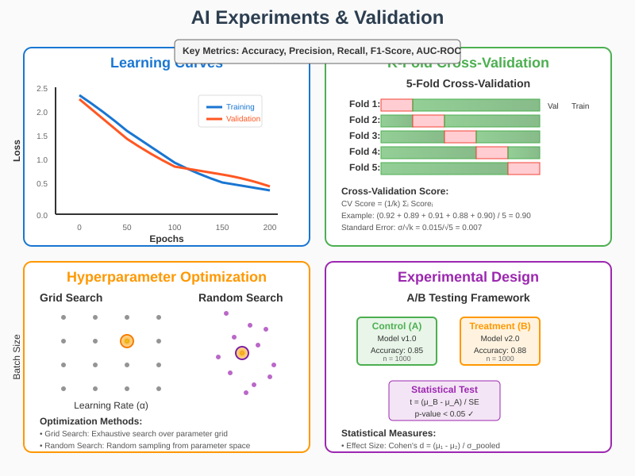

# AI Experiments and Validation: Mathematical Foundations



## Overview

Rigorous experimentation is fundamental to advancing artificial intelligence research and building reliable AI systems. This section explores the mathematical foundations of AI experimentation, including statistical validation methods, experimental design principles, hyperparameter optimization, and performance evaluation techniques. Understanding these concepts enables researchers and practitioners to conduct sound experiments and draw valid conclusions from their results.

## 1. Experimental Design Theory

### Statistical Foundations

**Hypothesis Testing Framework**:
- **Null Hypothesis (H₀)**: No effect or difference exists
- **Alternative Hypothesis (H₁)**: An effect or difference exists
- **Type I Error (α)**: False positive rate P(reject H₀|H₀ true)
- **Type II Error (β)**: False negative rate P(accept H₀|H₁ true)
- **Statistical Power**: 1 - β = P(reject H₀|H₁ true)

**Test Statistic**:
```
t = (θ̂ - θ₀) / SE(θ̂)
```
Where θ̂ is the estimated parameter and SE is the standard error.

**P-value**:
```
p = P(T ≥ t_obs | H₀)
```

**Confidence Interval**:
```
CI = θ̂ ± t_{α/2,df} × SE(θ̂)
```

### Multiple Comparisons Problem

**Bonferroni Correction**:
For m comparisons, use significance level α/m for each test.

**False Discovery Rate (FDR)**:
```
FDR = E[V/R] where V is false positives, R is total rejections
```

**Benjamini-Hochberg Procedure**:
For ordered p-values p₁ ≤ p₂ ≤ ... ≤ pₘ:
```
Reject H_i for i ≤ max{i : p_i ≤ (i/m)α}
```

### Sample Size Determination

**Power Analysis**:
Required sample size for detecting effect δ with power 1-β:
```
n = ((z_{α/2} + z_β)σ / δ)²
```

**Effect Size Measures**:
- **Cohen's d**: (μ₁ - μ₂)/σ
- **Pearson correlation**: r
- **Eta-squared**: η² = SS_between/SS_total

## 2. Cross-Validation: Statistical Validation

### K-Fold Cross-Validation

**Mathematical Formulation**:
Partition data into k folds: D = D₁ ∪ D₂ ∪ ... ∪ Dₖ

**CV Estimator**:
```
CV(f) = (1/k) Σᵢ L(f^(-i), Dᵢ)
```
Where f^(-i) is trained on D \ Dᵢ.

**Bias and Variance**:
```
Bias[CV] ≈ (k-1)/k × Bias[L_test]
Var[CV] = (1/k²) Σᵢ Var[L(f^(-i), Dᵢ)] + covariance terms
```

### Leave-One-Out Cross-Validation (LOOCV)

**Analytical Form for Linear Models**:
```
CV_LOO = (1/n) Σᵢ (y_i - ŷ_i / (1 - h_ii))²
```
Where h_ii is the i-th diagonal element of the hat matrix.

**Generalized Cross-Validation (GCV)**:
```
GCV = (1/n) Σᵢ (y_i - ŷ_i)² / (1 - tr(H)/n)²
```

### Stratified Sampling

**Proportional Allocation**:
```
n_i = n × (N_i / N)
```
Where n_i is sample size for stratum i.

**Optimal Allocation**:
```
n_i = n × (N_i σ_i / Σ_j N_j σ_j)
```

### Time Series Cross-Validation

**Rolling Window**:
Train on [t-w, t-1], test on t, for t = w+1, ..., T

**Expanding Window**:
Train on [1, t-1], test on t, for t = w+1, ..., T

**Blocked Cross-Validation**:
Account for temporal dependencies by creating time-based blocks.

## 3. Hyperparameter Optimization

### Grid Search

**Parameter Space**:
```
Θ = Θ₁ × Θ₂ × ... × Θₖ
```

**Optimization Problem**:
```
θ* = argmin_{θ∈Θ} CV(f_θ)
```

**Computational Complexity**:
O(|Θ₁| × |Θ₂| × ... × |Θₖ|) evaluations

### Random Search

**Theoretical Advantage**:
For function with d effective dimensions out of D total:
Random search finds ε-optimal solution in O(d/ε²) evaluations.

**Probability of Finding Good Solution**:
```
P(min_{i=1}^n f(x_i) ≤ f* + ε) = 1 - (1-p)^n
```
Where p is the probability that a random point is ε-optimal.

### Bayesian Optimization

**Gaussian Process Prior**:
```
f ~ GP(μ(x), k(x,x'))
```

**Acquisition Function**:
- **Expected Improvement**: EI(x) = E[max(f(x) - f*, 0)]
- **Upper Confidence Bound**: UCB(x) = μ(x) + βσ(x)
- **Probability of Improvement**: PI(x) = P(f(x) > f*)

**Expected Improvement**:
```
EI(x) = σ(x)[φ(Z) + Zɸ(Z)]
```
Where Z = (μ(x) - f*)/σ(x), φ is PDF, Φ is CDF of standard normal.

**Thompson Sampling**:
```
f_t ~ GP(μ_{t-1}, k_{t-1})
x_t = argmax_x f_t(x)
```

### Multi-Armed Bandits

**ε-Greedy**:
```
a_t = {argmax_a Q_t(a)  with probability 1-ε
       {random action    with probability ε
```

**Upper Confidence Bound (UCB)**:
```
a_t = argmax_a [Q_t(a) + c√(ln t / N_t(a))]
```

**Regret Bound**:
```
R_n = O(√(k ln n))
```
Where k is the number of arms.

## 4. Performance Evaluation Metrics

### Classification Metrics

**Confusion Matrix Elements**:
- True Positives (TP), False Positives (FP)
- True Negatives (TN), False Negatives (FN)

**Key Metrics**:
```
Accuracy = (TP + TN) / (TP + FP + TN + FN)
Precision = TP / (TP + FP)
Recall = TP / (TP + FN)
F1-Score = 2 × (Precision × Recall) / (Precision + Recall)
```

**ROC Analysis**:
```
TPR = TP / (TP + FN)  (True Positive Rate)
FPR = FP / (FP + TN)  (False Positive Rate)
AUC = ∫₀¹ TPR(FPR⁻¹(t)) dt
```

**Precision-Recall AUC**:
```
AP = Σₖ (R_k - R_{k-1}) P_k
```

### Regression Metrics

**Mean Squared Error**:
```
MSE = (1/n) Σᵢ (yᵢ - ŷᵢ)²
```

**Root Mean Squared Error**:
```
RMSE = √MSE
```

**Mean Absolute Error**:
```
MAE = (1/n) Σᵢ |yᵢ - ŷᵢ|
```

**R-squared**:
```
R² = 1 - (SS_res / SS_tot)
```
Where SS_res = Σ(yᵢ - ŷᵢ)² and SS_tot = Σ(yᵢ - ȳ)²

**Adjusted R-squared**:
```
R²_adj = 1 - (1 - R²) × (n - 1) / (n - p - 1)
```

### Information-Theoretic Metrics

**Mutual Information**:
```
I(Y; Ŷ) = Σᵧ Σ_ŷ P(y,ŷ) log(P(y,ŷ) / (P(y)P(ŷ)))
```

**Normalized Mutual Information**:
```
NMI = I(Y; Ŷ) / √(H(Y)H(Ŷ))
```

**Conditional Entropy**:
```
H(Y|Ŷ) = H(Y) - I(Y; Ŷ)
```

## 5. Statistical Significance Testing

### Parametric Tests

**t-Test for Mean Comparison**:
```
t = (x̄₁ - x̄₂) / √(s²(1/n₁ + 1/n₂))
```

**ANOVA F-Test**:
```
F = MS_between / MS_within
```
Where MS = Mean Square = SS/df

**Linear Regression t-Test**:
```
t = β̂ⱼ / SE(β̂ⱼ)
```

### Non-Parametric Tests

**Mann-Whitney U Test**:
```
U = R₁ - n₁(n₁+1)/2
```
Where R₁ is sum of ranks for group 1.

**Wilcoxon Signed-Rank Test**:
```
W = Σᵢ sign(xᵢ) × rank(|xᵢ|)
```

**Kruskal-Wallis Test**:
```
H = (12/N(N+1)) Σⱼ (R²ⱼ/nⱼ) - 3(N+1)
```

### Bootstrap Methods

**Bootstrap Sample**:
```
X*₁, X*₂, ..., X*ₙ ~ F̂ₙ
```
Where F̂ₙ is the empirical distribution function.

**Bootstrap Confidence Interval**:
- **Percentile Method**: [θ*_{α/2}, θ*_{1-α/2}]
- **Bias-Corrected**: [θ*_{α₁}, θ*_{α₂}] with bias correction
- **BCa**: Bias-corrected and accelerated intervals

**Bootstrap Hypothesis Testing**:
```
p-value ≈ #{θ*ᵦ ≥ θ₀} / B
```

## 6. A/B Testing for AI Systems

### Experimental Setup

**Randomization**:
Users assigned to treatment with probability p:
```
Treatment ~ Bernoulli(p)
```

**Sample Size Calculation**:
```
n = (z_{α/2} + z_β)² × (p₁(1-p₁) + p₂(1-p₂)) / (p₁ - p₂)²
```

**Statistical Power**:
```
Power = P(reject H₀ | H₁ true) = Φ((|δ|√n - z_{α/2}√(2p̄(1-p̄))) / √(p₁(1-p₁) + p₂(1-p₂)))
```

### Continuous Monitoring

**Sequential Testing**:
```
Z_t = (Σᵢ Xᵢ - E[Σᵢ Xᵢ|H₀]) / √Var[Σᵢ Xᵢ|H₀]
```

**Group Sequential Design**:
Use O'Brien-Fleming or Pocock boundaries for early stopping.

**Always Valid P-values**:
```
p_t = 2(1 - Φ(√(t/v_t)))
```
Where v_t is the variance at time t.

### Multi-Armed Bandits for A/B Testing

**Thompson Sampling**:
```
θᵢ,ₜ ~ Beta(αᵢ,ₜ, βᵢ,ₜ)
```
Choose arm with highest θᵢ,ₜ.

**Upper Confidence Bound**:
```
UCB_i(t) = p̂ᵢ,ₜ + √(2 log t / nᵢ,ₜ)
```

**Regret Bound**:
```
E[R_T] ≤ Σᵢ (8 log T / Δᵢ) + (1 + π²/3) Σᵢ Δᵢ
```

## 7. Learning Curves and Convergence Analysis

### Training Dynamics

**Learning Curve**:
Plot of validation error vs. training set size or epochs.

**Power Law Scaling**:
```
Error(n) = a × n^(-β) + c
```

**Exponential Decay**:
```
Error(t) = a × e^(-bt) + c
```

### Convergence Criteria

**Gradient Norm**:
```
||∇L(θ_t)|| ≤ ε
```

**Parameter Change**:
```
||θ_t - θ_{t-1}|| / ||θ_{t-1}|| ≤ ε
```

**Loss Change**:
```
|L(θ_t) - L(θ_{t-1})| / |L(θ_{t-1})| ≤ ε
```

### Early Stopping

**Patience-Based**:
```
Stop if: val_loss(t+i) ≥ val_loss(t) ∀i ∈ [1, patience]
```

**Improvement Threshold**:
```
Stop if: (val_loss(t) - min_val_loss) / min_val_loss < threshold
```

## 8. Experimental Reproducibility

### Random Seed Management

**Pseudorandom Number Generation**:
Linear Congruential Generator:
```
X_{n+1} = (aX_n + c) mod m
```

**Mersenne Twister**:
Period: 2^19937 - 1

**Cryptographically Secure RNG**:
Use for security-critical applications.

### Version Control for Experiments

**Data Versioning**:
Hash-based content addressing:
```
hash = SHA256(data)
```

**Model Versioning**:
Track architecture, hyperparameters, and weights.

**Experiment Tracking**:
Log all experimental parameters and results.

### Statistical Reproducibility

**Multiple Random Initializations**:
Report mean ± standard deviation across runs.

**Statistical Significance**:
Use appropriate tests for experimental conclusions.

**Effect Size Reporting**:
Report practical significance in addition to statistical significance.

## 9. Advanced Experimental Techniques

### Nested Cross-Validation

**Outer Loop**: Model selection
**Inner Loop**: Hyperparameter optimization

```
for i = 1 to k_outer:
    D_train = D \ D_i
    for j = 1 to k_inner:
        D_val = D_train_j
        D_fit = D_train \ D_val
        # Optimize hyperparameters
    # Train final model and evaluate on D_i
```

### Multi-Objective Optimization

**Pareto Optimality**:
Solution x* is Pareto optimal if ∄x such that f_i(x) ≤ f_i(x*) ∀i and f_j(x) < f_j(x*) for some j.

**Scalarization**:
```
min λ₁f₁(x) + λ₂f₂(x) + ... + λₖfₖ(x)
```

**Hypervolume Indicator**:
```
HV(A) = λ(∪_{a∈A} {x : a ≺ x ≺ r})
```
Where λ is the Lebesgue measure and r is a reference point.

### Federated Learning Experiments

**Communication Rounds**:
```
w_{t+1} = w_t - η Σᵢ (nᵢ/n) ∇F_i(w_t)
```

**Client Sampling**:
```
S_t ~ Uniform(C, K)
```
Where C is the set of all clients and K is the number of selected clients.

**Convergence Rate**:
```
E[||∇F(w_T)||²] ≤ O(1/T + σ²/nK)
```

## 10. Computational Considerations

### Parallel Experimentation

**Embarrassingly Parallel**:
Independent hyperparameter evaluations.

**Model Parallel**:
Split model across multiple devices:
```
y = f_n(f_{n-1}(...f_1(x)...))
```

**Data Parallel**:
```
∇L = (1/B) Σᵢ ∇L_i
```
Where B is the batch size across all devices.

### Resource Allocation

**Multi-Fidelity Optimization**:
Use cheap approximations (smaller datasets, fewer epochs) to guide expensive evaluations.

**Successive Halving**:
```
n_i = ⌊n/s^i⌋, r_i = r_min × s^i
```
Where s is the reduction factor.

**Hyperband**:
Combines successive halving with different resource allocations.

### Statistical Efficiency

**Importance Sampling**:
```
E[f(X)] = ∫ f(x) p(x) dx = ∫ f(x) (p(x)/q(x)) q(x) dx
```

**Control Variates**:
```
Y' = Y - c(X - E[X])
```
Where c is chosen to minimize variance.

**Stratified Sampling**:
```
Var[Ȳ_st] = Σᵢ (Nᵢ/N)² (σᵢ²/nᵢ)
```

## Best Practices for AI Experimentation

### Experimental Workflow
1. **Define clear hypotheses** with measurable outcomes
2. **Design appropriate baselines** for comparison
3. **Control for confounding variables** through randomization
4. **Use appropriate statistical tests** for your data type
5. **Report effect sizes** in addition to p-values
6. **Validate on held-out test sets** to assess generalization

### Statistical Rigor
- **Multiple comparison corrections** when testing multiple hypotheses
- **Confidence intervals** to quantify uncertainty
- **Power analysis** to ensure adequate sample sizes
- **Replication studies** to verify important results

### Reproducibility Standards
- **Version control** all code and data
- **Document experimental procedures** thoroughly  
- **Use random seeds** for deterministic results
- **Share code and data** when possible
- **Report negative results** to reduce publication bias

### Ethical Considerations
- **Privacy protection** in data collection and sharing
- **Bias assessment** in datasets and models
- **Fairness evaluation** across demographic groups
- **Transparency** in methodology and limitations

Understanding these mathematical foundations enables researchers to design rigorous experiments, draw valid conclusions, and advance the field of artificial intelligence through principled empirical investigation. The statistical techniques presented here provide the theoretical basis for sound experimental practice in AI research and development.