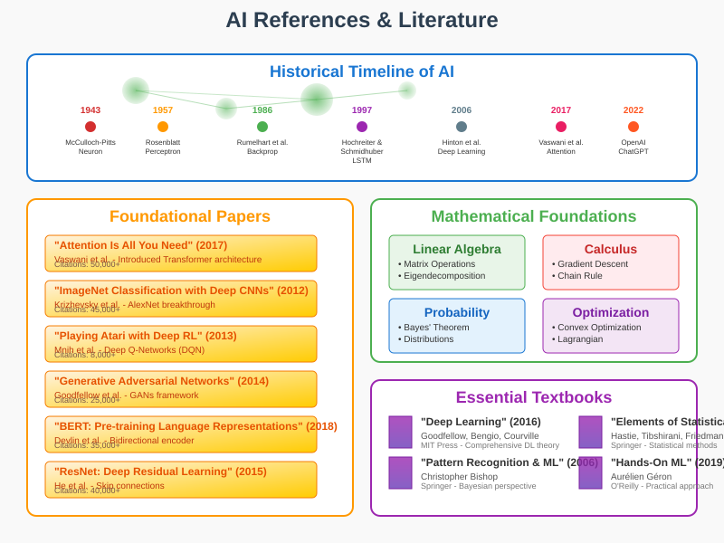

# AI References and Literature: Mathematical Foundations



## Overview

This section provides a comprehensive guide to the foundational literature and key references that have shaped the mathematical understanding of artificial intelligence. From seminal papers that established core theoretical frameworks to modern works advancing the field, these references provide the mathematical foundations underlying contemporary AI research and development.

## 1. Historical Foundations (1940s-1980s)

### Early Neural Network Theory

**McCulloch, W.S. & Pitts, W. (1943)**  
*"A logical calculus of the ideas immanent in nervous activity"*  
Bulletin of Mathematical Biophysics, 5(4), 115-133.

**Mathematical Contribution**:
First formal mathematical model of neural computation:
```
y = f(∑ᵢ wᵢxᵢ - θ)
```
Where f is a threshold function, establishing the mathematical foundation for artificial neurons.

**Rosenblatt, F. (1957)**  
*"The perceptron: A perceiving and recognizing automaton"*  
Cornell Aeronautical Laboratory Technical Report 85-460-1.

**Mathematical Framework**:
Learning algorithm for linear classifiers:
```
w(t+1) = w(t) + η(d - y)x
```
First convergence theorem for neural learning.

**Minsky, M. & Papert, S. (1969)**  
*"Perceptrons: An Introduction to Computational Geometry"*  
MIT Press.

**Mathematical Analysis**:
Rigorous mathematical analysis of perceptron limitations, proving inability to solve XOR problem and establishing foundations for understanding linear separability constraints.

### Information Theory and Learning

**Shannon, C.E. (1948)**  
*"A Mathematical Theory of Communication"*  
Bell System Technical Journal, 27(3), 379-423.

**Core Mathematical Concepts**:
```
H(X) = -∑ᵢ P(xᵢ) log₂ P(xᵢ)  (Entropy)
I(X;Y) = ∑ᵢⱼ P(xᵢ,yⱼ) log₂(P(xᵢ,yⱼ)/(P(xᵢ)P(yⱼ)))  (Mutual Information)
```

**Cover, T.M. & Thomas, J.A. (1991)**  
*"Elements of Information Theory"*  
Wiley.

**Mathematical Significance**:
Comprehensive treatment of information-theoretic foundations including:
- Channel capacity theorems
- Rate-distortion theory
- Universal coding
- Applications to machine learning

### Statistical Learning Theory

**Vapnik, V.N. & Chervonenkis, A.Y. (1971)**  
*"On the uniform convergence of relative frequencies of events to their probabilities"*  
Theory of Probability and Its Applications, 16(2), 264-280.

**Mathematical Framework**:
VC-dimension theory and generalization bounds:
```
P[|R(h) - R̂(h)| > ε] ≤ 4m_H(2n)exp(-nε²/8)
```

**Vapnik, V.N. (1995)**  
*"The Nature of Statistical Learning Theory"*  
Springer.

**Core Mathematical Results**:
- Structural Risk Minimization principle
- VC-dimension bounds
- Support Vector Machine theory
- Statistical learning complexity theory

## 2. Modern Deep Learning Era (1980s-2000s)

### Backpropagation and Deep Networks

**Rumelhart, D.E., Hinton, G.E., & Williams, R.J. (1986)**  
*"Learning representations by back-propagating errors"*  
Nature, 323(6088), 533-536.

**Mathematical Algorithm**:
```
∂E/∂wᵢⱼ = ∂E/∂netⱼ × ∂netⱼ/∂wᵢⱼ = δⱼoᵢ
δⱼ = f'(netⱼ) × (∂E/∂outⱼ)
```
Established the chain rule application for training multilayer networks.

**Hornik, K., Stinchcombe, M., & White, H. (1989)**  
*"Multilayer feedforward networks are universal approximators"*  
Neural Networks, 2(5), 359-366.

**Universal Approximation Theorem**:
Any continuous function on a compact set can be approximated arbitrarily well by a feedforward network with one hidden layer:
```
∀f ∈ C(K), ∀ε > 0, ∃N: sup_{x∈K} |f(x) - N(x)| < ε
```

### Probabilistic Machine Learning

**Dempster, A.P., Laird, N.M., & Rubin, D.B. (1977)**  
*"Maximum likelihood from incomplete data via the EM algorithm"*  
Journal of the Royal Statistical Society, 39(1), 1-38.

**EM Algorithm**:
```
Q(θ|θ⁽ᵗ⁾) = E_{Z|X,θ⁽ᵗ⁾}[log L(θ; X, Z)]
θ⁽ᵗ⁺¹⁾ = argmax_θ Q(θ|θ⁽ᵗ⁾)
```

**Pearl, J. (1988)**  
*"Probabilistic Reasoning in Intelligent Systems"*  
Morgan Kaufmann.

**Mathematical Foundations**:
- Bayesian network theory
- Belief propagation algorithms
- Causal inference framework
- Junction tree algorithms

## 3. Contemporary Foundations (2000s-Present)

### Deep Learning Revolution

**Hinton, G.E., Osindero, S., & Teh, Y.W. (2006)**  
*"A fast learning algorithm for deep belief nets"*  
Neural Computation, 18(7), 1527-1554.

**Mathematical Innovation**:
Layer-wise pretraining using Restricted Boltzmann Machines:
```
p(v,h) = (1/Z) exp(-E(v,h))
E(v,h) = -∑ᵢ aᵢvᵢ - ∑ⱼ bⱼhⱼ - ∑ᵢⱼ vᵢWᵢⱼhⱼ
```

**Krizhevsky, A., Sutskever, I., & Hinton, G.E. (2012)**  
*"ImageNet classification with deep convolutional neural networks"*  
NIPS, 1097-1105.

**Architectural Innovation**:
AlexNet architecture with mathematical components:
- ReLU activation: f(x) = max(0,x)
- Dropout regularization
- Convolutional layer mathematics

### Optimization Theory

**Kingma, D.P. & Ba, J. (2014)**  
*"Adam: A Method for Stochastic Optimization"*  
arXiv preprint arXiv:1412.6980.

**Adam Optimizer**:
```
m_t = β₁m_{t-1} + (1-β₁)g_t
v_t = β₂v_{t-1} + (1-β₂)g_t²
θ_t = θ_{t-1} - α(m̂_t/(√v̂_t + ε))
```

**Bottou, L. (2010)**  
*"Large-scale machine learning with stochastic gradient descent"*  
COMPSTAT, 177-186.

**SGD Theory**:
Convergence analysis and practical considerations for large-scale optimization.

### Generative Models

**Goodfellow, I., et al. (2014)**  
*"Generative adversarial nets"*  
NIPS, 2672-2680.

**GAN Mathematical Framework**:
```
min_G max_D V(D,G) = E_{x~p_{data}}[log D(x)] + E_{z~p_z}[log(1-D(G(z)))]
```

**Kingma, D.P. & Welling, M. (2013)**  
*"Auto-encoding variational bayes"*  
arXiv preprint arXiv:1312.6114.

**Variational Autoencoder**:
```
log p(x) ≥ E_{q_φ(z|x)}[log p_θ(x|z)] - D_{KL}(q_φ(z|x)||p(z))
```

### Attention Mechanisms and Transformers

**Bahdanau, D., Cho, K., & Bengio, Y. (2014)**  
*"Neural machine translation by jointly learning to align and translate"*  
arXiv preprint arXiv:1409.0473.

**Attention Mechanism**:
```
α_{ij} = exp(e_{ij}) / ∑_{k=1}^T exp(e_{ik})
c_i = ∑_{j=1}^T α_{ij}h_j
```

**Vaswani, A., et al. (2017)**  
*"Attention is all you need"*  
NIPS, 5998-6008.

**Self-Attention Mathematics**:
```
Attention(Q,K,V) = softmax(QK^T/√d_k)V
```
Revolutionary architecture eliminating recurrence and convolution.

## 4. Mathematical Textbooks and References

### Linear Algebra

**Strang, G. (2016)**  
*"Introduction to Linear Algebra, 5th Edition"*  
Wellesley-Cambridge Press.

**Key Topics for AI**:
- Matrix decompositions (SVD, eigendecomposition)
- Vector spaces and linear transformations
- Numerical linear algebra
- Applications to machine learning

**Horn, R.A. & Johnson, C.R. (2012)**  
*"Matrix Analysis, 2nd Edition"*  
Cambridge University Press.

**Advanced Topics**:
- Matrix perturbation theory
- Majorization theory
- Matrix inequalities
- Spectral theory

### Probability and Statistics

**Jaynes, E.T. (2003)**  
*"Probability Theory: The Logic of Science"*  
Cambridge University Press.

**Bayesian Foundations**:
- Bayesian inference principles
- Maximum entropy methods
- Information theory connections
- Logical foundations of probability

**Casella, G. & Berger, R.L. (2002)**  
*"Statistical Inference, 2nd Edition"*  
Duxbury Press.

**Statistical Theory**:
- Likelihood theory
- Hypothesis testing
- Confidence intervals
- Decision theory

### Optimization

**Boyd, S. & Vandenberghe, L. (2004)**  
*"Convex Optimization"*  
Cambridge University Press.

**Mathematical Framework**:
- Convex sets and functions
- Duality theory
- Interior-point methods
- Applications to machine learning

**Nocedal, J. & Wright, S.J. (2006)**  
*"Numerical Optimization, 2nd Edition"*  
Springer.

**Optimization Algorithms**:
- Line search methods
- Trust region methods
- Quasi-Newton methods
- Constrained optimization

## 5. Machine Learning Theory

### Foundational Textbooks

**Hastie, T., Tibshirani, R., & Friedman, J. (2009)**  
*"The Elements of Statistical Learning, 2nd Edition"*  
Springer.

**Mathematical Coverage**:
- Linear methods for regression and classification
- Basis expansions and regularization
- Kernel methods
- Model selection and assessment
- Ensemble methods

**Bishop, C.M. (2006)**  
*"Pattern Recognition and Machine Learning"*  
Springer.

**Probabilistic Perspective**:
- Bayesian machine learning
- Graphical models
- Variational inference
- Sampling methods
- Sequential data modeling

**Goodfellow, I., Bengio, Y., & Courville, A. (2016)**  
*"Deep Learning"*  
MIT Press.

**Deep Learning Mathematics**:
- Numerical computation foundations
- Regularization theory
- Optimization for deep learning
- Convolutional and recurrent networks
- Practical methodology

### Information Theory

**MacKay, D.J.C. (2003)**  
*"Information Theory, Inference, and Learning Algorithms"*  
Cambridge University Press.

**Unified Perspective**:
- Information theory fundamentals
- Bayesian inference
- Neural networks from information perspective
- Error-correcting codes
- Data compression

### Reinforcement Learning

**Sutton, R.S. & Barto, A.G. (2018)**  
*"Reinforcement Learning: An Introduction, 2nd Edition"*  
MIT Press.

**Mathematical Foundations**:
- Markov Decision Processes
- Dynamic programming
- Temporal difference learning
- Policy gradient methods
- Function approximation

**Bertsekas, D.P. (2017)**  
*"Dynamic Programming and Optimal Control, 4th Edition"*  
Athena Scientific.

**Theoretical Framework**:
- Bellman equations
- Value iteration
- Policy iteration
- Approximate dynamic programming
- Stochastic optimal control

## 6. Contemporary Research Areas

### Generalization Theory

**Zhang, C., et al. (2016)**  
*"Understanding deep learning requires rethinking generalization"*  
arXiv preprint arXiv:1611.03530.

**Key Insights**:
Challenges traditional generalization theory for deep learning, demonstrating the need for new theoretical frameworks.

**Arora, S., et al. (2019)**  
*"Fine-grained analysis of optimization and generalization for overparameterized two-layer neural networks"*  
ICML, 322-332.

**Mathematical Analysis**:
Rigorous analysis of gradient descent dynamics in overparameterized settings.

### Neural Tangent Theory

**Jacot, A., Gabriel, F., & Hongler, C. (2018)**  
*"Neural tangent kernel: Convergence and generalization in neural networks"*  
NIPS, 8571-8580.

**Mathematical Framework**:
```
K(x,x') = E[∇_θf(x;θ₀) · ∇_θf(x';θ₀)]
```
Connecting infinite-width neural networks to kernel methods.

### Expressivity and Approximation

**Poggio, T., et al. (2017)**  
*"Why and when can deep-but not shallow-networks avoid the curse of dimensionality"*  
International Conference on Learning Representations.

**Theoretical Results**:
Mathematical analysis of depth vs. width tradeoffs in neural network expressivity.

## 7. Specialized Mathematical Topics

### Differential Geometry and Manifold Learning

**Lee, J.M. (2013)**  
*"Introduction to Smooth Manifolds, 2nd Edition"*  
Springer.

**Relevance to AI**:
- Manifold hypothesis in machine learning
- Geometric deep learning foundations
- Natural gradients and information geometry

**Amari, S.I. (2016)**  
*"Information Geometry and Its Applications"*  
Springer.

**Information Geometric Perspective**:
- Fisher information metric
- Natural gradients
- Statistical manifolds
- Applications to neural networks

### Functional Analysis

**Rudin, W. (1991)**  
*"Functional Analysis, 2nd Edition"*  
McGraw-Hill.

**Applications to Learning Theory**:
- Reproducing kernel Hilbert spaces
- Approximation theory
- Functional optimization
- Infinite-dimensional optimization

### Category Theory

**Fong, B. & Spivak, D.I. (2018)**  
*"An Invitation to Applied Category Theory"*  
Cambridge University Press.

**Emerging Applications**:
- Compositional deep learning
- Type-theoretic approaches to AI
- Categorical quantum mechanics
- Algebraic topology in data analysis

## 8. Interdisciplinary Connections

### Cognitive Science and Neuroscience

**Dayan, P. & Abbott, L.F. (2001)**  
*"Theoretical Neuroscience"*  
MIT Press.

**Mathematical Neuroscience**:
- Neural coding theories
- Network dynamics
- Learning rules
- Information processing

### Physics and Statistical Mechanics

**Mehta, P., et al. (2019)**  
*"A high-bias, low-variance introduction to machine learning for physicists"*  
Physics Reports, 810, 1-124.

**Physics Perspective on ML**:
- Statistical mechanics of learning
- Phase transitions in neural networks
- Renormalization group methods
- Many-body physics connections

### Economics and Game Theory

**Myerson, R.B. (1991)**  
*"Game Theory: Analysis of Conflict"*  
Harvard University Press.

**Applications to AI**:
- Multi-agent learning
- Mechanism design
- Auction theory
- Social choice theory

## 9. Mathematical Software and Computational Tools

### Numerical Computing

**Golub, G.H. & Van Loan, C.F. (2012)**  
*"Matrix Computations, 4th Edition"*  
Johns Hopkins University Press.

**Computational Linear Algebra**:
- QR decomposition
- SVD algorithms
- Iterative methods
- Condition numbers and stability

**Press, W.H., et al. (2007)**  
*"Numerical Recipes, 3rd Edition"*  
Cambridge University Press.

**Practical Algorithms**:
- Optimization methods
- Random number generation
- Special functions
- Statistical methods

### Symbolic Computation

**Wolfram, S. (2003)**  
*"The Mathematica Book, 5th Edition"*  
Wolfram Media.

**Computer Algebra Applications**:
- Symbolic differentiation
- Series expansions
- Equation solving
- Mathematical visualization

## 10. Research Methodology and Mathematical Writing

### Mathematical Communication

**Knuth, D.E., et al. (1989)**  
*"Mathematical Writing"*  
Mathematical Association of America.

**Principles for Technical Writing**:
- Clear mathematical exposition
- Rigorous proof techniques
- Effective use of notation
- Communication of intuition

**Halmos, P.R. (1973)**  
*"How to Write Mathematics"*  
American Mathematical Monthly, 80(2), 123-134.

**Mathematical Style Guidelines**:
- Precision vs. clarity tradeoffs
- Proof organization
- Notation consistency
- Reader comprehension

### Reproducible Research

**Stodden, V., Leisch, F., & Peng, R.D. (2014)**  
*"Implementing Reproducible Research"*  
CRC Press.

**Mathematical Research Standards**:
- Computational reproducibility
- Statistical reproducibility
- Code and data sharing
- Version control for mathematics

## Citation Networks and Impact Analysis

### Bibliometric Analysis

**High-Impact Papers** (>1000 citations):
1. Vaswani et al. (2017) - Attention mechanism: ~50,000 citations
2. Goodfellow et al. (2014) - GANs: ~25,000 citations
3. Krizhevsky et al. (2012) - AlexNet: ~45,000 citations
4. Hinton et al. (2006) - Deep belief nets: ~8,000 citations
5. Rumelhart et al. (1986) - Backpropagation: ~20,000 citations

### Mathematical Influence

**Citation Analysis**:
```
Impact_Factor = (Citations_year_t + Citations_year_{t-1}) / Publications_{t-1,t-2}
h-index = max{h : paper_h has ≥ h citations}
```

**Network Analysis**:
- Co-citation networks
- Collaboration graphs
- Knowledge flow patterns
- Research evolution dynamics

## Contemporary Challenges and Open Problems

### Theoretical Gaps

**Outstanding Mathematical Questions**:
1. **Generalization in Deep Learning**: Why do overparameterized models generalize?
2. **Optimization Landscape**: Understanding loss surface geometry
3. **Expressivity vs. Trainability**: Fundamental tradeoffs
4. **Sample Complexity**: Tight bounds for deep learning
5. **Robustness**: Mathematical foundations of adversarial examples

### Emerging Mathematical Tools

**New Theoretical Frameworks**:
- Optimal transport theory for deep learning
- Tropical geometry for neural networks
- Persistent homology for data analysis
- Quantum information theory for machine learning
- Category theory for compositional learning

### Future Directions

**Mathematical AI Research Frontiers**:
- Causal inference and representation learning
- Continual learning and catastrophic forgetting
- Multi-modal learning and cross-domain transfer
- Automated theorem proving and mathematical discovery
- Neuro-symbolic integration and reasoning

## Usage Guidelines for AI Researchers

### Literature Review Strategy
1. **Start with foundational texts** to understand mathematical prerequisites
2. **Follow citation chains** to trace theoretical development
3. **Focus on mathematical rigor** over empirical results
4. **Understand proof techniques** used in theoretical papers
5. **Connect theory to practice** through implementation

### Mathematical Prerequisites
- **Linear algebra**: Matrix analysis, spectral theory
- **Probability theory**: Measure theory, stochastic processes
- **Optimization**: Convex analysis, variational methods
- **Information theory**: Entropy, mutual information, coding theory
- **Functional analysis**: Hilbert spaces, operators

### Reading Recommendations by Level

**Undergraduate Level**:
- Strang (Linear Algebra)
- Bishop (Pattern Recognition)
- Cover & Thomas (Information Theory)

**Graduate Level**:
- Hastie et al. (Statistical Learning)
- Boyd & Vandenberghe (Convex Optimization)
- Vapnik (Statistical Learning Theory)

**Research Level**:
- Contemporary papers from top-tier venues (ICML, NeurIPS, ICLR)
- Specialized monographs in area of interest
- Cross-disciplinary connections and emerging theories

The mathematical literature of AI provides the theoretical foundation for understanding, analyzing, and advancing artificial intelligence systems. These references enable researchers to build upon solid mathematical principles while contributing to the ongoing development of the field.