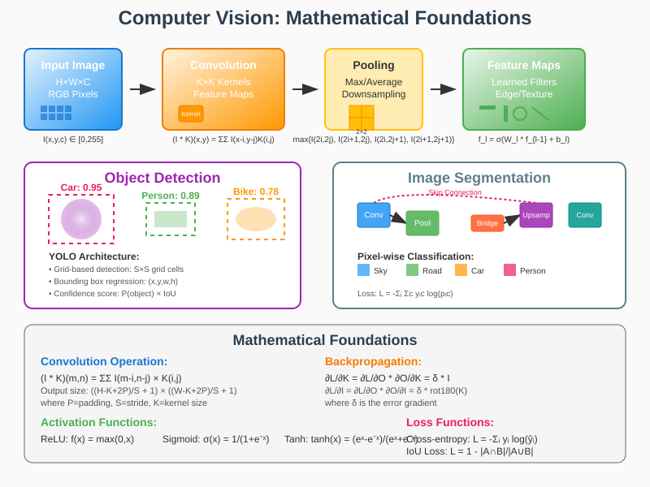

# Computer Vision: Mathematical Foundations and Applications



## Overview

Computer vision represents one of the most mathematically sophisticated and practically impactful areas of artificial intelligence. This field combines advanced mathematical concepts from linear algebra, signal processing, optimization theory, and statistical learning to enable machines to interpret and understand visual information. From autonomous vehicles navigating complex environments to medical imaging systems diagnosing diseases, computer vision applications rely on rigorous mathematical foundations to achieve human-level and superhuman performance in visual tasks.

## Mathematical Foundations

### 1. Image Representation and Processing

#### Digital Image Mathematics

**Image as Mathematical Function**:
A digital image can be represented as a discrete function:
```
I: Ω → ℝᵈ
```
Where:
- Ω ⊆ ℤ² is the spatial domain (pixel coordinates)
- d is the number of channels (1 for grayscale, 3 for RGB)
- I(x,y) ∈ [0,255] typically for 8-bit images

**Grayscale Image**:
```
I(x,y) ∈ ℝ, where (x,y) ∈ {0,1,...,W-1} × {0,1,...,H-1}
```

**Color Image (RGB)**:
```
I(x,y) = [I_R(x,y), I_G(x,y), I_B(x,y)]ᵀ ∈ ℝ³
```

#### Image Preprocessing

**Normalization**:
```
I_norm(x,y) = (I(x,y) - μ) / σ
```
Where μ and σ are the mean and standard deviation.

**Gamma Correction**:
```
I_corrected(x,y) = I(x,y)^(1/γ)
```

**Histogram Equalization**:
```
T(r_k) = (L-1) Σᵢ₌₀ᵏ p_r(r_i)
```
Where p_r(r_i) is the probability of intensity level r_i.

### 2. Convolutional Neural Networks (CNNs)

#### Mathematical Definition of Convolution

**2D Discrete Convolution**:
```
(I * K)(m,n) = ΣΣ I(m-i,n-j) × K(i,j)
```

**Cross-Correlation** (commonly used in deep learning):
```
(I ⊛ K)(m,n) = ΣΣ I(m+i,n+j) × K(i,j)
```

#### Convolutional Layer Mathematics

**Feature Map Computation**:
```
Y_k = σ(Σᵢ (X_i * W_k^i) + b_k)
```
Where:
- Y_k is the k-th output feature map
- X_i is the i-th input feature map
- W_k^i is the convolution kernel
- b_k is the bias term
- σ is the activation function

**Output Dimensions**:
```
Output_height = ⌊(Input_height + 2×Padding - Kernel_height)/Stride + 1⌋
Output_width = ⌊(Input_width + 2×Padding - Kernel_width)/Stride + 1⌋
```

#### Pooling Operations

**Max Pooling**:
```
P(i,j) = max_{(m,n)∈R(i,j)} I(m,n)
```
Where R(i,j) is the pooling region centered at (i,j).

**Average Pooling**:
```
P(i,j) = (1/|R(i,j)|) Σ_{(m,n)∈R(i,j)} I(m,n)
```

**Fractional Max Pooling**:
Uses random or pseudorandom pooling regions for regularization.

#### Backpropagation in CNNs

**Gradient w.r.t. Kernels**:
```
∂L/∂W_k = ∂L/∂Y * (∂Y/∂W_k) = δ_k * X
```

**Gradient w.r.t. Input**:
```
∂L/∂X = Σₖ (δ_k * rot180(W_k))
```

Where rot180 denotes 180-degree rotation of the kernel.

### 3. Advanced CNN Architectures

#### ResNet: Residual Learning

**Residual Block**:
```
F(x) = H(x) - x
H(x) = F(x) + x
```

**Mathematical Justification**:
If the optimal function is closer to identity mapping, it's easier to learn F(x) = 0 than H(x) = x.

**Gradient Flow**:
```
∂L/∂x_l = ∂L/∂x_L × (1 + ∂F/∂x_l)
```
The "+1" term ensures gradients can flow directly.

#### Inception Networks

**Multi-scale Feature Extraction**:
```
Output = Concat[Conv1×1(x), Conv3×3(x), Conv5×5(x), Pool3×3(x)]
```

**Dimension Reduction**:
```
Conv3×3_reduced = Conv3×3(Conv1×1(x))
```
Reduces computational complexity from O(d₁×d₂×k²) to O(d₁×d'×1² + d'×d₂×k²).

#### DenseNet

**Dense Connectivity**:
```
x_l = H_l([x₀, x₁, ..., x_{l-1}])
```
Where [·] denotes concatenation.

**Composite Function**:
```
H_l(·) = Conv3×3(ReLU(BatchNorm(·)))
```

### 4. Object Detection

#### Region-based CNN (R-CNN) Family

**R-CNN Pipeline**:
1. **Region Proposal**: Selective Search generates ~2000 proposals
2. **Feature Extraction**: CNN features for each proposal
3. **Classification**: SVM classifier for each category
4. **Bounding Box Regression**: Linear regression for box refinement

**Mathematical Formulation**:
```
L = L_cls + λ × L_reg
```
Where:
```
L_cls = -log p(y|x)  (classification loss)
L_reg = smooth_L1(t - v)  (regression loss)
```

#### Fast R-CNN

**ROI Pooling**:
```
ROI_pool(x) = MaxPool(x[y₁:y₂, x₁:x₂])
```
Converts variable-size ROIs to fixed-size feature maps.

**Multi-task Loss**:
```
L = (1/N_cls) Σᵢ L_cls(pᵢ, p*ᵢ) + λ(1/N_reg) Σᵢ p*ᵢ L_reg(tᵢ, t*ᵢ)
```

#### YOLO (You Only Look Once)

**Grid-based Detection**:
Divide image into S×S grid. Each cell predicts:
- B bounding boxes: (x, y, w, h, confidence)
- C class probabilities

**Confidence Score**:
```
Confidence = P(Object) × IoU_{truth}^{pred}
```

**Loss Function**:
```
L = λ_coord Σᵢ Σⱼ 𝟙ᵢⱼᵒᵇʲ [(xᵢ - x̂ᵢ)² + (yᵢ - ŷᵢ)²]
  + λ_coord Σᵢ Σⱼ 𝟙ᵢⱼᵒᵇʲ [(√wᵢ - √ŵᵢ)² + (√hᵢ - √ĥᵢ)²]
  + Σᵢ Σⱼ 𝟙ᵢⱼᵒᵇʲ (Cᵢ - Ĉᵢ)²
  + λ_noobj Σᵢ Σⱼ 𝟙ᵢⱼⁿᵒᵒᵇʲ (Cᵢ - Ĉᵢ)²
  + Σᵢ 𝟙ᵢᵒᵇʲ Σ_c (pᵢ(c) - p̂ᵢ(c))²
```

#### Single Shot MultiBox Detector (SSD)

**Multi-scale Feature Maps**:
Uses feature maps from different layers for detecting objects of various sizes.

**Default Boxes (Anchors)**:
```
Box_scale = s_min + (s_max - s_min) × (k-1)/(m-1)
```
Where k ∈ [1,m] and m is the number of feature maps.

**Aspect Ratios**:
```
w_k^a = s_k × √(a_r)
h_k^a = s_k / √(a_r)
```

### 5. Image Segmentation

#### Semantic Segmentation

**Pixel-wise Classification**:
```
P(y = c|x) = softmax(f_c(x))
```
Where f_c(x) is the score for class c at pixel x.

**Cross-entropy Loss**:
```
L = -Σᵢ Σ_c y_{i,c} log(p_{i,c})
```

#### Fully Convolutional Networks (FCN)

**Transposed Convolution**:
```
y[i] = Σⱼ x[i-j] × k[j]
```
Upsamples feature maps to original image size.

**Skip Connections**:
Combine high-level semantic and low-level spatial information:
```
Output = Upsample(HighLevel) + LowLevel
```

#### U-Net Architecture

**Encoder-Decoder Structure**:
- **Contracting Path**: Convolution + pooling
- **Expansive Path**: Upsampling + convolution
- **Skip Connections**: Concatenate corresponding encoder and decoder features

**Mathematical Formulation**:
```
Feature_decoder = Concat(Upsample(Feature_encoder_deeper), Feature_encoder_same_level)
```

#### Intersection over Union (IoU)

**Definition**:
```
IoU = |A ∩ B| / |A ∪ B|
```

**Dice Coefficient**:
```
Dice = 2|A ∩ B| / (|A| + |B|)
```

**Focal Loss** (for class imbalance):
```
FL(p_t) = -α_t(1-p_t)^γ log(p_t)
```

### 6. Feature Detection and Description

#### Classical Feature Detectors

**Harris Corner Detection**:
```
R = det(M) - k(trace(M))²
```
Where M is the structure matrix:
```
M = Σ w(x,y) [I_x² I_x I_y; I_x I_y I_y²]
```

**SIFT (Scale-Invariant Feature Transform)**:
**Scale-space representation**:
```
L(x,y,σ) = G(x,y,σ) * I(x,y)
```
**Difference of Gaussians**:
```
D(x,y,σ) = L(x,y,kσ) - L(x,y,σ)
```

#### Learned Features

**Feature Learning Objective**:
```
min_θ Σᵢ ||f_θ(x_i) - f_θ(x_i')||² + λ||θ||²
```
Where (x_i, x_i') are corresponding patches.

### 7. Generative Models for Computer Vision

#### Variational Autoencoders (VAE)

**Evidence Lower Bound (ELBO)**:
```
log p(x) ≥ E_q[log p(x|z)] - D_KL(q(z|x)||p(z))
```

**Reparameterization Trick**:
```
z = μ + σ ⊙ ε, where ε ~ N(0,I)
```

#### Generative Adversarial Networks (GANs)

**Minimax Game**:
```
min_G max_D E_x[log D(x)] + E_z[log(1-D(G(z)))]
```

**Nash Equilibrium**:
At optimal solution:
```
D*(x) = p_data(x) / (p_data(x) + p_g(x))
```

#### Conditional GANs

**Conditional Generation**:
```
min_G max_D E_{x,y}[log D(x,y)] + E_{z,y}[log(1-D(G(z,y),y))]
```

### 8. Transfer Learning and Domain Adaptation

#### Mathematical Framework

**Domain Adaptation**:
Let S = source domain, T = target domain
```
R_T(h) ≤ R_S(h) + d_H(D_S, D_T) + λ
```
Where d_H is the H-divergence between domains.

**Fine-tuning**:
```
θ_target = argmin_θ L_target(θ) + λ||θ - θ_source||²
```

### 9. Advanced Topics

#### Attention Mechanisms in Vision

**Spatial Attention**:
```
A(x,y) = softmax(f_att(F(x,y)))
Output = Σ_{x,y} A(x,y) × F(x,y)
```

**Channel Attention**:
```
A_c = σ(MLP(GAP(F_c)) + MLP(GMP(F_c)))
Output_c = A_c × F_c
```

#### Neural Architecture Search (NAS)

**Architecture Search Space**:
```
α = {operations, connections, layer_types}
```

**Differentiable Architecture Search (DARTS)**:
```
α* = argmin_α L_val(w*(α), α)
```
Subject to: w*(α) = argmin_w L_train(w, α)

#### Self-Supervised Learning

**Contrastive Learning**:
```
L = -log(exp(sim(z_i, z_j)/τ) / Σₖ exp(sim(z_i, z_k)/τ))
```

**SimCLR Objective**:
Maximize agreement between differently augmented views of the same data.

### 10. Evaluation Metrics

#### Classification Metrics

**Top-k Accuracy**:
```
Acc@k = (1/N) Σᵢ 𝟙(y_i ∈ top_k(ŷ_i))
```

#### Detection Metrics

**Average Precision (AP)**:
```
AP = ∫₀¹ p(r) dr
```
Where p(r) is precision as a function of recall r.

**Mean Average Precision (mAP)**:
```
mAP = (1/|C|) Σ_{c∈C} AP_c
```

#### Segmentation Metrics

**Pixel Accuracy**:
```
PA = (Σᵢ n_ii) / (Σᵢ Σⱼ n_ij)
```

**Mean IoU**:
```
mIoU = (1/|C|) Σᵢ (n_ii / (Σⱼ n_ij + Σⱼ n_ji - n_ii))
```

## Real-World Applications

### 1. Medical Imaging

#### Diagnostic Applications

**X-ray Analysis**:
- Pneumonia detection: CNN-based classification
- Bone fracture identification: Object detection with localization
- COVID-19 screening: Multi-class classification with uncertainty quantification

**MRI and CT Analysis**:
- Tumor segmentation: 3D U-Net architectures
- Organ segmentation: Multi-organ segmentation networks
- Abnormality detection: Anomaly detection using autoencoders

**Mathematical Challenges**:
- **Class Imbalance**: Focal loss and balanced sampling
- **3D Processing**: 3D convolutions and memory optimization
- **Uncertainty Quantification**: Bayesian neural networks

```python
# Example: 3D U-Net for medical segmentation
def conv3d_block(input, filters):
    x = Conv3D(filters, 3, padding='same')(input)
    x = BatchNormalization()(x)
    x = Activation('relu')(x)
    return x

# Dice loss for medical segmentation
def dice_loss(y_true, y_pred):
    smooth = 1.0
    intersection = K.sum(y_true * y_pred)
    union = K.sum(y_true) + K.sum(y_pred)
    return 1 - (2 * intersection + smooth) / (union + smooth)
```

### 2. Autonomous Vehicles

#### Perception Pipeline

**Object Detection and Tracking**:
- Multi-object tracking: Kalman filtering with deep learning
- 3D object detection: Point cloud processing with PointNet
- Semantic segmentation: Real-time segmentation for road scene understanding

**Depth Estimation**:
- Stereo vision: Disparity map computation
- Monocular depth estimation: CNN-based depth prediction
- LiDAR fusion: Multi-modal sensor integration

**Mathematical Frameworks**:

**Kalman Filter for Object Tracking**:
```
Prediction: x̂_{k|k-1} = F_k x̂_{k-1|k-1} + B_k u_k
            P_{k|k-1} = F_k P_{k-1|k-1} F_k^T + Q_k

Update: K_k = P_{k|k-1} H_k^T (H_k P_{k|k-1} H_k^T + R_k)^{-1}
        x̂_{k|k} = x̂_{k|k-1} + K_k (z_k - H_k x̂_{k|k-1})
        P_{k|k} = (I - K_k H_k) P_{k|k-1}
```

**Stereo Vision Mathematics**:
```
Depth = (baseline × focal_length) / disparity
```

### 3. Industrial Quality Control

#### Defect Detection

**Surface Inspection**:
- Anomaly detection using autoencoders
- Defect classification with CNNs
- Real-time processing requirements

**Dimensional Measurement**:
- Edge detection and measurement
- Template matching for component verification
- Sub-pixel accuracy requirements

**Mathematical Techniques**:
- **Template Matching**: Normalized cross-correlation
- **Edge Detection**: Sobel, Canny edge detectors
- **Morphological Operations**: Opening, closing, erosion, dilation

### 4. Retail and E-commerce

#### Visual Search

**Product Recognition**:
- Fine-grained classification
- Similarity search using learned embeddings
- Style transfer and recommendation

**Inventory Management**:
- Automated counting using object detection
- Shelf monitoring with real-time analysis
- Brand recognition and compliance checking

### 5. Security and Surveillance

#### Face Recognition

**Face Detection Pipeline**:
1. **Face Detection**: MTCNN, RetinaFace
2. **Face Alignment**: Landmark detection and geometric normalization
3. **Feature Extraction**: Deep face embeddings (FaceNet, ArcFace)
4. **Matching**: Cosine similarity or Euclidean distance

**ArcFace Loss**:
```
L = -log(e^{s(cos(θ_{yi} + m))} / (e^{s(cos(θ_{yi} + m))} + Σⱼ≠ᵧᵢ e^{s cos θⱼ}))
```

#### Activity Recognition

**Temporal Modeling**:
- 3D CNNs for spatiotemporal features
- LSTM networks for sequence modeling
- Transformer architectures for long-range dependencies

### 6. Agriculture and Environmental Monitoring

#### Crop Monitoring

**Satellite Image Analysis**:
- Multi-spectral image processing
- Change detection algorithms
- Vegetation index calculation (NDVI)

**Disease Detection**:
- Plant disease classification
- Early warning systems
- Yield prediction models

**NDVI Calculation**:
```
NDVI = (NIR - Red) / (NIR + Red)
```
Where NIR is near-infrared and Red is red band reflectance.

## Implementation Considerations

### 1. Computational Optimization

#### Memory Management

**Gradient Checkpointing**:
Trade computation for memory by recomputing intermediate activations.

**Mixed Precision Training**:
Use FP16 for forward pass, FP32 for gradients:
```python
# PyTorch example
with torch.cuda.amp.autocast():
    output = model(input)
    loss = criterion(output, target)

scaler.scale(loss).backward()
scaler.step(optimizer)
scaler.update()
```

#### Model Compression

**Quantization**:
```
Q(x) = round(x/s) - z
```
Where s is scale factor and z is zero point.

**Knowledge Distillation**:
```
L = α × L_CE(y, σ(z_s/T)) + (1-α) × L_CE(σ(z_t/T), σ(z_s/T))
```

### 2. Data Augmentation

#### Geometric Transformations

**Affine Transformations**:
```
[x'; y'; 1] = [a b c; d e f; 0 0 1] × [x; y; 1]
```

**Perspective Transformation**:
```
x' = (ax + by + c) / (gx + hy + 1)
y' = (dx + ey + f) / (gx + hy + 1)
```

#### Advanced Augmentation

**CutMix**:
Combine two images by replacing rectangular regions:
```
x̃ = M ⊙ x_A + (1-M) ⊙ x_B
ỹ = λy_A + (1-λ)y_B
```

**MixUp**:
```
x̃ = λx_i + (1-λ)x_j
ỹ = λy_i + (1-λ)y_j
```

### 3. Model Interpretability

#### Gradient-based Methods

**Grad-CAM**:
```
α_k^c = (1/Z) ΣᵢΣⱼ (∂y^c/∂A_{ij}^k)
L_Grad-CAM^c = ReLU(Σₖ α_k^c A^k)
```

**Integrated Gradients**:
```
IG_i(x) = (x_i - x'_i) × ∫₀¹ (∂F(x' + α(x-x'))/∂x_i) dα
```

#### Attention Visualization

**Attention Rollout**:
Visualize attention flow through transformer layers:
```
A_rollout = Π_{l=1}^L A_l
```

## Future Directions and Research Challenges

### 1. Emerging Architectures

#### Vision Transformers (ViTs)

**Self-Attention for Images**:
```
Attention(Q,K,V) = softmax(QK^T/√d_k)V
```
Applied to image patches treated as sequences.

**Mathematical Innovation**:
- Positional embeddings for spatial relationships
- Multi-head attention for different feature aspects
- Hierarchical processing with patch merging

### 2. Few-Shot and Zero-Shot Learning

#### Mathematical Formulation

**Prototypical Networks**:
```
p(y=k|x) = softmax(-d(f_φ(x), c_k))
```
Where c_k is the prototype for class k.

**Relation Networks**:
```
r_{i,j} = g_φ(f_θ(x_i), f_θ(x_j))
```

### 3. Continual Learning

#### Catastrophic Forgetting Mitigation

**Elastic Weight Consolidation (EWC)**:
```
L(θ) = L_B(θ) + Σᵢ (λᵢ/2)(θᵢ - θ_{A,i})²
```

**Progressive Neural Networks**:
Lateral connections between task-specific columns.

### 4. Multimodal Learning

#### Vision-Language Models

**CLIP Architecture**:
Joint training of image and text encoders:
```
L = -log(p(text|image)) - log(p(image|text))
```

**Mathematical Framework**:
Contrastive learning between vision and language representations.

## Conclusion

Computer vision represents a convergence of advanced mathematical theories with practical engineering challenges. The field's rapid advancement is driven by:

1. **Deep Mathematical Foundations**: Rigorous understanding of convolution, optimization, and statistical learning theory
2. **Architectural Innovations**: Novel network designs addressing specific visual challenges
3. **Computational Advances**: Efficient implementations enabling real-time processing
4. **Diverse Applications**: Wide range of real-world problems driving continued research

The mathematical frameworks presented here provide the theoretical foundation for understanding current computer vision systems and developing future innovations. As the field continues to evolve, new mathematical tools and concepts will emerge to address increasingly complex visual understanding challenges.

Understanding these mathematical foundations enables practitioners to:
- Design appropriate architectures for specific vision tasks
- Debug and optimize model performance systematically
- Adapt existing methods to novel applications
- Contribute to the theoretical advancement of the field

The future of computer vision lies in the continued integration of mathematical rigor with practical innovation, enabling machines to achieve human-level and superhuman performance in visual understanding tasks.