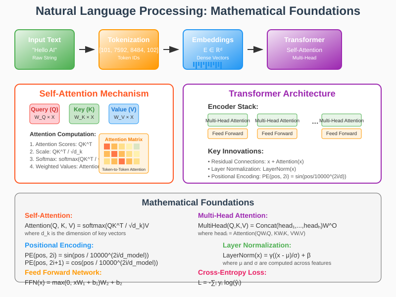

# Natural Language Processing: Mathematical Foundations and Applications



## Overview

Natural Language Processing (NLP) represents one of the most challenging and mathematically sophisticated areas of artificial intelligence, requiring the integration of linguistics, computer science, and advanced mathematics. This field combines concepts from linear algebra, probability theory, information theory, and optimization to enable machines to understand, interpret, and generate human language at scale.

## Mathematical Foundations

### 1. Text Representation and Embeddings

#### Vector Space Models
**Term Frequency-Inverse Document Frequency (TF-IDF)**:
```
TF-IDF(t,d) = TF(t,d) × IDF(t)
```
Where:
```
TF(t,d) = f(t,d) / max{f(w,d) : w ∈ d}
IDF(t) = log(|D| / |{d ∈ D : t ∈ d}|)
```

**Word2Vec Skip-gram Model**:
Objective function:
```
J = -1/T ∑(t=1 to T) ∑(-c≤j≤c,j≠0) log p(w(t+j)|w(t))
```

**Softmax Probability**:
```
p(w_O|w_I) = exp(v'_(w_O)^T v_(w_I)) / ∑(w=1 to W) exp(v'_w^T v_(w_I))
```

### 2. Transformer Architecture

#### Self-Attention Mechanism
**Scaled Dot-Product Attention**:
```
Attention(Q,K,V) = softmax(QK^T/√d_k)V
```

**Multi-Head Attention**:
```
MultiHead(Q,K,V) = Concat(head_1,...,head_h)W^O
head_i = Attention(QW_i^Q, KW_i^K, VW_i^V)
```

#### Positional Encoding
**Sinusoidal Position Encoding**:
```
PE(pos,2i) = sin(pos/10000^(2i/d_model))
PE(pos,2i+1) = cos(pos/10000^(2i/d_model))
```

### 3. Language Models

#### N-gram Language Models
**Probability Estimation**:
```
P(w_n|w_1^(n-1)) ≈ P(w_n|w_(n-N+1)^(n-1))
```

**Maximum Likelihood Estimation**:
```
P_ML(w_n|w_(n-N+1)^(n-1)) = C(w_(n-N+1)^n) / C(w_(n-N+1)^(n-1))
```

#### Neural Language Models
**LSTM Language Model**:
```
h_t = LSTM(x_t, h_(t-1))
P(w_t|w_1^(t-1)) = softmax(W_o h_t + b_o)
```

**Transformer Language Model**:
```
P(x_t|x_1,...,x_(t-1)) = softmax(W_e h_t)
```

## Real-World Applications

### 1. Machine Translation
- **Neural Machine Translation (NMT)**: Encoder-decoder architectures
- **Attention Mechanisms**: Alignment between source and target sequences
- **BLEU Score Evaluation**: Precision-based automatic evaluation

### 2. Sentiment Analysis
- **Binary Classification**: Positive/negative sentiment detection
- **Multi-class Classification**: Fine-grained emotion recognition
- **Aspect-based Sentiment**: Entity-specific opinion mining

### 3. Question Answering
- **Reading Comprehension**: Extract answers from passages
- **Knowledge-based QA**: Retrieve information from knowledge graphs
- **Conversational AI**: Multi-turn dialogue systems

### 4. Text Summarization
- **Extractive Summarization**: Select important sentences
- **Abstractive Summarization**: Generate novel summary text
- **Multi-document Summarization**: Synthesize multiple sources

### 5. Named Entity Recognition
- **Sequence Labeling**: BIO tagging scheme
- **Conditional Random Fields**: Structured prediction
- **BERT-based Models**: Contextual embeddings

## Mathematical Techniques

### Information Theory in NLP
**Cross-Entropy Loss**:
```
H(p,q) = -∑_i p_i log(q_i)
```

**Perplexity**:
```
PP(W) = P(w_1 w_2 ... w_N)^(-1/N)
```

### Optimization Methods
**Adam Optimizer**:
```
m_t = β_1 m_(t-1) + (1-β_1)g_t
v_t = β_2 v_(t-1) + (1-β_2)g_t^2
θ_t = θ_(t-1) - α m̂_t/(√v̂_t + ε)
```

### Regularization Techniques
**Dropout**:
```
y = f(W(r ⊙ x) + b)
```
Where r ~ Bernoulli(p)

## Implementation Considerations

### Computational Efficiency
- **Gradient Checkpointing**: Memory-computation trade-off
- **Mixed Precision Training**: FP16/FP32 optimization
- **Model Parallelism**: Distribute large models across devices

### Evaluation Metrics
- **ROUGE**: Recall-oriented evaluation for summarization
- **BLEU**: Precision-based metric for translation
- **F1 Score**: Harmonic mean of precision and recall

This mathematical framework enables the development of sophisticated NLP systems capable of understanding and generating human language with remarkable accuracy and fluency.