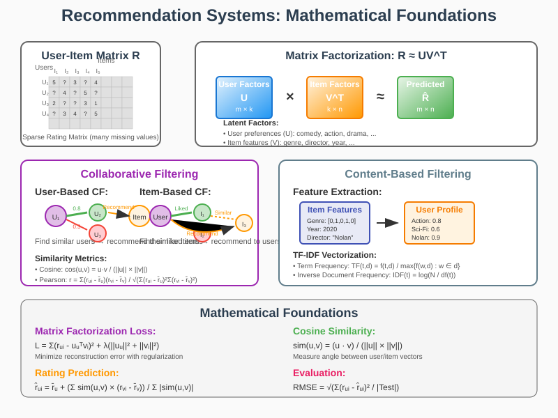

# Recommendation Systems: Mathematical Foundations and Applications



## Overview

Recommendation systems represent one of the most commercially successful applications of machine learning, powering everything from e-commerce platforms to streaming services. These systems leverage sophisticated mathematical techniques from linear algebra, optimization theory, and statistical learning to predict user preferences and deliver personalized content at scale.

## Mathematical Foundations

### 1. Matrix Factorization

#### Basic Matrix Factorization Model
**Problem Formulation**:
```
R ≈ UV^T
```
Where:
- R ∈ ℝ^(m×n): User-item rating matrix (sparse)
- U ∈ ℝ^(m×k): User latent factor matrix
- V ∈ ℝ^(n×k): Item latent factor matrix
- k: Number of latent factors (dimensionality)

**Objective Function**:
```
L = Σ(r_ui - u_u^T v_i)^2 + λ(||u_u||^2 + ||v_i||^2)
```

#### Singular Value Decomposition (SVD)
**Mathematical Framework**:
```
R = UΣV^T
```
Where:
- U: Left singular vectors (user space)
- Σ: Diagonal matrix of singular values
- V^T: Right singular vectors (item space)

**Truncated SVD for Dimensionality Reduction**:
```
R_k = U_k Σ_k V_k^T
```
Using only the top k singular values.

### 2. Collaborative Filtering

#### User-Based Collaborative Filtering
**Similarity Computation**:
```
sim(u,v) = cos(u,v) = (u·v)/(||u|| × ||v||)
```

**Pearson Correlation**:
```
sim(u,v) = Σ(r_ui - r̄_u)(r_vi - r̄_v) / √(Σ(r_ui - r̄_u)^2 Σ(r_vi - r̄_v)^2)
```

**Rating Prediction**:
```
r̂_ui = r̄_u + (Σ_v∈N(u) sim(u,v) × (r_vi - r̄_v)) / Σ_v∈N(u) |sim(u,v)|
```

#### Item-Based Collaborative Filtering
**Item Similarity**:
```
sim(i,j) = Σ_u∈U(i)∩U(j) r_ui × r_uj / √(Σ_u∈U(i) r_ui^2 × Σ_u∈U(j) r_uj^2)
```

**Prediction Formula**:
```
r̂_ui = (Σ_j∈I(u) sim(i,j) × r_uj) / Σ_j∈I(u) |sim(i,j)|
```

### 3. Content-Based Filtering

#### TF-IDF Vectorization
**Term Frequency**:
```
TF(t,d) = f(t,d) / max{f(w,d) : w ∈ d}
```

**Inverse Document Frequency**:
```
IDF(t) = log(N / df(t))
```

**TF-IDF Score**:
```
TF-IDF(t,d) = TF(t,d) × IDF(t)
```

#### User Profile Construction
**Weighted Average Profile**:
```
profile(u) = Σ_i∈I(u) r_ui × features(i) / Σ_i∈I(u) r_ui
```

### 4. Advanced Techniques

#### Non-Negative Matrix Factorization (NMF)
**Constrained Optimization**:
```
min ||R - UV^T||_F^2
subject to: U,V ≥ 0
```

**Multiplicative Update Rules**:
```
U ← U ⊙ (RV) ⊘ (UV^T V)
V ← V ⊙ (R^T U) ⊘ (VU^T U)
```

#### Deep Learning for Recommendations
**Neural Collaborative Filtering**:
```
ŷ_ui = f(P_u, Q_i | θ_f)
```
Where f is a neural network with parameters θ_f.

## Real-World Applications

### 1. E-commerce Platforms
- **Product Recommendations**: Amazon's item-to-item collaborative filtering
- **Cross-selling**: Related product suggestions
- **Bundle Recommendations**: Frequently bought together

### 2. Streaming Services
- **Content Discovery**: Netflix's recommendation engine
- **Sequential Recommendations**: Next episode/movie suggestions
- **Cold Start Solutions**: Popularity-based recommendations for new users

### 3. Social Media
- **Friend Recommendations**: Graph-based similarity metrics
- **Content Feed Curation**: Personalized timeline generation
- **Ad Targeting**: User interest prediction

### 4. Music Streaming
- **Playlist Generation**: Spotify's algorithmic playlists
- **Song Radio**: Similar song recommendations
- **Discovery Features**: New music based on listening history

## Implementation Considerations

### Scalability Solutions
- **Approximate Algorithms**: LSH for similarity computation
- **Distributed Computing**: Spark-based matrix factorization
- **Online Learning**: Real-time model updates

### Evaluation Metrics
- **Accuracy Metrics**: RMSE, MAE
- **Ranking Metrics**: Precision@k, Recall@k, NDCG
- **Diversity Metrics**: Intra-list diversity, coverage

### Cold Start Problem
- **Content-Based Hybrid**: Use item features for new items
- **Popularity-Based**: Recommend trending items
- **Active Learning**: Strategic user queries

This mathematical framework enables the development of sophisticated recommendation systems capable of delivering highly personalized experiences while maintaining computational efficiency at scale.