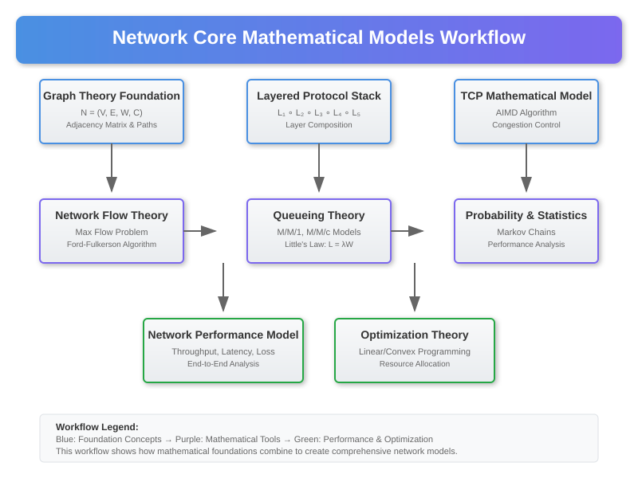

# Core Mathematical Models in Networking



## Overview

Modern networking's exceptional performance in global communications stems from sophisticated mathematical foundations. This section explores the core mathematical models that enable networks to achieve fault-tolerant, high-performance distributed communication through elegant abstractions and optimizations.

## 1. Graph Theory Foundation for Network Topology

### Mathematical Definition

A network can be formally defined as a mathematical graph structure:

```
N = (V, E, W, C)
```

Where:
- **V**: Set of network nodes `{v₁, v₂, ..., vₙ}` (routers, switches, hosts)
- **E**: Set of network edges `{e₁, e₂, ..., eₘ}` (physical/logical links)
- **W**: Weight function `W: E → ℝ⁺` (latency, bandwidth, cost)
- **C**: Capacity function `C: E → ℝ⁺` (maximum throughput per link)

### Network Connectivity Mathematics

**Adjacency Matrix Representation**:
```
A[i,j] = {
    W(e_{ij})  if edge exists between vertices i and j
    ∞          otherwise
}
```

**Path Cost Calculation**:
```
cost(path) = Σ(i=1 to k-1) W(e_{v_i, v_{i+1}})
```

**Shortest Path Properties**:
- **Optimal Substructure**: Every subpath of a shortest path is shortest
- **Bellman Equation**: `d(u,v) = min{d(u,w) + W(w,v) : w ∈ neighbors(v)}`
- **Triangle Inequality**: `d(u,v) ≤ d(u,w) + d(w,v)` for all vertices u,v,w

### Network Flow Theory

**Maximum Flow Problem**:
```
maximize: Σ f(s,v) - Σ f(v,s)
subject to:
    f(u,v) ≤ C(u,v)                    (capacity constraint)
    Σ f(u,v) = Σ f(v,w)                (flow conservation)
    f(u,v) ≥ 0                         (non-negativity)
```

**Ford-Fulkerson Algorithm**:
```
function maxFlow(G, source, sink):
    flow = 0
    while exists augmenting path P from source to sink:
        bottleneck = min{C(e) - f(e) : e ∈ P}
        for each edge e in P:
            f(e) += bottleneck
        flow += bottleneck
    return flow
```

**Network Reliability Analysis**:
- **Edge Connectivity**: Minimum number of edges to disconnect graph
- **Vertex Connectivity**: Minimum number of vertices to disconnect graph
- **Network Reliability**: `R = Π(1 - p_i)` where p_i is failure probability of component i

## 2. Layered Protocol Stack Mathematical Model

### Protocol Layer Abstraction

**Layer Function Composition**:
```
Application_Layer ∘ Transport_Layer ∘ Network_Layer ∘ Link_Layer ∘ Physical_Layer
```

Each layer can be modeled as a mathematical transformation:
```
L_i: D_i → D_{i-1}
```
Where `D_i` is the data domain at layer i.

### TCP Mathematical Model

**Additive Increase Multiplicative Decrease (AIMD)**:
```
cwnd(t+1) = {
    cwnd(t) + 1/cwnd(t)     if no congestion detected
    cwnd(t) × β             if congestion detected
}
```
Where β ∈ (0,1) is the multiplicative decrease factor (typically 0.5).

**TCP Throughput Model (Mathis Formula)**:
```
Throughput ≈ (MSS × C) / (RTT × √p)
```
Where:
- MSS: Maximum Segment Size
- C: Protocol constant (≈ 1.22)
- RTT: Round-trip time
- p: Packet loss probability

**Congestion Window Dynamics**:
```
dW/dt = 1/RTT - W²p(W)/(2RTT)
```
This differential equation models TCP's congestion control behavior.

### Queueing Theory for Network Performance

**M/M/1 Queue Model** (Single server, Poisson arrivals, exponential service):
```
ρ = λ/μ (utilization factor)
L = ρ/(1-ρ) (average number in system)
W = ρ/[μ(1-ρ)] = L/λ (average waiting time)
Wq = ρ²/[μ(1-ρ)] (average queue waiting time)
```

**M/M/c Queue** (Multiple servers):
```
P₀ = [Σ(k=0 to c-1) (ρᵏ/k!) + (ρᶜ/c!) × 1/(1-ρ/c)]⁻¹

L = ρ + (ρᶜ⁺¹/c!) × P₀/(c-1)! × (c-ρ)²

W = L/λ
```

**Little's Law**: `L = λW` (fundamental relationship in queueing systems)

### Packet Scheduling Mathematics

**Weighted Fair Queueing (WFQ)**:
```
Virtual_Finish_Time(packet_i) = max(Virtual_Start_Time, Current_Virtual_Time) + Packet_Length_i/Weight_i
```

**Earliest Deadline First (EDF)**:
```
Priority(packet_i) = Deadline_i - Current_Time
```

**Deficit Round Robin (DRR)**:
```
if Deficit[queue] >= Packet_Size:
    Transmit packet
    Deficit[queue] -= Packet_Size
else:
    Deficit[queue] += Quantum
```

## 3. Routing Algorithm Mathematics

### Distance Vector Protocols

**Bellman-Ford Distributed Algorithm**:
```
D_x(y) = min_v{c(x,v) + D_v(y)}
```

**Routing Information Protocol (RIP) Update**:
```
for each destination y:
    for each neighbor v:
        if D_x(y) > c(x,v) + D_v(y):
            D_x(y) = c(x,v) + D_v(y)
            next_hop(y) = v
```

### Link State Protocols

**Dijkstra's Algorithm Implementation**:
```
function dijkstra(G, source):
    dist[source] = 0
    for each vertex v ≠ source:
        dist[v] = ∞
    
    Q = all vertices in G
    while Q is not empty:
        u = vertex in Q with minimum dist[u]
        remove u from Q
        
        for each neighbor v of u:
            alt = dist[u] + weight(u,v)
            if alt < dist[v]:
                dist[v] = alt
                previous[v] = u
    
    return dist, previous
```

**OSPF Area Mathematics**:
- **Area 0**: Backbone area, must be connected
- **Stub Areas**: Reduce routing table size by excluding external routes
- **Path Cost**: `Cost = Reference_Bandwidth / Interface_Bandwidth`

### Border Gateway Protocol (BGP) Mathematics

**Path Vector Algorithm**:
```
Best_Path = argmax{Local_Pref(path), AS_Path_Length⁻¹, Origin_Type, MED⁻¹}
```

**BGP Decision Process** (in order):
1. Highest Local Preference
2. Shortest AS Path
3. Lowest Origin Type (IGP < EGP < Incomplete)
4. Lowest Multi-Exit Discriminator (MED)
5. External over Internal paths
6. Lowest IGP cost to next hop
7. Lowest Router ID

## 4. Information Theory in Networking

### Shannon's Theorems for Network Capacity

**Channel Capacity (Shannon-Hartley)**:
```
C = B × log₂(1 + S/N)
```
Where:
- C: Maximum error-free data rate (bits/second)
- B: Channel bandwidth (Hz)
- S/N: Signal-to-noise ratio

**Network Coding Capacity**:
For a network with multiple sources and destinations:
```
C_network = min{max-flow from sources to destinations}
```

### Error Detection and Correction

**Hamming Distance Mathematics**:
- **Error Detection**: Requires minimum distance d = e + 1
- **Error Correction**: Requires minimum distance d = 2e + 1
- **Hamming Bound**: `2ʳ ≥ n + 1` for single-error correction

**Cyclic Redundancy Check (CRC)**:
```
Remainder = Message(x) × x^r mod Generator(x)
```
Where r is the degree of the generator polynomial.

**Reed-Solomon Codes**:
```
n = 2^m - 1 (codeword length)
k = information symbols
t = (n-k)/2 (error correction capability)
```

### Network Coding Theory

**Linear Network Coding**:
```
y = Σ(i=1 to k) α_i × x_i mod p
```
Where y is output, x_i are inputs, α_i are coding coefficients.

**Butterfly Network Example**:
```
Capacity without coding: 1.5 units
Capacity with coding: 2 units
Improvement: 33.3%
```

## 5. Security Mathematics in Networking

### Cryptographic Protocol Foundations

**Diffie-Hellman Key Exchange**:
```
Public: prime p, generator g
Alice: chooses private a, computes g^a mod p
Bob: chooses private b, computes g^b mod p
Shared secret: (g^a)^b ≡ (g^b)^a ≡ g^(ab) mod p
```

**RSA Digital Signatures**:
```
Key generation: n = p×q, φ(n) = (p-1)(q-1)
Public key: (n,e) where gcd(e,φ(n)) = 1
Private key: d where ed ≡ 1 mod φ(n)
Signature: S = H(m)^d mod n
Verification: H(m) ≟ S^e mod n
```

### Network Security Analysis

**Attack Surface Mathematics**:
```
Attack_Surface = Σ(Access_Points × Vulnerabilities × Asset_Value)
```

**Security Risk Assessment**:
```
Risk = Threat_Probability × Vulnerability_Exploitability × Impact_Severity
```

**Intrusion Detection Statistical Models**:
- **Normal Behavior Modeling**: Using Gaussian distributions
- **Anomaly Detection**: χ² test for statistical deviation
- **False Positive Rate**: P(alarm | normal behavior)
- **False Negative Rate**: P(no alarm | attack)

## 6. Mobile Network Mathematics

### Cellular Network Coverage

**Path Loss Models**:
**Free Space Path Loss**:
```
FSPL(dB) = 20log₁₀(d) + 20log₁₀(f) + 32.45
```
Where d is distance in km, f is frequency in MHz.

**Hata Model** (for urban environments):
```
L = 69.55 + 26.16log₁₀(f) - 13.82log₁₀(h_b) + (44.9 - 6.55log₁₀(h_b))log₁₀(d) - a(h_m)
```

### Handoff Decision Mathematics

**Signal Strength Based Handoff**:
```
Handoff_Decision = {
    Switch to cell j if: RSSI_j > RSSI_current + Hysteresis_Margin
    Stay with current if: RSSI_current ≥ RSSI_j - Hysteresis_Margin
}
```

**Mobility Model (Random Waypoint)**:
```
P(X(t+Δt) = j | X(t) = i) = {
    1 - Σ(k≠i) λ_ik × Δt     if j = i
    λ_ij × Δt               if j ≠ i
}
```

### 5G Mathematical Foundations

**Massive MIMO Capacity**:
```
C = log₂(det(I + (ρ/σ²) × H × H^H))
```
Where H is the channel matrix, ρ is transmit power, σ² is noise variance.

**Beamforming Optimization**:
```
maximize: |w^H × h|²
subject to: ||w||² = 1
```
Solution: `w = h*/||h||` (matched filter)

## Mathematical Properties That Enable Network Performance

### 1. Scalability Through Hierarchical Design

**Network Diameter**: O(log n) for tree topologies
**Routing Table Size**: O(log n) with hierarchical addressing
**Convergence Time**: O(n) for distance vector, O(n log n) for link state

### 2. Fault Tolerance Through Redundancy

**Network Reliability**:
```
R_parallel = 1 - Π(1 - R_i)     (parallel paths)
R_series = Π(R_i)               (series components)
```

**k-Connected Networks**: Require k edge-disjoint paths between any two nodes

### 3. Performance Through Mathematical Optimization

**Traffic Engineering**: Linear programming for optimal flow allocation
**Quality of Service**: Optimization with multiple constraints
**Resource Allocation**: Game theory for fair resource sharing

## Business Impact: Mathematical Networking in Practice

Understanding these mathematical foundations enables network engineers to:

1. **Design Optimal Topologies**: Using graph theory for minimal cost and maximum reliability
2. **Predict Performance**: Through queueing theory and statistical modeling
3. **Optimize Routing**: Via shortest path algorithms and traffic engineering
4. **Ensure Security**: Using cryptographic protocols and statistical anomaly detection
5. **Scale Systems**: Through hierarchical design and mathematical analysis
6. **Troubleshoot Systematically**: Using mathematical models for root cause analysis

The mathematics of networking transforms complex communication challenges into solvable optimization problems, enabling the global Internet infrastructure we depend on today.