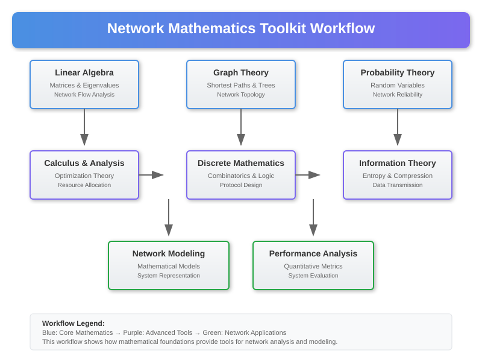

# Mathematical Toolkit for Network Analysis



## Overview

This section provides the essential mathematical tools and techniques used in modern network analysis, optimization, and design. These tools form the foundation for understanding network behavior, predicting performance, and solving complex networking problems.

## 1. Linear Algebra for Network Systems

### Matrix Representations of Networks

**Adjacency Matrix**:
```
A = [a_ij] where a_ij = {
    1 if there is an edge from i to j
    0 otherwise
}
```

**Weighted Adjacency Matrix**:
```
W = [w_ij] where w_ij = weight of edge (i,j)
```

**Incidence Matrix** (for directed graphs):
```
B = [b_ij] where b_ij = {
     1 if edge j leaves vertex i
    -1 if edge j enters vertex i
     0 otherwise
}
```

### Network Analysis with Eigenvalues

**Spectral Graph Theory**:
```
L = D - A (Laplacian matrix)
```
Where D is the degree matrix.

**Key Eigenvalue Properties**:
- **λ₁ = 0** (always, with eigenvector 1)
- **λ₂ > 0** (algebraic connectivity - measures how well connected the graph is)
- **λₙ ≤ 2Δ** where Δ is maximum degree

**Network Connectivity Metrics**:
```
Algebraic_Connectivity = λ₂(L)
Spectral_Radius = max{|λᵢ|}
Spectral_Gap = λ₂ - λ₁
```

### Linear Systems for Traffic Flow

**Traffic Flow Equations**:
```
Ax = b
```
Where:
- A: Network topology matrix
- x: Flow variables vector
- b: Demand vector

**Least Squares Solution** (when system is overdetermined):
```
x* = (AᵀA)⁻¹Aᵀb
```

**Regularized Solution** (Ridge regression for stability):
```
x* = (AᵀA + λI)⁻¹Aᵀb
```

## 2. Graph Theory Algorithms

### Shortest Path Algorithms

**Dijkstra's Algorithm** - O(V² + E) or O((V + E) log V) with binary heap:
```python
def dijkstra(graph, start):
    distances = {node: float('infinity') for node in graph}
    distances[start] = 0
    unvisited = set(graph.nodes())
    
    while unvisited:
        current = min(unvisited, key=lambda node: distances[node])
        unvisited.remove(current)
        
        for neighbor in graph.neighbors(current):
            distance = distances[current] + graph.edge_weight(current, neighbor)
            if distance < distances[neighbor]:
                distances[neighbor] = distance
    
    return distances
```

**Floyd-Warshall Algorithm** - O(V³) for all-pairs shortest paths:
```python
def floyd_warshall(graph):
    nodes = list(graph.nodes())
    distances = {(i, j): float('inf') for i in nodes for j in nodes}
    
    # Initialize distances
    for node in nodes:
        distances[(node, node)] = 0
    for edge in graph.edges():
        distances[edge] = graph.edge_weight(edge)
    
    # Floyd-Warshall iterations
    for k in nodes:
        for i in nodes:
            for j in nodes:
                distances[(i, j)] = min(distances[(i, j)], 
                                      distances[(i, k)] + distances[(k, j)])
    
    return distances
```

**Bellman-Ford Algorithm** - O(VE), handles negative weights:
```python
def bellman_ford(graph, start):
    distances = {node: float('infinity') for node in graph}
    distances[start] = 0
    
    # Relax edges V-1 times
    for _ in range(len(graph) - 1):
        for edge in graph.edges():
            u, v = edge
            if distances[u] + graph.edge_weight(edge) < distances[v]:
                distances[v] = distances[u] + graph.edge_weight(edge)
    
    # Check for negative cycles
    for edge in graph.edges():
        u, v = edge
        if distances[u] + graph.edge_weight(edge) < distances[v]:
            raise ValueError("Graph contains negative cycle")
    
    return distances
```

### Network Flow Algorithms

**Ford-Fulkerson Method** with DFS - O(E × max_flow):
```python
def ford_fulkerson(graph, source, sink):
    def dfs_path(graph, start, end, visited):
        if start == end:
            return [end]
        visited.add(start)
        for neighbor in graph.neighbors(start):
            if neighbor not in visited and graph.capacity(start, neighbor) > 0:
                path = dfs_path(graph, neighbor, end, visited)
                if path:
                    return [start] + path
        return None
    
    max_flow = 0
    while True:
        path = dfs_path(graph, source, sink, set())
        if not path:
            break
        
        # Find bottleneck capacity
        bottleneck = min(graph.capacity(path[i], path[i+1]) 
                        for i in range(len(path)-1))
        
        # Update residual capacities
        for i in range(len(path)-1):
            graph.decrease_capacity(path[i], path[i+1], bottleneck)
            graph.increase_capacity(path[i+1], path[i], bottleneck)
        
        max_flow += bottleneck
    
    return max_flow
```

**Edmonds-Karp Algorithm** (Ford-Fulkerson with BFS) - O(VE²):
```python
from collections import deque

def edmonds_karp(graph, source, sink):
    def bfs_path(graph, start, end):
        queue = deque([(start, [start])])
        visited = {start}
        
        while queue:
            node, path = queue.popleft()
            if node == end:
                return path
            
            for neighbor in graph.neighbors(node):
                if neighbor not in visited and graph.capacity(node, neighbor) > 0:
                    visited.add(neighbor)
                    queue.append((neighbor, path + [neighbor]))
        
        return None
    
    max_flow = 0
    while True:
        path = bfs_path(graph, source, sink)
        if not path:
            break
        
        bottleneck = min(graph.capacity(path[i], path[i+1]) 
                        for i in range(len(path)-1))
        
        for i in range(len(path)-1):
            graph.decrease_capacity(path[i], path[i+1], bottleneck)
            graph.increase_capacity(path[i+1], path[i], bottleneck)
        
        max_flow += bottleneck
    
    return max_flow
```

## 3. Probability Theory for Network Analysis

### Random Network Models

**Erdős-Rényi Random Graph G(n,p)**:
```
P(edge exists) = p
Expected degree = (n-1)p
Expected number of edges = n(n-1)p/2
```

**Scale-Free Networks (Barabási-Albert)**:
```
P(degree = k) ∝ k^(-γ)
where γ ≈ 3 for many real networks
```

**Small World Networks (Watts-Strogatz)**:
```
Clustering coefficient ≈ 3/4 × (1-p)
Average path length ∝ ln(n)/ln(⟨k⟩)
```

### Packet Loss and Reliability Models

**Geometric Distribution** (for retransmission modeling):
```
P(success on trial n) = (1-p)^(n-1) × p
Expected number of trials = 1/p
Variance = (1-p)/p²
```

**Poisson Process** (for packet arrivals):
```
P(N(t) = k) = (λt)^k × e^(-λt) / k!
Inter-arrival time ~ Exponential(λ)
```

**Markov Chain Models** for protocol states:
```
Transition matrix P = [p_ij]
Steady-state: π = πP
Expected return time to state i = 1/π_i
```

### Quality of Service (QoS) Metrics

**Jitter Calculation**:
```
J_i = |D_i - D_(i-1)|
where D_i is the delay of packet i
```

**Packet Loss Rate**:
```
PLR = (Packets_Lost / Packets_Sent) × 100%
```

**Availability Calculation**:
```
A = MTBF / (MTBF + MTTR)
where MTBF = Mean Time Between Failures
      MTTR = Mean Time To Repair
```

## 4. Optimization Theory for Network Design

### Linear Programming for Traffic Engineering

**Standard Form**:
```
minimize: cᵀx
subject to: Ax = b
           x ≥ 0
```

**Dual Problem**:
```
maximize: bᵀy
subject to: Aᵀy ≤ c
```

**Network Flow LP Formulation**:
```
minimize: Σ c_ij × x_ij (minimize total cost)
subject to: 
    Σ x_ij - Σ x_ji = b_i  (flow conservation)
    x_ij ≤ u_ij            (capacity constraints)
    x_ij ≥ 0               (non-negativity)
```

### Nonlinear Optimization for Congestion Control

**TCP Optimization Problem**:
```
maximize: Σ U_s(x_s)  (aggregate utility)
subject to: Σ x_s ≤ c_l  (link capacity constraints)
           x_s ≥ 0        (non-negativity)
```

**Gradient Descent for Distributed Optimization**:
```
x_s(t+1) = [x_s(t) + α × ∇U_s(x_s(t)) - α × p_s(t)]⁺
p_l(t+1) = [p_l(t) + β × (Σ x_s(t) - c_l)]⁺
```

### Game Theory for Resource Allocation

**Nash Equilibrium**:
```
x_i* = argmax u_i(x_i, x_{-i}*)
for all players i
```

**Price of Anarchy**:
```
PoA = (Worst Nash Equilibrium) / (Social Optimum)
```

**Auction Mechanisms** (Vickrey-Clarke-Groves):
```
Payment_i = Σ_{j≠i} v_j(f(v_{-i})) - Σ_{j≠i} v_j(f(v))
```

## 5. Queueing Theory for Performance Analysis

### Single Server Queues

**M/M/1 Queue** (Poisson arrivals, exponential service):
```
ρ = λ/μ (utilization)
L = ρ/(1-ρ) (average number in system)
W = 1/(μ-λ) (average time in system)
Lq = ρ²/(1-ρ) (average number in queue)
Wq = ρ/(μ-λ) (average waiting time)
```

**M/D/1 Queue** (deterministic service time):
```
L = ρ + ρ²/(2(1-ρ))
W = 1/μ + ρ/(2μ(1-ρ))
```

**M/G/1 Queue** (general service time distribution):
```
L = ρ + (λ²σ² + ρ²)/(2(1-ρ))
where σ² is service time variance
```

### Multi-Server Queues

**M/M/c Queue**:
```
P_0 = [Σ_{k=0}^{c-1} ρᵏ/k! + (ρᶜ/c!) × 1/(1-ρ/c)]⁻¹

P_n = {
    P_0 × ρⁿ/n!           if n ≤ c
    P_0 × ρⁿ/(c! × cⁿ⁻ᶜ)   if n > c
}

L = ρ + (ρᶜ⁺¹/c!) × P_0 / [(c-1)!(c-ρ)²]
```

**Jackson Networks** (open queueing networks):
```
π(n) = ∏ᵢ πᵢ(nᵢ)
where πᵢ(nᵢ) is steady-state probability for queue i
```

### Priority Queueing Systems

**Non-Preemptive Priority**:
```
W_k = (E[S²]/(2(1-σ₀)(1-σₖ))) × (Σᵢ₌₁ᵏ λᵢ)
where σₖ = Σᵢ₌₁ᵏ ρᵢ
```

**Preemptive Priority**:
```
W_k = E[S_k]/(1-σₖ₋₁) × 1/(1-σₖ)
```

## 6. Signal Processing for Network Analysis

### Fourier Transform for Traffic Analysis

**Discrete Fourier Transform**:
```
X[k] = Σ_{n=0}^{N-1} x[n] × e^(-j2πkn/N)
```

**Power Spectral Density**:
```
S(f) = lim_{T→∞} E[|X_T(f)|²]/T
```

**Autocorrelation Function**:
```
R_x(τ) = E[x(t) × x(t+τ)]
```

### Filter Design for Traffic Shaping

**Moving Average Filter**:
```
y[n] = (1/M) × Σ_{k=0}^{M-1} x[n-k]
```

**Exponential Smoothing**:
```
y[n] = α × x[n] + (1-α) × y[n-1]
where 0 < α < 1
```

**Kalman Filter for Network State Estimation**:
```
Prediction: x̂_{k|k-1} = F × x̂_{k-1|k-1} + B × u_k
           P_{k|k-1} = F × P_{k-1|k-1} × F^T + Q

Update: K_k = P_{k|k-1} × H^T × (H × P_{k|k-1} × H^T + R)^{-1}
        x̂_{k|k} = x̂_{k|k-1} + K_k × (z_k - H × x̂_{k|k-1})
        P_{k|k} = (I - K_k × H) × P_{k|k-1}
```

## 7. Information Theory for Network Capacity

### Entropy and Information Measures

**Shannon Entropy**:
```
H(X) = -Σ p(x) × log₂(p(x))
```

**Conditional Entropy**:
```
H(Y|X) = -Σ p(x,y) × log₂(p(y|x))
```

**Mutual Information**:
```
I(X;Y) = H(X) - H(X|Y) = H(Y) - H(Y|X)
```

### Channel Capacity Analysis

**Binary Symmetric Channel**:
```
C = 1 - H(p) = 1 + p×log₂(p) + (1-p)×log₂(1-p)
```

**AWGN Channel** (Additive White Gaussian Noise):
```
C = (1/2) × log₂(1 + SNR)
```

**Multiple Access Channel**:
```
R₁ ≤ I(X₁; Y|X₂)
R₂ ≤ I(X₂; Y|X₁)  
R₁ + R₂ ≤ I(X₁,X₂; Y)
```

### Network Coding Theory

**Linear Network Coding Capacity**:
```
For multicast: C = min_{cut separating source from any sink} capacity(cut)
```

**Random Linear Network Coding**:
```
Probability of success ≈ ∏ᵢ (1 - q^{-i})
where q is field size
```

## 8. Control Theory for Network Management

### Feedback Control Systems

**PID Controller**:
```
u(t) = K_p × e(t) + K_i × ∫e(τ)dτ + K_d × de(t)/dt
```

**Transfer Function**:
```
G(s) = Y(s)/X(s) = (K_p + K_i/s + K_d×s)
```

**Stability Analysis** (Routh-Hurwitz criterion):
```
For polynomial: s³ + as² + bs + c
Stable if: a > 0, c > 0, ab > c
```

### Adaptive Control for Congestion Management

**Model Reference Adaptive Control (MRAC)**:
```
θ̇ = -Γ × φ(t) × e(t)
where Γ is adaptation gain matrix
```

**Self-Tuning Regulator**:
```
Parameter estimation: θ̂(t) = θ̂(t-1) + K(t) × [y(t) - φᵀ(t) × θ̂(t-1)]
Control law: u(t) = -θ̂ᵀ(t) × φ(t)
```

## 9. Machine Learning for Network Analytics

### Supervised Learning for Traffic Classification

**Support Vector Machine (SVM)**:
```
minimize: (1/2)||w||² + C × Σᵢ ξᵢ
subject to: yᵢ(wᵀφ(xᵢ) + b) ≥ 1 - ξᵢ
           ξᵢ ≥ 0
```

**Random Forest for Protocol Classification**:
```
Prediction = mode{T₁(x), T₂(x), ..., T_B(x)}
where Tᵢ are individual decision trees
```

### Unsupervised Learning for Anomaly Detection

**K-Means Clustering**:
```
minimize: Σᵢ Σⱼ ||xᵢ⁽ʲ⁾ - μⱼ||²
```

**Principal Component Analysis (PCA)**:
```
Covariance matrix: C = (1/n) × XᵀX
Principal components: eigenvectors of C
Anomaly score: ||x - x_reconstructed||²
```

**Isolation Forest** for outlier detection:
```
Anomaly_Score(x) = 2^(-E[h(x)]/c(n))
where h(x) is path length in isolation tree
```

### Reinforcement Learning for Network Optimization

**Q-Learning**:
```
Q(s,a) ← Q(s,a) + α[r + γ×max_a' Q(s',a') - Q(s,a)]
```

**Deep Q-Network (DQN)**:
```
Loss = E[(r + γ×max_a' Q_target(s',a') - Q(s,a))²]
```

## Practical Application Framework

### Step-by-Step Network Analysis

1. **Problem Formulation**: Define objectives and constraints mathematically
2. **Model Selection**: Choose appropriate mathematical tools based on problem type
3. **Data Collection**: Gather network measurements and performance metrics  
4. **Analysis**: Apply selected mathematical techniques
5. **Optimization**: Use optimization algorithms to improve performance
6. **Validation**: Verify results through simulation or real-world testing
7. **Implementation**: Deploy optimized solutions in production networks

### Tool Selection Guidelines

**For Routing Problems**: Graph theory algorithms (Dijkstra, Floyd-Warshall)
**For Performance Analysis**: Queueing theory models (M/M/1, M/M/c)
**For Capacity Planning**: Linear programming and network flow algorithms
**For Anomaly Detection**: Statistical methods and machine learning
**For Traffic Engineering**: Optimization theory and control systems
**For Wireless Networks**: Probability theory and signal processing

This mathematical toolkit provides the foundation for understanding, analyzing, and optimizing modern network systems across all layers and applications.