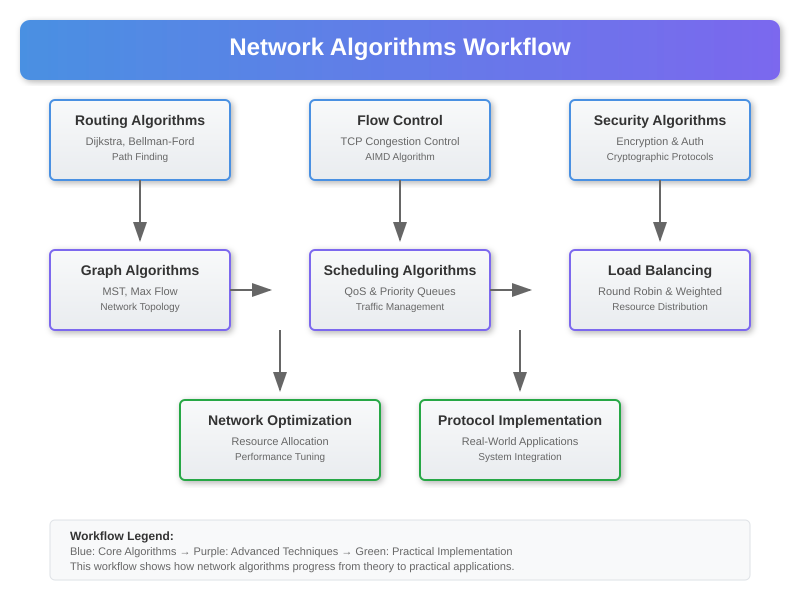

# Network Algorithms Implementation



## Overview

This section provides practical implementations of core networking algorithms that build upon the mathematical foundations and toolkit from previous sections. Each algorithm includes mathematical analysis, implementation details, complexity analysis, and performance optimization techniques.

## 1. Routing Algorithms

### Dijkstra's Algorithm for Shortest Path Routing

**Mathematical Foundation**:
```
d[v] = min{d[u] + w(u,v) : u ∈ V, (u,v) ∈ E}
```

**Implementation**:
```python
import heapq
from collections import defaultdict

class NetworkGraph:
    def __init__(self):
        self.graph = defaultdict(list)
    
    def add_edge(self, u, v, weight):
        self.graph[u].append((v, weight))
    
    def dijkstra(self, start, end=None):
        """
        Dijkstra's algorithm with priority queue optimization
        Time Complexity: O((V + E) log V)
        Space Complexity: O(V)
        """
        distances = defaultdict(lambda: float('inf'))
        distances[start] = 0
        previous = {}
        pq = [(0, start)]
        visited = set()
        
        while pq:
            current_dist, u = heapq.heappop(pq)
            
            if u in visited:
                continue
            visited.add(u)
            
            if end and u == end:
                break
                
            for v, weight in self.graph[u]:
                distance = current_dist + weight
                
                if distance < distances[v]:
                    distances[v] = distance
                    previous[v] = u
                    heapq.heappush(pq, (distance, v))
        
        return distances, previous
    
    def reconstruct_path(self, previous, start, end):
        """Reconstruct shortest path from previous nodes"""
        path = []
        current = end
        while current != start:
            path.append(current)
            current = previous[current]
        path.append(start)
        return path[::-1]
```

**Optimization for Large Networks**:
```python
class BidirectionalDijkstra:
    """
    Bidirectional search for faster pathfinding in large networks
    Expected speedup: ~2x for random graphs
    """
    def __init__(self, graph):
        self.graph = graph
        self.reverse_graph = self._build_reverse_graph()
    
    def _build_reverse_graph(self):
        reverse = defaultdict(list)
        for u in self.graph.graph:
            for v, weight in self.graph.graph[u]:
                reverse[v].append((u, weight))
        return reverse
    
    def bidirectional_dijkstra(self, start, end):
        # Forward search from start
        forward_dist = defaultdict(lambda: float('inf'))
        forward_dist[start] = 0
        forward_pq = [(0, start)]
        forward_visited = set()
        
        # Backward search from end
        backward_dist = defaultdict(lambda: float('inf'))
        backward_dist[end] = 0
        backward_pq = [(0, end)]
        backward_visited = set()
        
        best_distance = float('inf')
        meeting_point = None
        
        while forward_pq or backward_pq:
            # Forward step
            if forward_pq:
                f_dist, f_node = heapq.heappop(forward_pq)
                if f_node not in forward_visited:
                    forward_visited.add(f_node)
                    
                    if f_node in backward_visited:
                        total_dist = forward_dist[f_node] + backward_dist[f_node]
                        if total_dist < best_distance:
                            best_distance = total_dist
                            meeting_point = f_node
                    
                    for neighbor, weight in self.graph.graph[f_node]:
                        new_dist = f_dist + weight
                        if new_dist < forward_dist[neighbor]:
                            forward_dist[neighbor] = new_dist
                            heapq.heappush(forward_pq, (new_dist, neighbor))
            
            # Backward step
            if backward_pq:
                b_dist, b_node = heapq.heappop(backward_pq)
                if b_node not in backward_visited:
                    backward_visited.add(b_node)
                    
                    if b_node in forward_visited:
                        total_dist = forward_dist[b_node] + backward_dist[b_node]
                        if total_dist < best_distance:
                            best_distance = total_dist
                            meeting_point = b_node
                    
                    for neighbor, weight in self.reverse_graph[b_node]:
                        new_dist = b_dist + weight
                        if new_dist < backward_dist[neighbor]:
                            backward_dist[neighbor] = new_dist
                            heapq.heappush(backward_pq, (new_dist, neighbor))
        
        return best_distance, meeting_point
```

### Bellman-Ford Algorithm for Networks with Negative Weights

**Mathematical Foundation**:
```
d[v] = min{d[v], d[u] + w(u,v)} for all edges (u,v)
```

**Implementation**:
```python
def bellman_ford(self, start):
    """
    Bellman-Ford algorithm for shortest paths with negative edge detection
    Time Complexity: O(VE)
    Space Complexity: O(V)
    """
    distances = defaultdict(lambda: float('inf'))
    distances[start] = 0
    previous = {}
    
    # Relax edges V-1 times
    nodes = list(self.graph.keys())
    for _ in range(len(nodes) - 1):
        for u in self.graph:
            if distances[u] != float('inf'):
                for v, weight in self.graph[u]:
                    if distances[u] + weight < distances[v]:
                        distances[v] = distances[u] + weight
                        previous[v] = u
    
    # Check for negative cycles
    for u in self.graph:
        if distances[u] != float('inf'):
            for v, weight in self.graph[u]:
                if distances[u] + weight < distances[v]:
                    raise ValueError("Graph contains negative cycle")
    
    return distances, previous
```

## 2. Network Flow Algorithms

### Ford-Fulkerson Maximum Flow Algorithm

**Mathematical Foundation**:
```
maximize: Σ f(s,v) - Σ f(v,s)
subject to: f(u,v) ≤ c(u,v), conservation constraints
```

**Implementation**:
```python
class MaxFlowNetwork:
    def __init__(self):
        self.graph = defaultdict(lambda: defaultdict(int))
    
    def add_edge(self, u, v, capacity):
        self.graph[u][v] += capacity
    
    def bfs_find_path(self, source, sink, parent):
        """Find augmenting path using BFS"""
        visited = set([source])
        queue = [source]
        
        while queue:
            u = queue.pop(0)
            
            for v in self.graph[u]:
                if v not in visited and self.graph[u][v] > 0:
                    visited.add(v)
                    parent[v] = u
                    if v == sink:
                        return True
                    queue.append(v)
        return False
    
    def ford_fulkerson(self, source, sink):
        """
        Ford-Fulkerson algorithm using Edmonds-Karp (BFS)
        Time Complexity: O(VE²)
        """
        parent = {}
        max_flow = 0
        
        # Create residual graph
        residual = defaultdict(lambda: defaultdict(int))
        for u in self.graph:
            for v in self.graph[u]:
                residual[u][v] = self.graph[u][v]
        
        # Find augmenting paths
        while self.bfs_find_path_residual(source, sink, parent, residual):
            # Find minimum residual capacity along the path
            path_flow = float('inf')
            s = sink
            while s != source:
                path_flow = min(path_flow, residual[parent[s]][s])
                s = parent[s]
            
            # Add path flow to overall flow
            max_flow += path_flow
            
            # Update residual capacities
            v = sink
            while v != source:
                u = parent[v]
                residual[u][v] -= path_flow
                residual[v][u] += path_flow
                v = parent[v]
        
        return max_flow
    
    def bfs_find_path_residual(self, source, sink, parent, residual):
        """BFS in residual graph"""
        visited = set([source])
        queue = [source]
        
        while queue:
            u = queue.pop(0)
            
            for v in residual[u]:
                if v not in visited and residual[u][v] > 0:
                    visited.add(v)
                    parent[v] = u
                    if v == sink:
                        return True
                    queue.append(v)
        return False
```

### Minimum Cut Algorithm

**Implementation**:
```python
def min_cut(self, source, sink):
    """
    Find minimum cut using max-flow min-cut theorem
    Returns: (cut_value, cut_edges)
    """
    max_flow = self.ford_fulkerson(source, sink)
    
    # Find reachable nodes from source in residual graph
    visited = set()
    queue = [source]
    visited.add(source)
    
    while queue:
        u = queue.pop(0)
        for v in self.residual_graph[u]:
            if v not in visited and self.residual_graph[u][v] > 0:
                visited.add(v)
                queue.append(v)
    
    # Cut edges are from reachable to non-reachable nodes
    cut_edges = []
    for u in visited:
        for v in self.graph[u]:
            if v not in visited:
                cut_edges.append((u, v))
    
    return max_flow, cut_edges
```

## 3. Spanning Tree Algorithms

### Kruskal's Algorithm for Minimum Spanning Tree

**Mathematical Foundation**:
```
minimize: Σ w(e) for e ∈ T
subject to: T is a spanning tree
```

**Implementation**:
```python
class UnionFind:
    def __init__(self, n):
        self.parent = list(range(n))
        self.rank = [0] * n
    
    def find(self, x):
        if self.parent[x] != x:
            self.parent[x] = self.find(self.parent[x])  # Path compression
        return self.parent[x]
    
    def union(self, x, y):
        px, py = self.find(x), self.find(y)
        if px == py:
            return False
        
        # Union by rank
        if self.rank[px] < self.rank[py]:
            px, py = py, px
        self.parent[py] = px
        if self.rank[px] == self.rank[py]:
            self.rank[px] += 1
        return True

class MST:
    def __init__(self):
        self.edges = []
    
    def add_edge(self, u, v, weight):
        self.edges.append((weight, u, v))
    
    def kruskal_mst(self, num_vertices):
        """
        Kruskal's algorithm for Minimum Spanning Tree
        Time Complexity: O(E log E)
        """
        self.edges.sort()  # Sort by weight
        uf = UnionFind(num_vertices)
        mst = []
        total_weight = 0
        
        for weight, u, v in self.edges:
            if uf.union(u, v):
                mst.append((u, v, weight))
                total_weight += weight
                if len(mst) == num_vertices - 1:
                    break
        
        return mst, total_weight
```

### Prim's Algorithm Implementation

**Implementation**:
```python
def prim_mst(self, start=0):
    """
    Prim's algorithm for Minimum Spanning Tree
    Time Complexity: O(E log V)
    """
    visited = set([start])
    edges = []
    mst = []
    total_weight = 0
    
    # Add all edges from start vertex
    for neighbor, weight in self.graph[start]:
        heapq.heappush(edges, (weight, start, neighbor))
    
    while edges and len(visited) < len(self.graph):
        weight, u, v = heapq.heappop(edges)
        
        if v not in visited:
            visited.add(v)
            mst.append((u, v, weight))
            total_weight += weight
            
            # Add edges from newly added vertex
            for neighbor, edge_weight in self.graph[v]:
                if neighbor not in visited:
                    heapq.heappush(edges, (edge_weight, v, neighbor))
    
    return mst, total_weight
```

## 4. Load Balancing Algorithms

### Consistent Hashing for Distributed Networks

**Mathematical Foundation**:
```
hash_ring: [0, 2^32) → {servers}
hash(key) mod 2^32 → find_next_server(position)
```

**Implementation**:
```python
import hashlib
import bisect

class ConsistentHash:
    def __init__(self, replicas=100):
        self.replicas = replicas
        self.ring = {}
        self.sorted_keys = []
    
    def _hash(self, key):
        return int(hashlib.md5(key.encode()).hexdigest(), 16)
    
    def add_server(self, server):
        for i in range(self.replicas):
            key = self._hash(f"{server}:{i}")
            self.ring[key] = server
            bisect.insort(self.sorted_keys, key)
    
    def remove_server(self, server):
        for i in range(self.replicas):
            key = self._hash(f"{server}:{i}")
            if key in self.ring:
                del self.ring[key]
                self.sorted_keys.remove(key)
    
    def get_server(self, key):
        if not self.ring:
            return None
        
        hash_key = self._hash(key)
        idx = bisect.bisect_right(self.sorted_keys, hash_key)
        
        if idx == len(self.sorted_keys):
            idx = 0
        
        return self.ring[self.sorted_keys[idx]]
```

### Weighted Round Robin Load Balancing

**Implementation**:
```python
class WeightedRoundRobin:
    def __init__(self, servers_weights):
        """
        servers_weights: list of (server, weight) tuples
        """
        self.servers = []
        self.weights = []
        self.current_weights = []
        
        for server, weight in servers_weights:
            self.servers.append(server)
            self.weights.append(weight)
            self.current_weights.append(0)
        
        self.total_weight = sum(self.weights)
    
    def get_server(self):
        """
        Weighted Round Robin algorithm
        Time Complexity: O(n) where n is number of servers
        """
        if not self.servers:
            return None
        
        # Increase current weights
        for i in range(len(self.servers)):
            self.current_weights[i] += self.weights[i]
        
        # Find server with highest current weight
        max_weight_idx = 0
        for i in range(1, len(self.servers)):
            if self.current_weights[i] > self.current_weights[max_weight_idx]:
                max_weight_idx = i
        
        # Decrease current weight of selected server
        self.current_weights[max_weight_idx] -= self.total_weight
        
        return self.servers[max_weight_idx]
```

## 5. Network Optimization Algorithms

### Traffic Engineering with Linear Programming

**Mathematical Formulation**:
```
minimize: Σ c_ij × x_ij
subject to: flow conservation, capacity constraints
```

**Implementation using Scipy**:
```python
import numpy as np
from scipy.optimize import linprog

class TrafficEngineering:
    def __init__(self, topology, demands):
        self.topology = topology  # adjacency matrix with capacities
        self.demands = demands    # demand matrix
        self.num_nodes = len(topology)
    
    def optimize_routing(self):
        """
        Solve traffic engineering problem using linear programming
        """
        # Create variables for each path flow
        num_edges = np.count_nonzero(self.topology)
        
        # Objective: minimize maximum link utilization
        c = np.ones(num_edges)  # coefficients for min-max formulation
        
        # Constraints: flow conservation and capacity
        A_eq, b_eq = self._build_flow_conservation_constraints()
        A_ub, b_ub = self._build_capacity_constraints()
        
        # Solve linear program
        result = linprog(c, A_ub=A_ub, b_ub=b_ub, A_eq=A_eq, b_eq=b_eq, 
                        method='highs', bounds=(0, None))
        
        return result
    
    def _build_flow_conservation_constraints(self):
        """Build flow conservation constraint matrix"""
        # Implementation details for constraint matrix construction
        pass
    
    def _build_capacity_constraints(self):
        """Build capacity constraint matrix"""
        # Implementation details for capacity constraints
        pass
```

## 6. Performance Analysis

### Algorithm Complexity Summary

| Algorithm | Time Complexity | Space Complexity | Use Case |
|-----------|----------------|------------------|----------|
| Dijkstra | O((V+E) log V) | O(V) | Single-source shortest path |
| Bellman-Ford | O(VE) | O(V) | Negative weights, cycle detection |
| Floyd-Warshall | O(V³) | O(V²) | All-pairs shortest paths |
| Ford-Fulkerson | O(E × max_flow) | O(V) | Maximum flow |
| Kruskal's MST | O(E log E) | O(V) | Minimum spanning tree |
| Prim's MST | O(E log V) | O(V) | Minimum spanning tree |

### Practical Implementation Tips

**Memory Optimization**:
```python
# Use adjacency lists instead of matrices for sparse graphs
# Implement path compression in Union-Find
# Use lazy propagation for large-scale networks
```

**Parallel Processing**:
```python
# Parallelize independent shortest path computations
# Use multi-threading for network flow algorithms
# Implement distributed versions for very large networks
```

## 7. Testing and Validation

### Algorithm Correctness Tests

**Unit Tests Example**:
```python
import unittest

class TestNetworkAlgorithms(unittest.TestCase):
    def setUp(self):
        self.graph = NetworkGraph()
        self.graph.add_edge('A', 'B', 4)
        self.graph.add_edge('A', 'C', 2)
        self.graph.add_edge('B', 'C', 1)
        self.graph.add_edge('B', 'D', 5)
        self.graph.add_edge('C', 'D', 8)
    
    def test_dijkstra_shortest_path(self):
        distances, previous = self.graph.dijkstra('A')
        self.assertEqual(distances['D'], 8)  # A->C->B->D
        
        path = self.graph.reconstruct_path(previous, 'A', 'D')
        expected_path = ['A', 'C', 'B', 'D']
        self.assertEqual(path, expected_path)
    
    def test_max_flow(self):
        flow_network = MaxFlowNetwork()
        flow_network.add_edge('s', 'A', 10)
        flow_network.add_edge('A', 't', 10)
        
        max_flow = flow_network.ford_fulkerson('s', 't')
        self.assertEqual(max_flow, 10)

if __name__ == '__main__':
    unittest.main()
```

### Performance Benchmarks

**Benchmark Framework**:
```python
import time
import random

def benchmark_algorithms():
    """Benchmark different algorithms on various graph sizes"""
    sizes = [100, 500, 1000, 5000]
    
    for size in sizes:
        graph = generate_random_graph(size)
        
        # Benchmark Dijkstra
        start_time = time.time()
        dijkstra_result = graph.dijkstra(0)
        dijkstra_time = time.time() - start_time
        
        print(f"Graph size: {size}, Dijkstra time: {dijkstra_time:.4f}s")

def generate_random_graph(size, density=0.1):
    """Generate random graph for testing"""
    graph = NetworkGraph()
    
    for i in range(size):
        for j in range(i+1, size):
            if random.random() < density:
                weight = random.randint(1, 100)
                graph.add_edge(i, j, weight)
                graph.add_edge(j, i, weight)  # Undirected
    
    return graph
```

This comprehensive algorithms section provides the practical implementation foundation needed to build upon the mathematical models and toolkit from the previous sections, leading naturally to the failure analysis and experimental validation in the following sections.