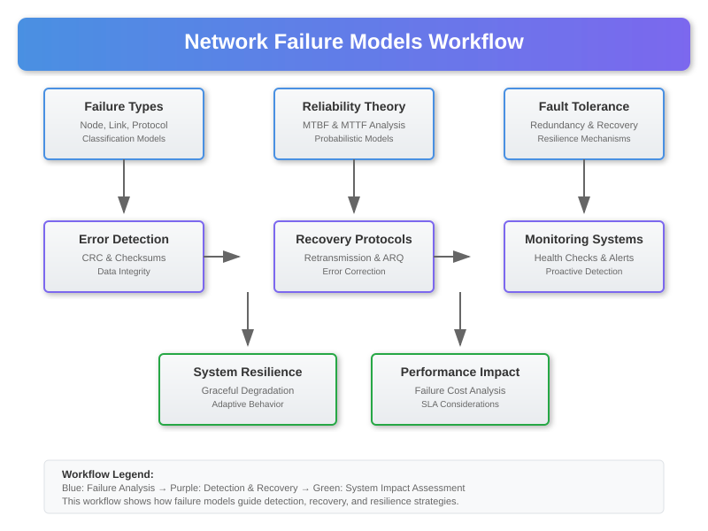

# Network Failure Models and Analysis



## Overview

Network systems are inherently prone to failures due to hardware malfunctions, software bugs, environmental factors, and human errors. This section provides mathematical models and analysis techniques for understanding, predicting, and mitigating network failures to ensure robust and reliable network operations.

## 1. Fundamental Failure Models

### 1.1 Node Failure Models

**Independent Node Failure Model**:
```
P(node i fails) = p_i
P(all nodes operational) = ∏(1 - p_i)
```

**Correlated Node Failure Model**:
```
P(nodes i,j fail together) = p_ij > p_i × p_j
```

**Time-Dependent Failure Model**:
```
λ(t) = failure rate at time t
R(t) = e^(-∫₀ᵗ λ(τ)dτ)  (reliability function)
F(t) = 1 - R(t)           (failure probability)
```

### 1.2 Link Failure Models

**Exponential Failure Model**:
```
f(t) = λe^(-λt)    (probability density)
MTBF = 1/λ         (mean time between failures)
```

**Weibull Failure Model**:
```
f(t) = (β/η)(t/η)^(β-1)e^(-(t/η)^β)
```
Where:
- β: shape parameter (β < 1: decreasing failure rate, β > 1: increasing failure rate)
- η: scale parameter (characteristic life)

**Bathtub Curve Model**:
```
λ(t) = {
    α₁t^(-α₂)     (early life failures)
    λ₀            (useful life)
    α₃t^α₄        (wear-out failures)
}
```

## 2. Network Reliability Analysis

### 2.1 Connectivity-Based Reliability

**k-Terminal Reliability**:
Probability that a specific set of k nodes remain connected.

**All-Terminal Reliability**:
```
R_all = P(all nodes connected)
```

**Two-Terminal Reliability**:
```
R_st = P(node s connected to node t)
```

**Mathematical Computation using Inclusion-Exclusion**:
```python
def two_terminal_reliability(graph, source, target, link_reliabilities):
    """
    Calculate two-terminal reliability using path enumeration
    """
    import networkx as nx
    from itertools import combinations
    
    # Find all simple paths
    all_paths = list(nx.all_simple_paths(graph, source, target))
    
    # Calculate path reliabilities
    path_reliabilities = []
    for path in all_paths:
        path_rel = 1.0
        for i in range(len(path) - 1):
            edge = (path[i], path[i+1])
            path_rel *= link_reliabilities[edge]
        path_reliabilities.append(path_rel)
    
    # Apply inclusion-exclusion principle
    reliability = 0
    n_paths = len(all_paths)
    
    for r in range(1, n_paths + 1):
        for path_combination in combinations(range(n_paths), r):
            # Find union of edges in this combination
            union_edges = set()
            for path_idx in path_combination:
                path = all_paths[path_idx]
                for i in range(len(path) - 1):
                    union_edges.add((path[i], path[i+1]))
            
            # Calculate reliability of edge union
            union_reliability = 1.0
            for edge in union_edges:
                union_reliability *= link_reliabilities[edge]
            
            # Apply inclusion-exclusion
            if r % 2 == 1:
                reliability += union_reliability
            else:
                reliability -= union_reliability
    
    return reliability
```

### 2.2 Network Reliability Bounds

**Moore-Shannon Lower Bound**:
```
R ≥ max{P(path i works) : i ∈ all_paths}
```

**Esary-Proschan Upper Bound**:
```
R ≤ min{1 - P(cut j fails) : j ∈ minimal_cuts}
```

**Improved Bounds using Path-Cut Duality**:
```python
def reliability_bounds(graph, source, target, link_reliabilities):
    """
    Calculate upper and lower bounds for network reliability
    """
    import networkx as nx
    
    # Lower bound: best single path
    all_paths = list(nx.all_simple_paths(graph, source, target))
    lower_bound = 0
    
    for path in all_paths:
        path_reliability = 1.0
        for i in range(len(path) - 1):
            edge = (path[i], path[i+1])
            path_reliability *= link_reliabilities[edge]
        lower_bound = max(lower_bound, path_reliability)
    
    # Upper bound: complement of worst cut
    min_cuts = list(nx.minimum_edge_cut(graph, source, target))
    upper_bound = 1.0
    
    for cut in [min_cuts]:  # Simplified - should consider all minimal cuts
        cut_failure_prob = 0
        for edge in cut:
            cut_failure_prob += (1 - link_reliabilities[edge])
        cut_failure_prob = min(cut_failure_prob, 1.0)
        upper_bound = min(upper_bound, 1 - cut_failure_prob)
    
    return lower_bound, upper_bound
```

## 3. Fault Tolerance Models

### 3.1 Redundancy Models

**k-out-of-n System**:
System works if at least k out of n components work.

```
R_k_out_of_n = Σ(i=k to n) C(n,i) × p^i × (1-p)^(n-i)
```

**Parallel Redundancy**:
```
R_parallel = 1 - ∏(1 - R_i)
```

**Series Redundancy** (all components must work):
```
R_series = ∏R_i
```

**Hot Standby Model**:
```python
class HotStandbyModel:
    def __init__(self, primary_reliability, backup_reliability, switch_reliability=1.0):
        self.p_primary = primary_reliability
        self.p_backup = backup_reliability
        self.p_switch = switch_reliability
    
    def system_reliability(self):
        """
        Calculate reliability of hot standby system
        R = P(primary works) + P(primary fails) × P(switch works) × P(backup works)
        """
        return (self.p_primary + 
                (1 - self.p_primary) * self.p_switch * self.p_backup)
    
    def mean_time_to_failure(self, lambda_primary, lambda_backup):
        """
        Calculate MTTF for hot standby system
        """
        return (1/lambda_primary) + (1/(lambda_primary + lambda_backup))
```

**Cold Standby Model**:
```python
class ColdStandbyModel:
    def __init__(self, primary_mtbf, backup_mtbf, switch_time=0):
        self.lambda_p = 1/primary_mtbf
        self.lambda_b = 1/backup_mtbf
        self.switch_time = switch_time
    
    def reliability(self, t):
        """
        Reliability function for cold standby
        """
        import math
        
        if t <= 0:
            return 1.0
        
        # Primary phase + backup phase
        term1 = math.exp(-self.lambda_p * t)
        term2 = (self.lambda_p / (self.lambda_b - self.lambda_p)) * \
                (math.exp(-self.lambda_p * t) - math.exp(-self.lambda_b * t))
        
        return term1 + term2
```

### 3.2 Network Fault Tolerance Metrics

**Node Connectivity**:
```python
def node_connectivity(graph):
    """
    Calculate minimum number of nodes that must be removed 
    to disconnect the graph
    """
    import networkx as nx
    return nx.node_connectivity(graph)
```

**Edge Connectivity**:
```python
def edge_connectivity(graph):
    """
    Calculate minimum number of edges that must be removed 
    to disconnect the graph
    """
    import networkx as nx
    return nx.edge_connectivity(graph)
```

**Fault Diameter**:
```python
def fault_diameter(graph, max_faults):
    """
    Calculate maximum shortest path length after removing 
    up to max_faults nodes
    """
    import networkx as nx
    from itertools import combinations
    
    nodes = list(graph.nodes())
    max_diameter = 0
    
    # Try all possible fault combinations
    for num_faults in range(max_faults + 1):
        for failed_nodes in combinations(nodes, num_faults):
            remaining_graph = graph.copy()
            remaining_graph.remove_nodes_from(failed_nodes)
            
            if nx.is_connected(remaining_graph):
                diameter = nx.diameter(remaining_graph)
                max_diameter = max(max_diameter, diameter)
    
    return max_diameter
```

## 4. Failure Propagation Models

### 4.1 Cascade Failure Model

**Linear Threshold Model**:
```python
class CascadeFailureModel:
    def __init__(self, graph, node_capacities, edge_capacities):
        self.graph = graph
        self.node_capacities = node_capacities
        self.edge_capacities = edge_capacities
        self.failed_nodes = set()
        self.failed_edges = set()
    
    def simulate_cascade(self, initial_failures, load_redistribution='proportional'):
        """
        Simulate cascade failure propagation
        """
        import networkx as nx
        
        # Initialize failures
        self.failed_nodes.update(initial_failures)
        
        # Remove failed nodes and edges
        active_graph = self.graph.copy()
        active_graph.remove_nodes_from(self.failed_nodes)
        
        changed = True
        iteration = 0
        
        while changed and iteration < 100:  # Prevent infinite loops
            changed = False
            iteration += 1
            
            # Check for overloaded nodes
            for node in list(active_graph.nodes()):
                if node not in self.failed_nodes:
                    # Calculate current load
                    current_load = self._calculate_node_load(active_graph, node)
                    
                    if current_load > self.node_capacities[node]:
                        # Node fails due to overload
                        self.failed_nodes.add(node)
                        active_graph.remove_node(node)
                        changed = True
            
            # Check for overloaded edges
            for edge in list(active_graph.edges()):
                if edge not in self.failed_edges:
                    current_flow = self._calculate_edge_flow(active_graph, edge)
                    
                    if current_flow > self.edge_capacities[edge]:
                        # Edge fails due to overload
                        self.failed_edges.add(edge)
                        active_graph.remove_edge(*edge)
                        changed = True
        
        return {
            'failed_nodes': self.failed_nodes,
            'failed_edges': self.failed_edges,
            'iterations': iteration,
            'final_graph': active_graph
        }
    
    def _calculate_node_load(self, graph, node):
        """Calculate load on a specific node"""
        # Simplified: degree-based load calculation
        return graph.degree(node)
    
    def _calculate_edge_flow(self, graph, edge):
        """Calculate flow through a specific edge"""
        # Simplified: constant flow model
        return 1.0 if graph.has_edge(*edge) else 0.0
```

### 4.2 Epidemic Failure Model

**SIR Model for Network Failures**:
```python
class EpidemicFailureModel:
    def __init__(self, graph, infection_rate, recovery_rate):
        self.graph = graph
        self.beta = infection_rate      # Rate of failure spread
        self.gamma = recovery_rate      # Rate of recovery/repair
        self.susceptible = set(graph.nodes())
        self.infected = set()
        self.recovered = set()
    
    def simulate_epidemic(self, initial_infected, time_steps=100, dt=0.1):
        """
        Simulate epidemic-style failure propagation using SIR model
        """
        import random
        import math
        
        self.infected.update(initial_infected)
        self.susceptible -= self.infected
        
        history = {
            'time': [],
            'susceptible': [],
            'infected': [],
            'recovered': []
        }
        
        for t in range(int(time_steps / dt)):
            current_time = t * dt
            
            # Record current state
            history['time'].append(current_time)
            history['susceptible'].append(len(self.susceptible))
            history['infected'].append(len(self.infected))
            history['recovered'].append(len(self.recovered))
            
            # Calculate transitions
            new_infected = set()
            new_recovered = set()
            
            # Infection spread
            for infected_node in self.infected:
                for neighbor in self.graph.neighbors(infected_node):
                    if neighbor in self.susceptible:
                        # Probability of infection
                        prob_infection = 1 - math.exp(-self.beta * dt)
                        if random.random() < prob_infection:
                            new_infected.add(neighbor)
            
            # Recovery process
            for infected_node in self.infected:
                prob_recovery = 1 - math.exp(-self.gamma * dt)
                if random.random() < prob_recovery:
                    new_recovered.add(infected_node)
            
            # Update states
            self.infected.update(new_infected)
            self.susceptible -= new_infected
            self.infected -= new_recovered
            self.recovered.update(new_recovered)
            
            # Stop if no more infected nodes
            if not self.infected:
                break
        
        return history
```

## 5. Failure Detection and Monitoring

### 5.1 Statistical Failure Detection

**CUSUM (Cumulative Sum) Algorithm**:
```python
class CUSUMDetector:
    def __init__(self, threshold=5.0, drift=0.5):
        self.threshold = threshold
        self.drift = drift
        self.cumsum_pos = 0.0
        self.cumsum_neg = 0.0
        self.baseline_mean = 0.0
        self.baseline_std = 1.0
    
    def update_baseline(self, historical_data):
        """Update baseline statistics from historical data"""
        import numpy as np
        self.baseline_mean = np.mean(historical_data)
        self.baseline_std = np.std(historical_data)
    
    def detect_anomaly(self, observation):
        """
        Detect anomalies using CUSUM algorithm
        Returns: (anomaly_detected, alarm_type)
        """
        # Normalize observation
        normalized_obs = (observation - self.baseline_mean) / self.baseline_std
        
        # Update CUSUM statistics
        self.cumsum_pos = max(0, self.cumsum_pos + normalized_obs - self.drift)
        self.cumsum_neg = min(0, self.cumsum_neg + normalized_obs + self.drift)
        
        # Check for alarms
        if self.cumsum_pos > self.threshold:
            return True, "upward_shift"
        elif self.cumsum_neg < -self.threshold:
            return True, "downward_shift"
        else:
            return False, "normal"
```

**Exponential Weighted Moving Average (EWMA)**:
```python
class EWMADetector:
    def __init__(self, lambda_param=0.2, control_limit=3.0):
        self.lambda_param = lambda_param
        self.control_limit = control_limit
        self.ewma = 0.0
        self.variance = 1.0
        self.initialized = False
    
    def update(self, observation):
        """Update EWMA with new observation"""
        if not self.initialized:
            self.ewma = observation
            self.initialized = True
        else:
            self.ewma = self.lambda_param * observation + (1 - self.lambda_param) * self.ewma
    
    def detect_anomaly(self, observation):
        """Detect anomalies using EWMA control chart"""
        self.update(observation)
        
        # Calculate control limits
        ewma_variance = (self.lambda_param / (2 - self.lambda_param)) * self.variance
        ucl = self.control_limit * (ewma_variance ** 0.5)
        lcl = -ucl
        
        # Check if EWMA exceeds control limits
        return abs(self.ewma) > ucl
```

### 5.2 Network Health Monitoring

**Network Health Score**:
```python
class NetworkHealthMonitor:
    def __init__(self, graph):
        self.graph = graph
        self.baseline_metrics = self._calculate_baseline_metrics()
    
    def _calculate_baseline_metrics(self):
        """Calculate baseline network metrics"""
        import networkx as nx
        
        return {
            'connectivity': nx.node_connectivity(self.graph),
            'efficiency': nx.global_efficiency(self.graph),
            'clustering': nx.average_clustering(self.graph),
            'diameter': nx.diameter(self.graph) if nx.is_connected(self.graph) else float('inf'),
            'avg_path_length': nx.average_shortest_path_length(self.graph) if nx.is_connected(self.graph) else float('inf')
        }
    
    def calculate_health_score(self, current_graph):
        """
        Calculate network health score (0-100)
        Based on deviation from baseline metrics
        """
        import networkx as nx
        import math
        
        if not nx.is_connected(current_graph):
            return 0.0  # Network is disconnected
        
        current_metrics = {
            'connectivity': nx.node_connectivity(current_graph),
            'efficiency': nx.global_efficiency(current_graph),
            'clustering': nx.average_clustering(current_graph),
            'diameter': nx.diameter(current_graph),
            'avg_path_length': nx.average_shortest_path_length(current_graph)
        }
        
        # Calculate normalized scores for each metric
        scores = []
        weights = {'connectivity': 0.3, 'efficiency': 0.3, 'clustering': 0.1, 
                  'diameter': 0.15, 'avg_path_length': 0.15}
        
        for metric, weight in weights.items():
            baseline = self.baseline_metrics[metric]
            current = current_metrics[metric]
            
            if baseline == 0:
                score = 100.0 if current == 0 else 0.0
            else:
                # Higher is better for connectivity, efficiency, clustering
                # Lower is better for diameter, avg_path_length
                if metric in ['connectivity', 'efficiency', 'clustering']:
                    ratio = current / baseline
                    score = min(100.0, 100.0 * ratio)
                else:
                    ratio = baseline / current if current > 0 else 0
                    score = min(100.0, 100.0 * ratio)
            
            scores.append(score * weight)
        
        return sum(scores)
```

## 6. Recovery and Repair Models

### 6.1 Repair Rate Models

**Exponential Repair**:
```
MTTR = 1/μ    (mean time to repair)
R(t) = 1 - e^(-μt)    (repair probability by time t)
```

**Scheduled Maintenance Model**:
```python
class ScheduledMaintenanceModel:
    def __init__(self, maintenance_interval, repair_rate):
        self.T_m = maintenance_interval  # Time between maintenance
        self.mu = repair_rate           # Repair rate
    
    def availability(self, failure_rate):
        """
        Calculate steady-state availability with scheduled maintenance
        """
        lambda_f = failure_rate
        
        # Availability with perfect maintenance
        A = (self.mu / (lambda_f + self.mu)) * \
            (1 - ((lambda_f * self.T_m) / (1 + lambda_f * self.T_m)))
        
        return A
```

**Repair Priority Model**:
```python
class RepairPriorityModel:
    def __init__(self):
        self.repair_queue = []  # (priority, component_id, failure_time)
        self.repair_resources = 1
        self.currently_repairing = []
    
    def add_failure(self, component_id, failure_time, priority=1):
        """Add failed component to repair queue"""
        import heapq
        heapq.heappush(self.repair_queue, (-priority, component_id, failure_time))
    
    def process_repairs(self, current_time, repair_times):
        """Process repairs based on available resources and priorities"""
        completed_repairs = []
        
        # Check completed repairs
        for i, (comp_id, start_time, duration) in enumerate(self.currently_repairing):
            if current_time >= start_time + duration:
                completed_repairs.append(comp_id)
        
        # Remove completed repairs
        self.currently_repairing = [(comp_id, start, dur) for comp_id, start, dur 
                                   in self.currently_repairing 
                                   if comp_id not in completed_repairs]
        
        # Start new repairs if resources available
        while (len(self.currently_repairing) < self.repair_resources and 
               self.repair_queue):
            _, component_id, failure_time = heapq.heappop(self.repair_queue)
            repair_duration = repair_times.get(component_id, 1.0)
            self.currently_repairing.append((component_id, current_time, repair_duration))
        
        return completed_repairs
```

## 7. Failure Impact Analysis

### 7.1 Business Impact Assessment

**Service Disruption Model**:
```python
class ServiceDisruptionModel:
    def __init__(self, service_dependencies):
        self.dependencies = service_dependencies  # Graph of service dependencies
    
    def calculate_impact(self, failed_components):
        """
        Calculate cascading impact of component failures on services
        """
        import networkx as nx
        
        affected_services = set()
        impact_scores = {}
        
        # Find services directly affected by failed components
        for component in failed_components:
            if component in self.dependencies:
                # Find all services that depend on this component
                dependent_services = nx.descendants(self.dependencies, component)
                affected_services.update(dependent_services)
        
        # Calculate impact scores
        for service in affected_services:
            # Impact score based on service criticality and user base
            criticality = self.dependencies.nodes[service].get('criticality', 1.0)
            users_affected = self.dependencies.nodes[service].get('users', 0)
            
            impact_scores[service] = criticality * users_affected
        
        return {
            'affected_services': affected_services,
            'impact_scores': impact_scores,
            'total_impact': sum(impact_scores.values())
        }
```

**Economic Impact Model**:
```python
class EconomicImpactModel:
    def __init__(self, hourly_costs, sla_penalties):
        self.hourly_costs = hourly_costs      # Cost per hour of downtime
        self.sla_penalties = sla_penalties    # SLA violation penalties
    
    def calculate_cost(self, service, downtime_hours, availability_achieved):
        """
        Calculate total economic impact of service failure
        """
        # Direct operational costs
        operational_cost = self.hourly_costs.get(service, 0) * downtime_hours
        
        # SLA penalty costs
        sla_target = self.sla_penalties.get(service, {}).get('target_availability', 0.99)
        penalty_rate = self.sla_penalties.get(service, {}).get('penalty_rate', 0)
        
        if availability_achieved < sla_target:
            sla_penalty = penalty_rate * (sla_target - availability_achieved)
        else:
            sla_penalty = 0
        
        return {
            'operational_cost': operational_cost,
            'sla_penalty': sla_penalty,
            'total_cost': operational_cost + sla_penalty
        }
```

## 8. Validation and Testing

### 8.1 Reliability Model Validation

**Monte Carlo Simulation for Model Validation**:
```python
import random
import numpy as np

def validate_reliability_model(model, num_simulations=10000, time_horizon=100):
    """
    Validate reliability model using Monte Carlo simulation
    """
    successful_runs = 0
    
    for _ in range(num_simulations):
        # Simulate system operation
        system_failed = False
        
        for t in range(time_horizon):
            # Check if failure occurs at time t
            failure_prob = model.failure_probability(t)
            if random.random() < failure_prob:
                system_failed = True
                break
        
        if not system_failed:
            successful_runs += 1
    
    simulated_reliability = successful_runs / num_simulations
    theoretical_reliability = model.reliability(time_horizon)
    
    return {
        'simulated_reliability': simulated_reliability,
        'theoretical_reliability': theoretical_reliability,
        'error': abs(simulated_reliability - theoretical_reliability),
        'confidence_interval': 1.96 * np.sqrt(simulated_reliability * (1 - simulated_reliability) / num_simulations)
    }
```

### 8.2 Failure Model Testing Framework

**Unit Tests for Failure Models**:
```python
import unittest

class TestFailureModels(unittest.TestCase):
    def test_exponential_failure_model(self):
        """Test exponential failure model properties"""
        lambda_rate = 0.01
        model = ExponentialFailureModel(lambda_rate)
        
        # Test that reliability decreases monotonically
        r1 = model.reliability(10)
        r2 = model.reliability(20)
        self.assertGreater(r1, r2)
        
        # Test MTBF calculation
        expected_mtbf = 1 / lambda_rate
        self.assertAlmostEqual(model.mtbf(), expected_mtbf, places=5)
    
    def test_network_reliability_bounds(self):
        """Test that reliability bounds are valid"""
        # Create test network
        graph = create_test_network()
        reliabilities = {edge: 0.9 for edge in graph.edges()}
        
        lower, upper = reliability_bounds(graph, 'A', 'Z', reliabilities)
        
        # Bounds should be valid
        self.assertGreaterEqual(lower, 0)
        self.assertLessEqual(upper, 1)
        self.assertLessEqual(lower, upper)
    
    def test_cascade_failure_convergence(self):
        """Test that cascade failure simulation converges"""
        graph = create_test_network()
        model = CascadeFailureModel(graph, {}, {})
        
        result = model.simulate_cascade(['A'])
        
        # Should converge within reasonable iterations
        self.assertLess(result['iterations'], 50)

def create_test_network():
    """Create a simple test network for validation"""
    import networkx as nx
    
    G = nx.Graph()
    G.add_edges_from([('A', 'B'), ('B', 'C'), ('C', 'D'), ('A', 'D')])
    return G

if __name__ == '__main__':
    unittest.main()
```

## Conclusion

This comprehensive failure modeling framework provides the mathematical foundation and practical tools needed to:

1. **Understand** failure mechanisms and propagation patterns
2. **Predict** system reliability and availability metrics
3. **Design** fault-tolerant network architectures
4. **Monitor** system health and detect anomalies
5. **Optimize** repair and recovery strategies
6. **Validate** models through simulation and testing

These models form the basis for the experimental validation and optimization techniques presented in the subsequent sections.