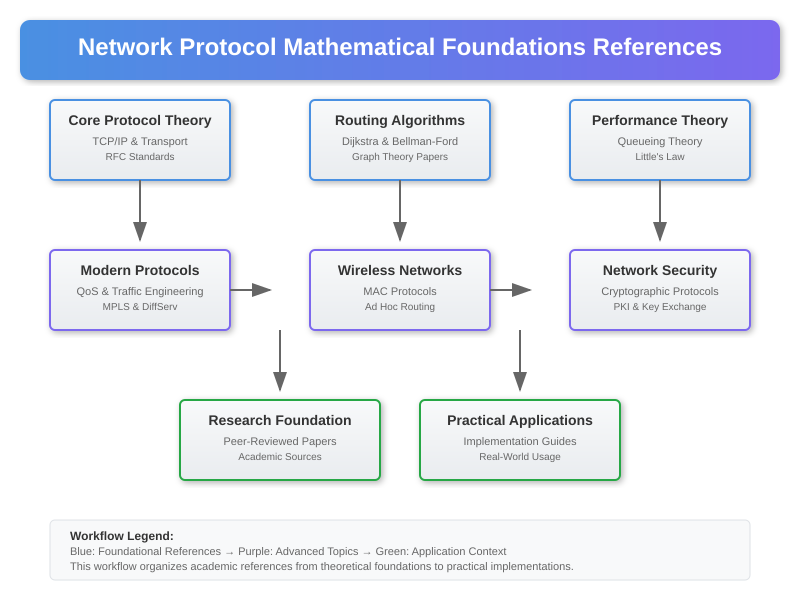

# References: Network Protocol Mathematical Foundations and Research Papers

## Overview

This section provides comprehensive references to the mathematical foundations, research papers, and theoretical concepts that underpin modern networking systems. These references serve as deep-dive resources for understanding the academic and theoretical basis of network protocols, routing algorithms, congestion control, and performance analysis demonstrated in our experiments.

## Core Network Protocol Theory References

### TCP/IP and Transport Protocols
- **Postel, J. (1981)**  
  *"Internet Protocol - DARPA Internet Program Protocol Specification"*  
  RFC 791, Internet Engineering Task Force  
  📖 Original specification for Internet Protocol establishing packet-switched networking foundations

- **Postel, J. (1981)**  
  *"Transmission Control Protocol - DARPA Internet Program Protocol Specification"*  
  RFC 793, Internet Engineering Task Force  
  📖 Foundational TCP specification defining reliable, ordered, and error-checked delivery

- **Jacobson, V. (1988)**  
  *"Congestion avoidance and control"*  
  ACM SIGCOMM Computer Communication Review, 18(4), 314-329  
  📖 Seminal work establishing modern TCP congestion control algorithms

- **Brakmo, L. S., & Peterson, L. L. (1995)**  
  *"TCP Vegas: End to end congestion avoidance on a global Internet"*  
  IEEE Journal on Selected Areas in Communications, 13(8), 1465-1480  
  📖 Alternative congestion control approach using delay-based measurements

### Routing Algorithms and Graph Theory
- **Dijkstra, E. W. (1959)**  
  *"A note on two problems in connexion with graphs"*  
  Numerische Mathematik, 1(1), 269-271  
  📖 Original shortest path algorithm with O((V + E) log V) complexity

- **Bellman, R. (1958)**  
  *"On a routing problem"*  
  Quarterly of Applied Mathematics, 16(1), 87-90  
  📖 Dynamic programming approach to shortest path problems

- **Ford, L. R., & Fulkerson, D. R. (1962)**  
  *"Flows in Networks"*  
  Princeton University Press  
  📖 Mathematical foundations of network flow problems and optimization

- **McQuillan, J. M., Richer, I., & Rosen, E. C. (1980)**  
  *"The new routing algorithm for the ARPANET"*  
  IEEE Transactions on Communications, 28(5), 711-719  
  📖 Practical implementation of distributed shortest-path routing

### Network Performance and Queueing Theory
- **Little, J. D. C. (1961)**  
  *"A proof for the queuing formula: L = λW"*  
  Operations Research, 9(3), 383-387  
  📖 Fundamental relationship between queue length, arrival rate, and waiting time

- **Kleinrock, L. (1976)**  
  *"Queueing Systems, Volume 2: Computer Applications"*  
  John Wiley & Sons  
  📖 Comprehensive analysis of queueing theory applications in computer networks

- **Jackson, J. R. (1957)**  
  *"Networks of waiting lines"*  
  Operations Research, 5(4), 518-521  
  📖 Mathematical foundation for analyzing networks of interconnected queues

## Modern Network Protocols and Standards

### Quality of Service and Traffic Engineering
- **Zhang, L., Deering, S., Estrin, D., Shenker, S., & Zappala, D. (1993)**  
  *"RSVP: A new resource reservation protocol"*  
  IEEE Network, 7(5), 8-18  
  📖 Resource reservation protocol for guaranteed service quality

- **Blake, S., Black, D., Carlson, M., Davies, E., Wang, Z., & Weiss, W. (1998)**  
  *"An architecture for differentiated services"*  
  RFC 2475, Internet Engineering Task Force  
  📖 Scalable service differentiation framework for IP networks

- **Awduche, D., Malcolm, J., Agogbua, J., O'Dell, M., & McManus, J. (1999)**  
  *"Requirements for traffic engineering over MPLS"*  
  RFC 2702, Internet Engineering Task Force  
  📖 Mathematical optimization approaches for network traffic engineering

### Wireless and Mobile Networks
- **Karn, P. (1990)**  
  *"MACA-a new channel access method for packet radio"*  
  9th ARRL Computer Networking Conference  
  📖 Multiple access collision avoidance for wireless medium sharing

- **Bharghavan, V., Demers, A., Shenker, S., & Zhang, L. (1994)**  
  *"MACAW: a media access protocol for wireless LAN's"*  
  ACM SIGCOMM Computer Communication Review, 24(4), 212-225  
  📖 Enhanced wireless medium access control with collision detection

- **Johnson, D. B., & Maltz, D. A. (1996)**  
  *"Dynamic source routing in ad hoc wireless networks"*  
  Mobile Computing, 353, 153-181  
  📖 On-demand routing protocol for mobile ad hoc networks

### Network Security and Cryptographic Protocols
- **Diffie, W., & Hellman, M. (1976)**  
  *"New directions in cryptography"*  
  IEEE Transactions on Information Theory, 22(6), 644-654  
  📖 Introduction of public-key cryptography and key exchange protocols

- **Rivest, R. L., Shamir, A., & Adleman, L. (1978)**  
  *"A method for obtaining digital signatures and public-key cryptosystems"*  
  Communications of the ACM, 21(2), 120-126  
  📖 RSA algorithm enabling secure communications over insecure channels

- **Krawczyk, H., Bellare, M., & Canetti, R. (1997)**  
  *"HMAC: Keyed-hashing for message authentication"*  
  RFC 2104, Internet Engineering Task Force  
  📖 Hash-based message authentication code for data integrity

## Advanced Network Topics

### Software-Defined Networking
- **McKeown, N., Anderson, T., Balakrishnan, H., Parulkar, G., Peterson, L., Rexford, J., ... & Turner, J. (2008)**  
  *"OpenFlow: enabling innovation in campus networks"*  
  ACM SIGCOMM Computer Communication Review, 38(2), 69-74  
  📖 Programmable network control plane separation from data plane

- **Kreutz, D., Ramos, F. M., Verissimo, P. E., Rothenberg, C. E., Azodolmolky, S., & Uhlig, S. (2015)**  
  *"Software-defined networking: A comprehensive survey"*  
  Proceedings of the IEEE, 103(1), 14-76  
  📖 Comprehensive analysis of SDN architecture and mathematical models

### Network Function Virtualization
- **Chiosi, M., Clarke, D., Willis, P., Reid, A., Feger, J., Bugenhagen, M., ... & Cui, C. (2012)**  
  *"Network functions virtualisation: An introduction, benefits, enablers, challenges, and call for action"*  
  SDN and OpenFlow World Congress, 22-24  
  📖 Virtualization of network services and mathematical optimization approaches

### Internet of Things and Edge Computing
- **Atzori, L., Iera, A., & Morabito, G. (2010)**  
  *"The internet of things: A survey"*  
  Computer Networks, 54(15), 2787-2805  
  📖 Comprehensive survey of IoT architectures and protocol requirements

- **Shi, W., Cao, J., Zhang, Q., Li, Y., & Xu, L. (2016)**  
  *"Edge computing: Vision and challenges"*  
  IEEE Internet of Things Journal, 3(5), 637-646  
  📖 Mathematical models for distributed computing at network edge

## Performance Analysis and Measurement

### Network Measurement and Monitoring
- **Paxson, V. (1997)**  
  *"End-to-end routing behavior in the Internet"*  
  IEEE/ACM Transactions on Networking, 5(5), 601-615  
  📖 Large-scale empirical analysis of Internet routing characteristics

- **Claffy, K., Monk, T. E., & McRobb, D. (1999)**  
  *"Internet tomography"*  
  Nature, 7(1), 11-14  
  📖 Inferring network topology and performance from end-to-end measurements

### Traffic Modeling and Analysis
- **Leland, W. E., Taqqu, M. S., Willinger, W., & Wilson, D. V. (1994)**  
  *"On the self-similar nature of Ethernet traffic"*  
  IEEE/ACM Transactions on Networking, 2(1), 1-15  
  📖 Discovery of self-similar and long-range dependent properties in network traffic

- **Paxson, V., & Floyd, S. (1995)**  
  *"Wide area traffic: the failure of Poisson modeling"*  
  IEEE/ACM Transactions on Networking, 3(3), 226-244  
  📖 Statistical analysis revealing non-Poisson characteristics of Internet traffic

## Mathematical Foundations

### Graph Theory Applications
- **West, D. B. (2001)**  
  *"Introduction to Graph Theory"*  
  Second Edition, Prentice Hall  
  📖 Comprehensive treatment of graph algorithms applicable to network topology

- **Cormen, T. H., Leiserson, C. E., Rivest, R. L., & Stein, C. (2009)**  
  *"Introduction to Algorithms"*  
  Third Edition, MIT Press, Chapters 22-26  
  📖 Algorithmic foundations for graph traversal, shortest paths, and network flows

### Probability Theory and Statistics
- **Ross, S. M. (2019)**  
  *"Introduction to Probability Models"*  
  Twelfth Edition, Academic Press  
  📖 Stochastic processes and Markov chains for network performance modeling

- **Papoulis, A., & Pillai, S. U. (2002)**  
  *"Probability, Random Variables, and Stochastic Processes"*  
  Fourth Edition, McGraw-Hill  
  📖 Mathematical foundations for network traffic analysis and modeling

### Optimization Theory
- **Boyd, S., & Vandenberghe, L. (2004)**  
  *"Convex Optimization"*  
  Cambridge University Press  
  📖 Mathematical optimization techniques for network resource allocation

- **Bertsekas, D. P. (1998)**  
  *"Network Optimization: Continuous and Discrete Models"*  
  Athena Scientific  
  📖 Comprehensive treatment of network flow optimization and algorithms

## Implementation Standards and Specifications

### IETF Standards and RFCs
- **Internet Engineering Task Force (IETF)**  
  *"Request for Comments (RFC) Series"*  
  Available at: https://tools.ietf.org/rfc/  
  📖 Authoritative specifications for Internet protocols and standards

### IEEE 802 Standards
- **Institute of Electrical and Electronics Engineers (IEEE)**  
  *"IEEE 802 LAN/MAN Standards Committee"*  
  Available at: https://www.ieee802.org/  
  📖 Local and metropolitan area network protocol specifications

### ITU-T Recommendations
- **International Telecommunication Union (ITU)**  
  *"ITU-T Recommendations"*  
  Available at: https://www.itu.int/rec/T-REC/  
  📖 International standards for telecommunications and networking

## Research Conferences and Journals

### Premier Networking Conferences
- **ACM SIGCOMM**: Annual conference on data communication
- **IEEE INFOCOM**: International conference on computer communications
- **USENIX NSDI**: Networked Systems Design and Implementation
- **ACM CoNEXT**: International Conference on Emerging Networking EXperiments and Technologies

### Leading Academic Journals
- **IEEE/ACM Transactions on Networking**: Premier networking research journal
- **Computer Networks**: Elsevier journal covering all aspects of networking
- **IEEE Network**: Magazine focusing on practical networking solutions
- **ACM Computing Surveys**: Comprehensive survey articles on networking topics

## Historical Perspectives

### Internet Development History
- **Leiner, B. M., Cerf, V. G., Clark, D. D., Kahn, R. E., Kleinrock, L., Lynch, D. C., ... & Wolff, S. (2009)**  
  *"A brief history of the Internet"*  
  ACM SIGCOMM Computer Communication Review, 39(5), 22-31  
  📖 Historical development of Internet protocols and architecture

### Network Evolution and Future Directions
- **Clark, D. D. (1988)**  
  *"The design philosophy of the DARPA Internet protocols"*  
  ACM SIGCOMM Computer Communication Review, 18(4), 106-114  
  📖 Foundational design principles that shaped modern Internet architecture

## Practical Implementation Guides

### Protocol Implementation
- **Stevens, W. R. (1994)**  
  *"TCP/IP Illustrated, Volume 1: The Protocols"*  
  Addison-Wesley Professional  
  📖 Detailed protocol analysis with packet-level implementation details

- **Fall, K. R., & Stevens, W. R. (2011)**  
  *"TCP/IP Illustrated, Volume 1: The Protocols"*  
  Second Edition, Addison-Wesley Professional  
  📖 Updated comprehensive guide to modern TCP/IP implementation

### Network Programming
- **Stevens, W. R., Fenner, B., & Rudoff, A. M. (2003)**  
  *"UNIX Network Programming, Volume 1: The Sockets Networking API"*  
  Third Edition, Addison-Wesley Professional  
  📖 Comprehensive guide to network application development

These references provide the theoretical foundation for understanding the mathematical principles, algorithms, and protocols demonstrated in the network experiments. They span from fundamental graph theory and queueing models to modern software-defined networking and Internet of Things applications.