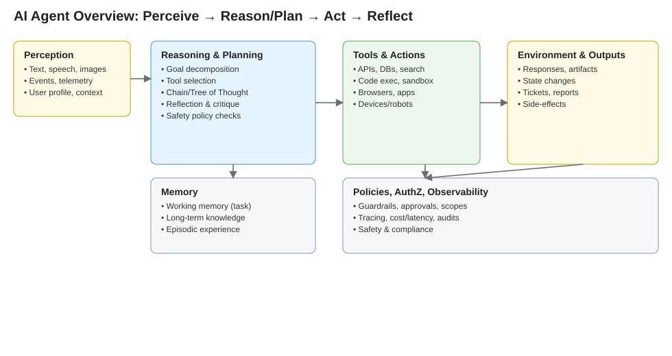
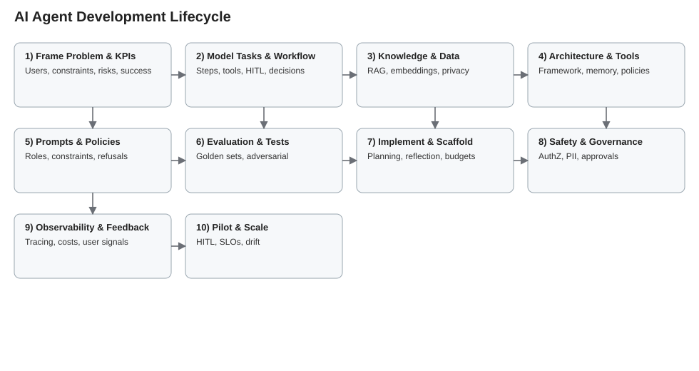
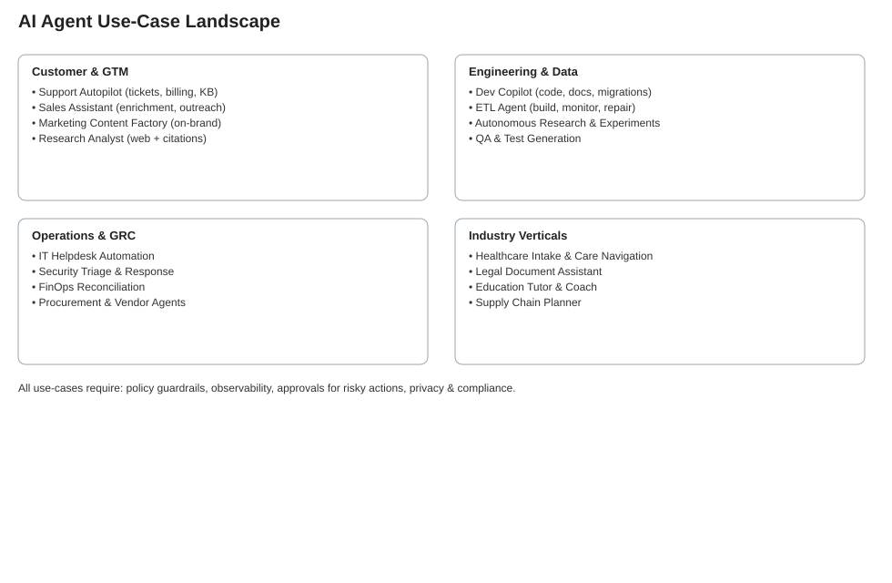

> **Earlier draft (August 2025), not yet checked.** Formulas and claims here may be wrong or unsourced. See [../README.md](../README.md); the checked tutorials are on the Tech by Math shelf of it.akadian.ca.

# AI Agents: Concepts, Capabilities, Development, and Use‑Cases

Updated: 2025-08-29

## Table of Contents
- What is an AI Agent?
  - A quick, tangible use case
  - A short history, today’s status, and what’s next
- What can AI Agents do?
- A generic development process (lifecycle)
- Popular use cases with development blueprints
- Workflow automation tools (n8n and alternatives)
- References and further reading

---

## What is an AI Agent?
An AI Agent is a software entity that can perceive, reason, and act toward achieving a goal, often autonomously. Unlike a single LLM prompt/response, an agent maintains state (memory), plans multi‑step actions, uses tools and external services (APIs, databases, browsers, apps), and evaluates its own progress.

Core building blocks:
- Perception: ingest inputs (text, speech, images, events, telemetry)
- Reasoning and Planning: decompose goals into steps, choose strategies
- Tools and Actions: call APIs, run code, query data, control apps/robots
- Memory: working memory for the current task; long‑term memory for knowledge and experience
- Feedback and Evaluation: reflect, critique, and adjust behavior
- Policies and Safety: constraints, permissions, guardrails

See the overview diagram: [ai-agent-overview.svg](./ai-agent-overview.svg)

### A quick, tangible use case
Customer Support Autopilot:
- Goal: Resolve a billing ticket end‑to‑end
- Steps: parse ticket → identify account → check payment history (API) → compute adjustment → draft response → ask for approval (if needed) → resolve and log
- Agent tools: CRM API, Billing API, Email/Chat API, Policy library
- Benefits: lower handling time, consistent policy application, 24/7 availability

### A short history, today’s status, and what’s next
- Early roots (1950s–2000s): symbolic agents, planning (GOFAI), RL agents in games/robotics
- Transformer era (2017–2022): powerful language models enable general reasoning via prompts
- Agentic patterns (2023–2025): tool‑use, planning, reflection, multi‑agent collaboration; frameworks (LangChain, Semantic Kernel, Autogen, OpenAI Assistants, CrewAI)
- Today’s status (2025): production agents handle bounded workflows (support, ETL, RAG, QA), with human‑in‑the‑loop and strong guardrails
- Near future: more reliable long‑horizon planning, trustworthy tool use, verifiable reasoning, on‑device and edge agents, safety‑aware swarms, tight enterprise governance and observability

---

## What can AI Agents do?
- Automate multi‑step workflows with external tools and approvals
- Search, read, write, execute code and scripts (secure sandboxes)
- Retrieve and reason over private data (RAG) with citations
- Browse the web and synthesize reports with sources
- Orchestrate other agents; negotiate and collaborate
- Monitor systems and remediate incidents (runbooks)
- Draft content then self‑critique and revise
- Personalize experiences (recommendations, tutoring, coaching)
- Control physical devices/robots within safety constraints

Capabilities depend on allowed tools, memory, policies, and evaluation loops.

---

## A generic development process (lifecycle)
See lifecycle diagram: [ai-agent-lifecycle.svg](./ai-agent-lifecycle.svg)

1. Problem framing and success criteria
   - Define the user, goals, constraints, KPIs, compliance and safety needs
2. Task modeling and workflow design
   - Break down tasks, identify tool calls, decision points, human‑in‑the‑loop
3. Knowledge and data design
   - RAG corpora, embeddings, indices; privacy and retention
4. Architecture and tool integration
   - Choose framework, define tools (APIs, functions), memory, policies
5. Prompting and policy engineering
   - System prompts, roles, constraints, refusal criteria, logging
6. Evaluation plan and test sets
   - Golden tasks, adversarial cases, offline eval metrics, online A/B
7. Implementation and scaffolding
   - Planning/reflection loops, retries, timeouts, cost/latency budgets
8. Safety and governance
   - AuthZ scopes, PII redaction, jailbreak resistance, action approvals
9. Observability and feedback
   - Tracing, telemetry, tool success rates, user feedback loops
10. Pilot, iterate, and scale
   - Human oversight, phased rollout, SLOs, drift monitoring, retraining

---

## Popular use cases with development blueprints
See landscape: [ai-agent-use-cases-map.svg](./ai-agent-use-cases-map.svg)

Detailed blueprints have been split into separate folders under ./07-use-cases, each with its own SVG and README.

For each use case below, we outline: Goals, Tools, Memory, Policies, Evaluation, Rollout.

1) [Customer Support Autopilot](use-cases/customer-support-autopilot/)
- Goals: deflect and resolve Tier‑1/2 tickets; reduce time‑to‑resolution
- Tools: CRM, ticketing, billing, knowledge base search, email/chat
- Memory: conversation state, customer profile, historical tickets
- Policies: escalation rules, refunds, compliance scripts
- Evaluation: resolution rate, CSAT, policy violations, time saved
- Rollout: start with suggestions; move to auto‑resolve with approvals

2) [Sales Assistant and Lead Researcher](use-cases/sales-assistant-lead-researcher/)
- Goals: enrich leads, draft outreach, tailor value props
- Tools: CRM, web browsing, enrichment APIs, email
- Memory: account notes, ICP characteristics
- Policies: do‑not‑contact, compliant messaging
- Evaluation: reply rate uplift, meetings booked, quality checks
- Rollout: pilot with SDR team; tighten prompts and guardrails

3) [Developer Copilot for Internal Codebases](use-cases/developer-copilot-internal/)
- Goals: code generation, refactors, docs, migrations
- Tools: repo indexer, code search, CI, issue tracker
- Memory: workspace state, dependency graph, style guides
- Policies: branch protections, test coverage gate
- Evaluation: PR cycle time, defect rate, review load
- Rollout: suggestions only → gated actions → auto‑PRs for low‑risk

4) [Data Engineer ETL Agent](use-cases/data-engineer-etl-agent/)
- Goals: build/maintain pipelines; monitor and fix failures
- Tools: SQL engines, warehouses, schedulers, data quality APIs
- Memory: schema registry, lineage, run history
- Policies: PII handling, cost budgets, approval for schema changes
- Evaluation: pipeline reliability, MTTR, cost per run
- Rollout: read‑only → propose fixes → gated execution

5) [Research Analyst and Report Generator](use-cases/research-analyst-reporter/)
- Goals: answer questions with citations, synthesize literature
- Tools: web search, PDF parsers, vector DB, citation manager
- Memory: research graph, notes per topic
- Policies: citation requirements, claim verification, bias checks
- Evaluation: factuality with source support, coverage, timeliness
- Rollout: internal research first → stakeholder sign‑off workflows

6) [Product Manager Requirements Agent](use-cases/product-manager-requirements/)
- Goals: turn feedback into structured specs, PRDs, and roadmaps
- Tools: issue trackers, survey tools, analytics, doc editors
- Memory: product taxonomy, historic roadmap decisions
- Policies: privacy for user feedback, template adherence
- Evaluation: stakeholder satisfaction, cycle time, rework rate
- Rollout: draft‑only → review templates → partial automation

7) [Financial Operations Reconciliation Agent](use-cases/finops-reconciliation-agent/)
- Goals: match transactions, flag anomalies, prepare journals
- Tools: ERP, bank APIs, spreadsheets, anomaly detectors
- Memory: ledger schema, rules, historical matches
- Policies: approval thresholds, audit trails, SOX controls
- Evaluation: reconciliation accuracy, time saved, exceptions rate
- Rollout: shadow mode → propose entries → gated posting

8) [Security Triage and Response Agent](use-cases/security-triage-response/)
- Goals: triage alerts, enrich with context, propose response steps
- Tools: SIEM, EDR, threat intel, ticketing, sandbox
- Memory: asset inventory, runbooks, incident history
- Policies: isolation actions require approval, evidence retention
- Evaluation: MTTD/MTTR, false positive reduction
- Rollout: triage suggestions → gated containment actions

9) [Marketing Content Factory](use-cases/marketing-content-factory/)
- Goals: generate on‑brand content variations at scale
- Tools: CMS, brand style DB, asset libraries, A/B platforms
- Memory: style guide embeddings, campaign history
- Policies: brand compliance, legal review, region rules
- Evaluation: engagement lift, approval rate, turnaround time
- Rollout: drafts with checks → partial auto‑publish for low‑risk

10) [IT Helpdesk and Automation Agent](use-cases/it-helpdesk-automation/)
- Goals: resolve common IT requests and incidents
- Tools: endpoint mgmt, identity, knowledge base, chat
- Memory: device inventory, user permissions, run histories
- Policies: privileged actions gated, change windows
- Evaluation: first‑contact resolution, time saved
- Rollout: suggestions → runbooks with approvals → auto for trivial

11) [Legal Document Assistant](use-cases/legal-document-assistant/)
- Goals: summarize, clause compare, draft with playbooks
- Tools: DMS, clause library, compare tools, e‑signature
- Memory: matter history, definitions, precedents
- Policies: confidentiality levels, jurisdiction checks
- Evaluation: review time, error rate, compliance
- Rollout: internal teams first, strict guardrails

12) [Healthcare Intake and Care Navigator](use-cases/healthcare-intake-navigator/)
- Goals: triage symptoms, coordinate appointments, follow‑ups
- Tools: EHR, scheduling, telehealth, guidelines
- Memory: patient context and consents
- Policies: HIPAA, escalation to clinicians
- Evaluation: wait times, adherence, outcomes proxy
- Rollout: pilot under clinical supervision

13) [Education Tutor and Coach](use-cases/education-tutor-coach/)
- Goals: adaptive practice, explanations, feedback
- Tools: content repos, assessment engines, calendars
- Memory: learner model and progress
- Policies: age/consent, curriculum alignment
- Evaluation: learning gains, engagement, fairness
- Rollout: teacher‑in‑the‑loop, classroom pilots

14) [Supply Chain Planner](use-cases/supply-chain-planner/)
- Goals: forecast demand, plan inventory, optimize logistics
- Tools: forecasting libs, ERP, traffic APIs
- Memory: lead times, constraints, historical sales
- Policies: service levels, cost caps, risk buffers
- Evaluation: forecast accuracy, stockouts, cost
- Rollout: decision support → semi‑auto → closed‑loop

15) [Autonomous Research and Code Execution Agent](use-cases/autonomous-research-execution/)
- Goals: propose experiments, run code, analyze results
- Tools: notebook runners, sandboxes, datasets
- Memory: experiment registry, results store
- Policies: resource limits, safe execution, approvals
- Evaluation: result validity, reproducibility, cost
- Rollout: sandbox only → gated to production datasets

---

## Workflow automation tools (n8n and alternatives)
For building and operating agent-driven workflows with external tools, see the dedicated resources:
- Overview and quick start: [tools/workflow-automation/README.md](./tools/workflow-automation/README.md)
- n8n detailed guide: [tools/workflow-automation/n8n.md](./tools/workflow-automation/n8n.md)
- Alternatives and selection guide: [tools/workflow-automation/alternatives.md](./tools/workflow-automation/alternatives.md)

---

## References and further reading
- Russell & Norvig, Artificial Intelligence: A Modern Approach
- Sutton & Barto, Reinforcement Learning
- Planning and agents: GOAP, HTN, PDDL literature
- LLM agents and tool‑use frameworks: LangChain, Semantic Kernel, Autogen, CrewAI, OpenAI Assistants
- Safety and governance: model spec safety docs, OWASP LLM, NIST AI Risk Management

---

## Diagrams
- [ai-agent-overview.svg](./ai-agent-overview.svg): high‑level components and data flow
- [ai-agent-lifecycle.svg](./ai-agent-lifecycle.svg): development lifecycle
- [ai-agent-use-cases-map.svg](./ai-agent-use-cases-map.svg): clustered use‑case landscape
- [ai-agent-architecture.svg](./ai-agent-architecture.svg): detailed agent loop and subsystems
