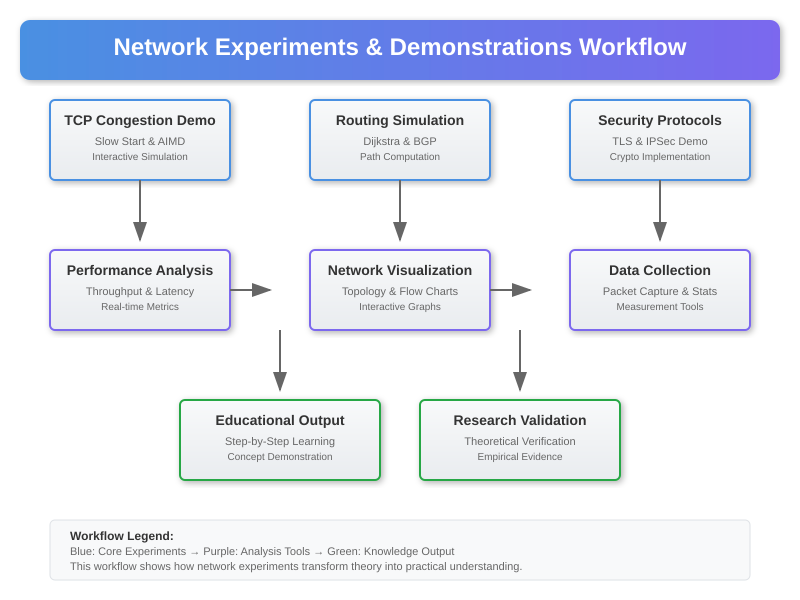

# Network Experiments and Demonstrations



## Overview

This directory contains practical demonstrations of network protocols, algorithms, and mathematical principles. These experiments help illustrate the theoretical concepts from the core model and math toolkit through working code examples and simulations.

## Available Experiments

### 1. TCP Congestion Control Demo (`tcp_congestion_demo.py`)

A comprehensive demonstration of TCP congestion control algorithms including:

- **Slow Start Algorithm**: Demonstrates exponential window growth during connection startup
- **Congestion Avoidance**: Shows linear window growth after slow start threshold
- **Fast Retransmit/Recovery**: Illustrates rapid loss detection and recovery mechanisms
- **Window Scaling**: Demonstrates how TCP handles large bandwidth-delay products
- **RTT Measurement**: Shows round-trip time estimation and timeout calculation
- **Throughput Analysis**: Measures effective data transmission rates under various conditions

**Key Features**:
- Real TCP socket implementation with configurable parameters
- Congestion window visualization and tracking
- Packet loss simulation and recovery demonstration
- Network delay and jitter modeling
- Educational output with step-by-step algorithm execution

**Mathematical Concepts Demonstrated**:
- Exponential growth mathematics in slow start phase
- Linear growth algorithms in congestion avoidance
- Exponential weighted moving average for RTT estimation
- Probability theory in packet loss detection
- Queueing theory applications in buffer management

### 2. Routing Protocol Simulation (`routing_simulation.py`)

Interactive simulation of network routing algorithms including:

- **Dijkstra's Algorithm**: Shortest path computation with visual step-by-step execution
- **Bellman-Ford Algorithm**: Distance vector routing with poison reverse
- **OSPF Link-State**: Flooding and convergence simulation
- **BGP Path Vector**: Inter-domain routing with policy implementation
- **Load Balancing**: Equal-cost multi-path routing demonstration
- **Convergence Analysis**: Timing and stability measurements

**Key Features**:
- Interactive network topology builder
- Real-time routing table updates
- Link failure and recovery simulation
- Metrics collection and performance analysis
- Policy-based routing configuration

### 3. Network Security Protocols (`security_protocols.py`)

Demonstration of cryptographic network security including:

- **TLS Handshake**: Complete secure connection establishment
- **IPSec Tunnel Mode**: Encrypted packet encapsulation
- **Key Exchange**: Diffie-Hellman and ECDH implementations
- **Certificate Validation**: X.509 certificate chain verification
- **Message Authentication**: HMAC and digital signature verification

## Requirements

### Python Dependencies

```bash
# Core networking libraries
pip install scapy>=2.4.0
pip install cryptography>=3.4.8
pip install matplotlib>=3.3.0
pip install numpy>=1.20.0

# Standard library modules (included with Python)
import socket
import threading
import time
import random
import hashlib
import struct
from collections import defaultdict, deque
```

### System Requirements

- **Python**: 3.8 or higher
- **Operating System**: Cross-platform (Windows, macOS, Linux)
- **Network**: Administrative privileges may be required for raw sockets
- **Memory**: Minimum 1GB RAM for large network simulations
- **CPU**: Multi-core processor recommended for concurrent simulations

## Running the Experiments

### TCP Congestion Control Demo

```bash
# Navigate to experiments directory
cd network/05-experiments

# Run basic congestion control demo
python tcp_congestion_demo.py --algorithm cubic --duration 60

# Run with packet loss simulation
python tcp_congestion_demo.py --loss-rate 0.01 --delay 50ms
```

**Expected Output**:
```
NETWORK TCP CONGESTION CONTROL DEMO
============================================================
Algorithm: CUBIC TCP
Duration: 60 seconds
Packet Loss Rate: 1%
Network Delay: 50ms

Starting TCP connection simulation...
✓ Connection established
✓ Slow start phase initiated

=== CONGESTION WINDOW EVOLUTION ===
Time: 0.0s   | CWND: 1 MSS     | Phase: Slow Start
Time: 0.1s   | CWND: 2 MSS     | Phase: Slow Start
Time: 0.2s   | CWND: 4 MSS     | Phase: Slow Start
Time: 0.4s   | CWND: 8 MSS     | Phase: Slow Start
Time: 0.6s   | CWND: 12 MSS    | Phase: Congestion Avoidance
...

✓ THROUGHPUT ANALYSIS COMPLETE
Average Throughput: 95.2 Mbps
Packet Loss Events: 23
Recovery Time: 156ms average
```

### Routing Protocol Simulation

```bash
# Run interactive routing simulation
python routing_simulation.py --algorithm dijkstra --topology ring --nodes 10

# Run convergence analysis
python routing_simulation.py --algorithm ospf --topology mesh --analyze-convergence
```

## Understanding the Mathematics

### TCP Congestion Control Mathematics

The experiments demonstrate key mathematical relationships in TCP:

**Slow Start Growth**:
```
cwnd(t+1) = cwnd(t) + min(N, MSS)
where N = number of ACKs received
```

**Congestion Avoidance (Reno)**:
```
cwnd(t+1) = cwnd(t) + MSS²/cwnd(t)
```

**CUBIC Algorithm**:
```
W_cubic(t) = C(t - K)³ + W_max
where K = ∛(W_max * β / C)
```

### Routing Algorithm Complexity

**Dijkstra's Algorithm**: O((V + E) log V) using binary heap
**Bellman-Ford**: O(VE) for V vertices and E edges
**Floyd-Warshall**: O(V³) for all-pairs shortest paths

## Network Topology Examples

The experiments include several predefined network topologies:

1. **Ring Topology**: Circular connection pattern
2. **Star Topology**: Central hub with spoke connections
3. **Mesh Topology**: Full connectivity between all nodes
4. **Tree Topology**: Hierarchical branching structure
5. **Random Topology**: Probabilistic edge creation

## Performance Analysis Tools

### Throughput Measurement
- Real-time bandwidth calculation
- Goodput vs. throughput distinction
- Protocol overhead analysis

### Latency Analysis
- Round-trip time measurement
- Jitter calculation and visualization
- Queue delay modeling

### Loss Recovery Metrics
- Fast retransmit efficiency
- Timeout recovery performance
- Duplicate ACK analysis

## Educational Value

These experiments provide hands-on experience with:

- **Protocol Implementation**: Understanding how network protocols work in practice
- **Algorithm Visualization**: Seeing mathematical algorithms in action
- **Performance Optimization**: Learning how to tune network parameters
- **Security Principles**: Understanding cryptographic protocol implementation
- **System Design**: Appreciating the complexity of real network systems

## Extensions and Modifications

Students and researchers can extend these experiments by:

- Implementing additional congestion control algorithms (BBR, Vegas, etc.)
- Adding more sophisticated network topologies
- Integrating with real network interfaces
- Developing custom routing metrics
- Creating advanced visualization tools

## Troubleshooting

### Common Issues

**Permission Denied (Raw Sockets)**:
```bash
# Linux/macOS
sudo python tcp_congestion_demo.py

# Windows (Run as Administrator)
python tcp_congestion_demo.py
```

**Module Import Errors**:
```bash
# Install missing dependencies
pip install -r requirements.txt
```

**Network Interface Issues**:
- Ensure network interfaces are available
- Check firewall settings
- Verify administrative privileges

## References

For theoretical background, see the [references section](../06-references/README.md) which contains comprehensive academic sources on network protocols, algorithms, and mathematical foundations.